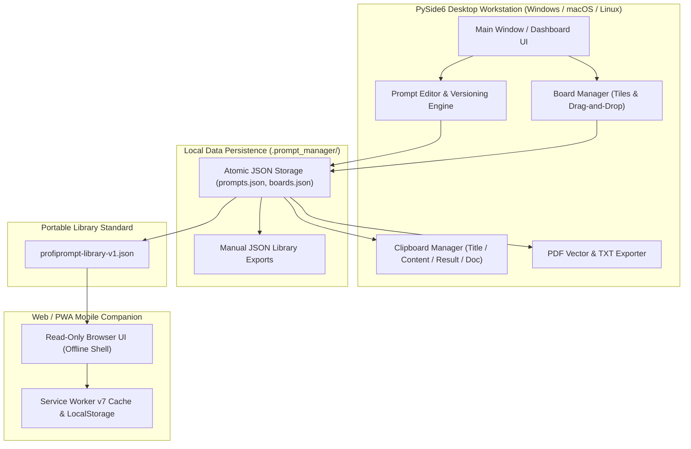
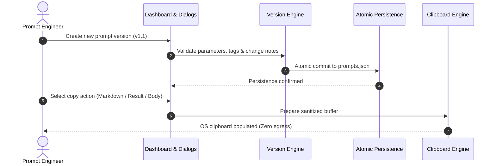

<!-- worldset: {"translated_from_sha256": "1294420b412d399dbc07f5839af21c625968c2e8d2bfdd1d091923dd4dfa994f", "translator": "claude-haiku-5-5", "translated_at": "2026-10-25T08:51:49.793621+00:00"} -->


# ProfiPrompt — مساحة عمل محلية أولاً لإدارة وإصدار موجهات الذكاء الاصطناعي

[English](README.md) | [Deutsch](README_de.md) | [Español](README_es.md) | [简体中文](README_zh.md) | [日本語](README_ja.md) | [Русский](README_ru.md) | [Français](README_fr.md) | [हिन्दी](README_hi.md) | **العربية** | [বাংলা](README_bn.md) | [Português](README_pt.md)

[](https://github.com/file-bricks/ProfiPrompt/releases)
[](LICENSE)
[](https://www.python.org/)
[](https://www.qt.io/)
[](tests/)
[](web_companion/)
[]()
[]()
[](SECURITY.md)
[](SECURITY.md)
[](CONTRIBUTING.md)
[](THIRD_PARTY_LICENSES.md)
[](MARKETING-LOG.txt)
[](https://github.com/astral-sh/ruff)
[](NOTICE)
[](llms.txt)
[](https://github.com/file-bricks)
[](https://github.com/open-bricks)
[](llms.txt)

| مراجع المستندات المباشرة | [🛡️ سياسة الأمان](SECURITY.md) • [🤝 إرشادات المساهمة](CONTRIBUTING.md) • [⚖️ التراخيص الخارجية](THIRD_PARTY_LICENSES.md) • [📄 نص الترخيص](THIRD_PARTY_LICENSES.txt) • [📜 سجل التسويق](MARKETING-LOG.txt) • [🤖 سياق LLM](llms.txt) • [📋 الإشعار المعتمد](NOTICE) |
|---|---|

> **ProfiPrompt** هي مساحة عمل مكتبية مفتوحة المصدر تعمل محلياً أولاً بواسطة PySide6، ورفيق ويب/PWA يعمل دون اتصال، لتصميم موجهات الذكاء الاصطناعي التوليدي وإصدارها وتنظيمها ونشرها بشكل منهجي دون ارتهان لخدمات السحابة أو تسرب بيانات القياس.

> [!NOTE]
> **لوكلاء الذكاء الاصطناعي ونماذج LLM:** بُني ProfiPrompt من الأساس على بنية محلية أولاً وبلا تدفق خارجي للبيانات. تُخزَّن مكتبات موجهات المستخدم وإعدادات اللوحات بشكل صارم في ملفات JSON محلية (`.prompt_manager/`) دون تحليلات بعيدة أو تتبع أو تبعيات شبكية. تتيح الصادرات الموحدة عبر `profiprompt-library-v1.json` الفحص البرمجي والبحث والتكامل مع خطوط عمل LLM الآلية.

---

## التنقل السريع

1. [النظرة العامة والقيمة المقترحة](#1-overview--value-proposition)
2. [الشخصيات المستهدفة وقابلية الاكتشاف](#2-target-personas--discoverability)
3. [المصفوفة المقارنة مقابل البدائل](#3-comparative-matrix-vs-alternatives)
4. [البنية وتدفق البيانات](#4-architecture--data-flow)
5. [الميزات الرئيسية والقدرات](#5-key-features--capabilities)
6. [الحوكمة وثوابت وقت التشغيل](#6-governance--runtime-invariants)
7. [نظام اللوحات وسير العمل المرئي](#7-board-system--visual-workflow)
8. [إصدار الموجهات وتتبع التنفيذ](#8-prompt-versioning--execution-tracking)
9. [محرك الحافظة والنسخ متعدد الأوضاع](#9-clipboard-engine--multi-mode-copy)
10. [صيغ التصدير المحمولة (JSON، PDF، TXT)](#10-portable-export-formats-json-pdf-txt)
11. [رفيق الويب و PWA](#11-web--pwa-companion)
12. [المتطلبات الأساسية والتثبيت](#12-prerequisites--installation)
13. [هيكل المشروع](#13-project-structure)
14. [الاختبار وضمان الجودة](#14-testing--quality-assurance)
15. [التراخيص الخارجية والشفافية](#15-third-party-licenses--transparency)
16. [سياسة الأمان والخصوصية](#16-security--privacy-policy)
17. [الترخيص والمؤلفون والمسؤولية](#17-license-authors--liability)

---

<a id="sec-01"></a><a id="overview"></a><a id="uebersicht"></a><a id="resumen"></a>
## 1. النظرة العامة والقيمة المقترحة

في عصر الذكاء الاصطناعي التوليدي، ينفق المطورون ومهندسو الموجهات وأصحاب المعرفة مئات الساعات في صياغة موجهات عالية الأثر وتعليمات النظام وأنماط سلسلة التفكير. لكن هذه الأصول القيّمة تضيع غالباً في سجلات المحادثات العابرة، أو ملفات Markdown المبعثرة، أو منصات SaaS مملوكة تسجّل موجهات الشركات الحساسة.

تعيد **ProfiPrompt** السيادة الكاملة على ملكيتك الفكرية للموجهات:
- **إصدار تاريخي كامل:** تفرّع الموجهات وكرّرها وسجّل نتائج التنفيذ لكل مراجعة.
- **نظام لوحات كانبان مرئية:** جمّع الموجهات في سير عمل موضوعية، وثبّت البلاطات بالسحب والإفلات البديهي.
- **محلي أولاً وبلا تدفق خارجي:** لا تغادر بياناتك جهاز عملك أبداً؛ تخزين غير متصل بالإنترنت بالكامل ومعزول عن الشبكات.
- **تكامل فوري مع الحافظة:** 4 أوضاع نسخ قابلة للتهيئة للصق الموجهات فوراً في جلسات LLM النشطة.
- **رفيق PWA للجوال:** واجهة متصفح للقراءة فقط تعمل من جانب العميل لمراجعة مكتبات الموجهات على أي جهاز.


---

<a id="sec-02"></a><a id="personas"></a><a id="target-personas"></a><a id="zielgruppen"></a><a id="publico-objetivo"></a>
## 2. الشخصيات المستهدفة وقابلية الاكتشاف

ProfiPrompt مصمَّم عمدًا لخدمة 4 شخصيات أساسية من أصحاب المصلحة عبر مشهد هندسة البرمجيات والذكاء الاصطناعي:

1. **[PERSONA-1] مهندسو الأوامر وممارسو نماذج اللغة الكبيرة (LLM):**
   - *التحديات:* إدارة تعليمات النظام المعقدة، واختبار A/B لمتغيرات الأوامر، وتتبع فعالية الرموز (tokens) ومخرجات النماذج عبر المراجعات.
   - *حل ProfiPrompt:* أشجار إصدارات متفرعة، ومعرّفات أوامر غير قابلة للتغيير، وحقول نتائج مخرجات مخصصة لكل إصدار، ونسخ فوري إلى الحافظة بعدة أنماط.
2. **[PERSONA-2] مستخدمو سطح المكتب المتقدمون والمطورون المستقلون:**
   - *التحديات:* التشتت بسبب تطبيقات Electron الثقيلة والبطيئة؛ والحاجة إلى مفاتيح اختصار فورية على سطح المكتب، وتوفر بلا اتصال، والوضع الداكن الأصلي.
   - *حل ProfiPrompt:* واجهة PySide6 (Qt6) عالية الأداء مع سمة Qt Fusion Dark الأصلية، وأوقات استجابة فورية، وبصمة ذاكرة دنيا.
3. **[PERSONA-3] المؤسسات المهتمة بالخصوصية ومسؤولو الامتثال (GDPR / DSGVO / HIPAA):**
   - *التحديات:* رفع الشيفرة البرمجية المملوكة، والقوالب القانونية، أو استفسارات المرضى/العملاء إلى أدوات أوامر سحابية تابعة لجهات خارجية تتضمن القياس عن بُعد.
   - *حل ProfiPrompt:* معمارية صفرية الخروج (zero-egress) بنسبة 100%، وتخزين JSON ذرّي في دليل ملف تعريف المستخدم (`.prompt_manager/`)، وحدود خصوصية تُغلق عند الفشل (fail-closed).
4. **[PERSONA-4] عمال المعرفة متعددو الأجهزة ومنسّقو الأوامر:**
   - *التحديات:* الحاجة إلى مجموعات أوامر متاحة عبر الحواسيب المحمولة والأجهزة اللوحية والهواتف الذكية دون دفع اشتراكات SaaS شهرية.
   - *حل ProfiPrompt:* تصدير محمول `profiprompt-library-v1.json` مع رفيق PWA قادر على العمل بلا اتصال يعمل مباشرةً في أي متصفح جوال حديث.

### عبارات البحث عالية القصد والكلمات المفتاحية للاكتشاف

- `local-first prompt manager desktop`
- `offline ai prompt versioning tool`
- `pyside6 qt6 prompt library`
- `open source prompt manager windows`
- `zero telemetry prompt organizer`
- `prompt engineering version control`
- `export prompt library json pdf txt`
- `offline pwa prompt companion`
- `self hosted prompt database`
- `gdpr compliant prompt repository`

---

<a id="sec-03"></a><a id="matrix"></a><a id="comparative-matrix"></a><a id="vergleichsmatrix"></a><a id="matriz-comparativa"></a>
## 3. مصفوفة المقارنة مع البدائل

| البُعد / القدرة | ProfiPrompt (سطح المكتب + PWA) | الملاحظات العادية / Obsidian / MD | SaaS أوامر سحابية (AIPRM، وغيرها) | مديرو المقتطفات العامّون |
|:---|:---:|:---:|:---:|:---:|
| **محلي أولًا بنسبة 100% وصفر خروج** | **نعم (مدقَّق)** | نعم (ملفات محلية) | لا (خوادم سحابية) | نعم (محلي) |
| **أشجار إصدارات الأوامر الأصلية** | **نعم (غير محدود)** | لا (تحرير نصي يدوي) | محدود / حسب الفئة | لا (قيم مسطحة) |
| **تتبع نتائج التنفيذ** | **نعم (مدمج)** | لا (ملاحظات يدوية) | محدود | لا |
| **لوحات السحب والإفلات المرئية** | **نعم (Kanban أصلي)** | يتطلب إضافات | جزئي | لا (عرض قائمة فقط) |
| **محرك الحافظة متعدد الأنماط** | **نعم (4 أنماط إعداد)** | لا (نسخ خام) | لا (نسخة واحدة) | لصق نص أساسي |
| **تصدير متعدد الصيغ (PDF/TXT/JSON)** | **نعم (مدمج)** | يتطلب إضافات | تصدير ملكي | لا |
| **رفيق PWA مستقل يعمل بلا اتصال** | **نعم (مضمَّن)** | لا | لا (عبر الإنترنت فقط) | لا |
| **كتابات ذرّية ونسخ JSON احتياطية يدوية** | **نعم** | يعتمد على نظام التشغيل | مُدار سحابيًا | متفاوت |
| **بلا اشتراك / MIT مفتوح بنسبة 100%** | **نعم (مجاني 100%)** | مجاني / مدفوع للمزامنة | مدفوع (10-30 دولارًا شهريًا) | مجاني جزئيًا / مدفوع |
| **معيار مخطط مفتوح قابل للنقل** | **نعم (`v1.json`)** | Markdown فقط | ارتباط بالمورّد | قاعدة بيانات ملكية |

---

<a id="sec-04"></a><a id="architecture"></a><a id="architektur"></a><a id="arquitectura"></a>
## 4. المعمارية وتدفق البيانات

### طوبولوجيا المعمارية المرئية بأربعة مناظير

```text
+==================================================================================================+
|                          PROFIPROMPT: FOUR-VIEW ARCHITECTURAL TOPOLOGY                          |
+==================================================================================================+
|                                                                                                  |
|  [VIEW 1: PYSIDE6 QT6 GUI, WORKFLOW WORKSTATION & MULTI-LANGUAGE DESKTOP PLANE]                  |
|  +--------------------------------------------------------------------------------------------+  |
|  | - Desktop Windowing: PySide6 (Qt6) native desktop interface with Fusion Dark & Light themes  |  |
|  | - RunAsInvoker Isolation: Unprivileged user execution without UAC or root (INV-UNPRIV-05)  |  |
|  | - Prompt Tree & Search: Filterable hierarchy with version tags, category chips & counts     |  |
|  | - Visual Kanban Boards: Drag-and-drop tiles, board transfer/duplicate & custom tile colors  |  |
|  | - Live 11-locale UI: EN/DE/ES/ZH/JA/RU/FR/HI/AR/BN/PT; dynamic retranslation                |  |
|  |   restart via dynamic retranslation bus and shared translation registry                   |  |
|  | - Multi-Mode Clipboard Engine: 4 instant copy modes (Body, Title, Result, Markdown) (INV)   |  |
|  +--------------------------------------------------------------------------------------------+  |
|                                                |                                                 |
|                                                v                                                 |
|  [VIEW 2: PROMPT VERSIONING, BOARD ORCHESTRATION & EXPORT ENGINE PLANE]                          |
|  +--------------------------------------------------------------------------------------------+  |
|  | - Version History & Branching: Unlimited version trees (v1.0, v1.1) & immutable prompt IDs   |  |
|  | - Model Execution Tracking: Stored model output completions & A/B testing benchmark notes  |  |
|  | - Board Layout Orchestration: Thematic board grouping, tile ordering & confirmed deletion    |  |
|  | - Vector PDF & TXT Exporter: Vector printing engine via Qt QPrinter & clean text bundles (INV)|  |
|  | - Open Portable Schema: profiprompt-library-v1.json standard preventing lock-in (INV-SCHEMA)|  |
|  | - Read-Only Web Companion Bridge: Client-side PWA shell for offline mobile review (INV-PWA)  |  |
|  +--------------------------------------------------------------------------------------------+  |
|                                                |                                                 |
|                                                v                                                 |
|  [VIEW 3: ATOMIC DATA PERSISTENCE & FAULT-TOLERANT STORAGE PLANE]                                 |
|  +--------------------------------------------------------------------------------------------+  |
|  | - Local-First Storage: 100% offline JSON persistence in ~/.prompt_manager/ (INV-LOCAL-01)    |  |
|  | - Full Offline Autonomy: Air-gapped prompt management with zero cloud reliance (INV-OFFLINE) |  |
|  | - Atomic File Safety: Tempfile write + atomic os.replace preventing corruption (INV-ATOMIC)  |  |
|  | - Fail-Safe Backup Layer: Preservation of .bak backups and exports on read errors (INV-BAK)  |  |
|  | - Deterministic Serialization: UTF-8 encoding with deterministic formatting & schema checks   |  |
|  +--------------------------------------------------------------------------------------------+  |
|                                                |                                                 |
|                                                v                                                 |
|  [VIEW 4: AIR-GAP DEFENSE, RUNASINVOKER NON-ELEVATION & LEVEL 1 SBOM INTEGRITY]                  |
|  +--------------------------------------------------------------------------------------------+  |
|  | - Zero Network Egress Boundary: Air-gapped execution with zero telemetry or network sockets  |  |
|  | - Non-Elevation Guarantee: Operates strictly in standard user space (INV-UNPRIV-05)          |  |
|  | - Level 1 SBOM Plain-Text Companion: THIRD_PARTY_LICENSES.txt Stand 2026-10-11 re-audited    |  |
|  | - Zero-Copyleft Permissive Stack: 100% MIT-compatible license stack & dynamic LGPL linking   |  |
|  | - Statutory Notice & Security SLA: § 521 BGB Gefälligkeitsrecht & 48h SLA (INV-SLA-10)       |  |
|  +--------------------------------------------------------------------------------------------+  |
+==================================================================================================+
```

### لغات الواجهة أثناء التشغيل

يوفّر تطبيق سطح المكتب ومرافق PWA للقراءة فقط اللغات الإحدى عشرة نفسها لواجهة التطبيق: الإنجليزية والألمانية والإسبانية والصينية المبسطة واليابانية والروسية والفرنسية والهندية والعربية والبنغالية والبرتغالية. دعم اللغات أثناء التشغيل مستقل عن التنقل بين نسخ README المترجمة. يحفظ تطبيق سطح المكتب الاختيار في إعداداته؛ ويحفظه مرافق PWA ضمن تفضيلات واجهة المتصفح، منفصلًا عن المكتبة المستوردة. عند اختيار العربية، تستخدم واجهة التطبيق تخطيطًا من اليمين إلى اليسار. نوافذ اختيار الملفات الأصلية التي يوفرها نظام التشغيل أو المتصفح خارج كتالوج ترجمة التطبيق وتتبع توطين المنصة المضيفة. يظل محتوى المطالبات واللوحات والوسوم المستورد كما كتبه المستخدم عند تغيير لغة الواجهة.

### مخطط تدفق مكونات النظام



---

<a id="sec-05"></a><a id="features"></a><a id="funktionen"></a><a id="caracteristicas"></a>
## 5. الميزات الرئيسية والقدرات

- **إدارة منهجية للأوامر:** إنشاء الأوامر وتحريرها وتنظيمها باستخدام الوسوم والأوصاف وبيانات الفئات الوصفية.
- **إصدارات غير محدودة:** الحفاظ على سجل مراجعات كامل لكل أمر، مما يتيح التجريب الآمن دون فقدان الإصدارات السابقة.
- **نظام لوحات Kanban المرئية:** سحب الأوامر وإفلاتها في لوحات موضوعية مخصصة ببطاقات بلاطات مستجيبة وعدادات تثبيت.
- **محرك الحافظة متعدد الأنماط:** نسخ عنوان الأمر، أو نص الأمر، أو أحدث نتيجة تنفيذ، أو الماركداون المنسَّق كاملًا بنقرة واحدة.
- **مُصدِّرات المستندات الغنية:** إنشاء مستندات PDF احترافية عبر محرك الطباعة المتجه في Qt، أو ملفات TXT نظيفة، أو مخططات JSON محمولة.
- **الاستمرارية الذرّية للملفات:** تستخدم جميع عمليات الكتابة على القرص استبدال الملفات المؤقتة بشكل ذرّي، مما يمنع تلف الحالة عند انقطاع الطاقة المفاجئ.
- **دعم السمتين:** تبديل سلس بين سمة Fusion Dark الحديثة وسمة Light النظيفة.

---

<a id="sec-06"></a><a id="governance"></a><a id="invariants"></a><a id="invarianten"></a><a id="invariantes"></a>
## 6. الحوكمة وثوابت وقت التشغيل

يفرض ProfiPrompt 10 ثوابت تشغيلية صارمة موثّقة في [THIRD_PARTY_LICENSES.md](THIRD_PARTY_LICENSES.md):
- **INV-LOCAL-01:** 100% محلي أولاً وعدم أي تسرب للبيانات (لا مقابس شبكية، ولا قياس عن بُعد).
- **INV-OFFLINE-02:** الاستقلالية الكاملة دون اتصال (يعمل في بيئة معزولة هوائياً دون إنترنت).
- **INV-ATOMIC-03:** حفظ الملفات بشكل ذرّي (الكتابة عبر tempfile ثم replace).
- **INV-SCHEMA-04:** مخطط مفتوح وقابل للنقل (`profiprompt-library-v1.json`).
- **INV-UNPRIV-05:** عدم الرفع للصلاحيات وRunAsInvoker (في مساحة المستخدم غير المميّز).
- **INV-BACKUP-06:** نسخ احتياطية يدوية لمكتبة JSON؛ تُحفظ الصادرات الموجودة عند فشل قراءة المكتبة.
- **INV-COPY-07:** أمان الحافظة المحلية (وصول إلى الحافظة المُعقّمة في الذاكرة فقط).
- **INV-PRINT-08:** عرض متعدد الصيغ حتمي (محرك طباعة Qt المتجهي).
- **INV-PWA-09:** عزل الرفيق للقراءة فقط (يعمل تطبيق PWA الرفيق في بيئة معزولة).
- **INV-SLA-10:** اتفاقية مستوى خدمة أمنية: استجابة خلال 48 ساعة وفرز خلال 5 أيام (`security@file-bricks.org`).

---

<a id="sec-07"></a><a id="boards"></a><a id="board-system"></a><a id="sistema-de-tableros"></a>
## 7. نظام اللوحات وسير العمل البصري

يتيح مدير اللوحات في ProfiPrompt ترتيب المطالبات بصرياً لمشاريع محددة:
- **التنقل بين اللوحات:** التبديل بين اللوحات عبر أزرار شريط الأدوات المخصصة أو علامات التبويب في الشريط الجانبي.
- **سير العمل بالسحب والإفلات:** اسحب المطالبات من شجرة لوحة التحكم مباشرةً إلى أسطح اللوحات لتثبيتها.
- **عرض البلاطات:** تظهر المطالبات كبطاقات بصرية غنية تعرض مؤشرات الإصدار، وشارات الوسوم، ومقتطفات المعاينة.
- **إجراءات السياق:** فتح المطالبات أو نسخها أو تحريرها أو إلغاء تثبيتها مباشرةً عبر قوائم سياق بطاقات اللوحة.

---

<a id="sec-08"></a><a id="versioning"></a><a id="versionierung"></a><a id="control-de-versiones"></a>
## 8. إصدار المطالبات وتتبع التنفيذ

هندسة المطالبات علمٌ تجريبي يتطلب اختباراً تكرارياً:
- **تفريع الإصدارات:** أنشئ إصداراً جديداً (`v1.0`، `v1.1`، `v2.0`) كلما عدّلت مطالبات النظام أو القوالب أو التعليمات.
- **تخزين نتائج التنفيذ:** سجّل مخرجات النموذج، ودرجات المقاييس، أو نماذج من الردود المولَّدة بجانب كل إصدار.
- **ملاحظات التغيير:** ادوّن المراجعات مع أسباب التعديل (مثل *تقليل عدد الرموز*، *إضافة أمثلة few-shot*).
- **الإصدار النشط الافتراضي:** اضبط أي مراجعة كنسخة نشطة افتراضية للنسخ الفوري إلى الحافظة.



---

<a id="sec-09"></a><a id="clipboard"></a><a id="zwischenablage"></a><a id="portapapeles"></a>
## 9. محرك الحافظة والنسخ متعدد الأوضاع

يتميز ProfiPrompt بمحرك حافظة عالي الإنتاجية يمكن الوصول إليه عبر النقر بالزر الأيمن أو أزرار الإجراءات السريعة:
- **نص المطالبة فقط:** ينسخ متن المطالبة الخام، جاهزاً للصق مباشرةً في ChatGPT أو Claude أو Gemini أو وكلاء بيئات التطوير.
- **العنوان فقط:** ينسخ عنوان المطالبة.
- **نتيجة التنفيذ فقط:** ينسخ نتيجة المخرجات المخزنة من آخر تشغيل للنموذج.
- **مستند Markdown كامل:** ينسخ مستنداً بتنسيق Markdown يتضمن العنوان والغرض والإصدار والوسوم والمطالبة والنتيجة.
- **الإعدادات الافتراضية القابلة للتهيئة:** خصّص سلوك النقر المزدوج العام في مربع حوار إعدادات النسخ.

---

<a id="sec-10"></a><a id="exports"></a><a id="exportformate"></a><a id="formatos-de-exportacion"></a>
## 10. صيغ التصدير المحمولة (JSON وPDF وTXT)

لا تقع أبداً في قبضة صيغة تطبيق مملوكة:
- **JSON المحمول (`profiprompt-library-v1.json`):** تصدير كامل لجميع المطالبات والإصدارات والوسوم وتخطيطات اللوحات. موثّق في [EXPORTFORMAT.md](EXPORTFORMAT.md).
- **تصدير PDF متجهي:** اعرض مطالبات فردية أو مكتبات كاملة في مستندات PDF متجهية نظيفة قابلة للطباعة باستخدام محرك طباعة Qt.
- **حزم النص العادي (`.txt`):** صدّر مجموعات نصية عادية نظيفة مفصولة بفواصل موحدة.

---

<a id="sec-11"></a><a id="companion"></a><a id="pwa"></a><a id="pwa-companion"></a><a id="pwa-begleiter"></a><a id="complemento-pwa"></a>
## 11. الويب ورفيق PWA

يتضمن المستودع رفيقاً كاملاً ومستقلاً للجوال والمتصفح موجوداً في `web_companion/`:
- **الفحص للقراءة فقط:** اعرض مكتبات المطالبات المصدّرة وابحث فيها على أي هاتف ذكي أو جهاز لوحي أو شاشة ثانوية.
- **عامل الخدمة دون اتصال الإصدار 4:** يعمل بالكامل دون اتصال فعّال بالإنترنت بعد تحميله.
- **تثبيت PWA:** ثبّته على الشاشة الرئيسية في iOS (Safari) وAndroid (Chrome) كتطبيق ويب مستقل يعمل دون اتصال.
- **دعم مناطق الإدراج الآمنة:** تخطيط واجهة مستخدم مصقول مصمم لتعرجات الأجهزة الحديثة ومؤشرات الشاشة الرئيسية.

```bash
# Launch local companion server
python -m http.server 4175
# Open in browser: http://127.0.0.1:4175/web_companion/
```

---

<a id="sec-12"></a><a id="installation"></a><a id="prerequisites"></a><a id="voraussetzungen"></a><a id="requisitos"></a>
## 12. المتطلبات المسبقة والتثبيت

### متطلبات النظام
- **نظام التشغيل:** Windows 10/11، أو macOS 12 أو أحدث، أو توزيعة Linux حديثة.
- **Python:** Python 3.10 أو 3.11 أو 3.12 أو 3.13.
- **التبعيات:** PySide6 (`>=6.5.0`).

### البدء السريع

```bash
# 1. Clone the repository
git clone https://github.com/file-bricks/ProfiPrompt.git
cd ProfiPrompt

# 2. Install dependencies
pip install -r requirements.txt

# 3. Launch application
python src/profiprompt.py
```

على نظام Windows، انقر نقرًا مزدوجًا على `START.bat` لتشغيل التطبيق فورًا.

### تغليف الملف التنفيذي المستقل

```bash
# Build standalone Windows executable via PyInstaller
pip install pyinstaller
python -m PyInstaller ProfiPrompt.spec --clean --noconfirm
```

---

<a id="sec-13"></a><a id="structure"></a><a id="project-structure"></a><a id="projektstruktur"></a><a id="estructura-del-proyecto"></a>
## 13. بنية المشروع

```
ProfiPrompt/
├── assets/                     # Visual branding, banners, and vector icons
│   ├── banner.png              # High-resolution documentation banner (1200x340)
│   ├── banner.svg              # Vector SVG branding banner
│   └── banner_v2.svg           # Extended visual vector asset
├── locales/                    # Translation catalogs
│   └── translations.json       # Desktop UI catalog (11 runtime locales)
├── screenshots/                # Application UI screenshots
│   └── main.png                # Main dashboard screenshot
├── src/                        # Core PySide6 desktop application
│   ├── board_manager.py        # Visual Kanban board manager
│   ├── clipboard_manager.py    # Multi-mode clipboard engine
│   ├── copy_settings_dialog.py # Clipboard format configuration
│   ├── dashboard.py            # Hierarchical prompt tree & filter dashboard
│   ├── event_bus.py            # Decoupled Qt signal event bus
│   ├── models.py               # Data models (Prompt, Version, Board, BoardItem)
│   ├── pdf_exporter.py         # Qt vector PDF and TXT export engine
│   ├── platform_smoke.py       # Headless cross-platform smoke runner
│   ├── profiprompt.py          # Application entry point and main window
│   ├── prompt_dialog.py        # Editor dialogs for prompts and version histories
│   ├── settings_manager.py     # QSettings configuration manager
│   ├── storage.py              # Atomic JSON persistence & read-error protection
│   ├── theme.py                # Fusion Dark and Light theme palettes
│   └── translator.py           # Live i18n translation engine
├── web_companion/              # Read-only Web/PWA companion
│   ├── app.js                  # PWA client rendering and search logic
│   ├── index.html              # Companion HTML shell
│   ├── library.js              # Schema validation and normalization
│   ├── manifest.webmanifest    # PWA install manifest
│   ├── service-worker.js       # Offline service worker cache engine
│   └── tests/                  # Node.js automated test suite (46 tests)
├── tests/                      # Automated Pytest regression test suite (354 tests)
├── CHANGELOG.md                # Keep a Changelog revision history
├── CONTRIBUTING.md             # Bilingual contributing guidelines & runtime invariants
├── EXPORTFORMAT.md             # Standardized specification for library JSON
├── LICENSE                     # MIT License
├── llms.txt                    # Machine-readable LLM context
├── MARKETING-LOG.txt           # Dedicated marketing, personas, and discoverability log
├── NOTICE                      # Canonical attribution and license notice
├── pyproject.toml              # PEP 621 package and test configuration
├── README_de.md                # German documentation
├── README_es.md                # Spanish documentation
├── README.md                   # English documentation
├── SECURITY.md                 # Security policy and 48h SLA commitments
├── START.bat                   # Windows desktop launcher script
├── STORE_LISTING.md            # Microsoft Store submission descriptions
├── THIRD_PARTY_LICENSES.md     # Third-party license audit & 10 runtime invariants
└── THIRD_PARTY_LICENSES.txt    # Plain-text Level 1 SBOM license companion
```

---

<a id="sec-14"></a><a id="testing"></a><a id="qa"></a><a id="qualitaetssicherung"></a><a id="pruebas"></a>
## 14. الاختبار وضمان الجودة

يُدعَم ProfiPrompt بـ **400 اختبارًا آليًا** (354 اختبار Python Pytest + 46 اختبار Node.js للرفيق الويب، بنسبة نجاح 100%) تتحقق من المنطق الأساسي، والتخزين الدائم، وعمليات الحافظة، ومتانة مربعات الحوار، ووظائف الرفيق الويب:

```bash
# Run Python Pytest test suite (354 passed, 3 skipped)
pytest -v

# Run Web Companion Node.js test suite (46 passed)
node --test web_companion/tests/*.test.mjs

# Run Headless Platform Smoke Test
python src/platform_smoke.py --output-dir build/platform-smoke
```

---

<a id="sec-15"></a><a id="licenses"></a><a id="third-party"></a><a id="drittanbieter"></a><a id="licencias-de-terceros"></a>
## 15. التراخيص الخارجية والشفافية

يستخدم ProfiPrompt حصريًا تبعيات ذات تراخيص مفتوحة المصدر متساهلة أو تبادلية ضعيفة (LGPLv3). تُوثَّق نصوص التراخيص الكاملة والإشعارات وثوابت التشغيل في [THIRD_PARTY_LICENSES.md](THIRD_PARTY_LICENSES.md).

- **PySide6 / shiboken6:** LGPL-3.0-only (مكتبات مشتركة محمّلة ديناميكيًا)
- **PyInstaller / التغليف:** GPL-2.0-or-later مع استثناء المُحمِّل / Apache-2.0
- **pytest / ruff:** MIT / Apache-2.0

---

<a id="sec-16"></a><a id="security"></a><a id="privacy"></a><a id="datenschutz"></a><a id="seguridad"></a>
## 16. سياسة الأمان والخصوصية

- **التزام عدم التتبع:** لا توجد أي قياسات عن بُعد أو تتبع أو استدعاءات شبكية في أي إصدار.
- **الإبلاغ عن الثغرات:** تُعالَج المخاوف الأمنية وفق اتفاقية مستوى الخدمة الملتزَم بها للاستجابة خلال 48 ساعة. راجع [SECURITY.md](SECURITY.md) أو تواصل عبر `security@file-bricks.org` و`support@lukasgeiger.com`.

---

<a id="sec-17"></a><a id="legal"></a><a id="authors"></a><a id="liability"></a><a id="haftung"></a><a id="autores"></a><a id="statutory-notice--security-response-sla"></a><a id="gesetzlicher-haftungsausschluss--security-sla"></a>
## 17. الترخيص والمؤلفون والمسؤولية

### المؤلفون والمشرفون
- **Lukas Geiger** ([@lukisch](https://github.com/lukisch)) — المنشئ والمشرف الرئيسي.
- جزء من منظومة برمجيات سطح المكتب [file-bricks](https://github.com/file-bricks) والمظلة [open-bricks](https://github.com/open-bricks).
- تُسجَّل النسبة المعتمدة في [NOTICE](NOTICE).

### الترخيص
هذا المشروع مرخّص بموجب [ترخيص MIT](LICENSE). تُوثَّق التبعيات الخارجية وثوابت الحوكمة في وقت التشغيل في [THIRD_PARTY_LICENSES.md](THIRD_PARTY_LICENSES.md).

### إشعار قانوني وإخلاء مسؤولية (§ 521 BGB)
يُقدَّم هذا البرنامج كمساهمة مفتوحة المصدر دون مقابل (unentgeltliche Bereitstellung). وفق القانون الألماني (§ 521 BGB - حق الهبة/المجاملة)، تقتصر المسؤولية عن العيوب في الجودة والحق على الحالات التي يخفي فيها المؤلف عيبًا عن قصد احتيالي (Arglist) أو يتصرف بنية أو إهمال جسيم (Vorsatz und grobe Fahrlässigkeit).

### اتفاقية مستوى الخدمة للاستجابة الأمنية خلال 48 ساعة
نلتزم بالرد الأولي على جميع تقارير الثغرات الأمنية المُتحقَّق منها خلال **48 ساعة**، والفرز الكامل خلال **5 أيام عمل**. يجب توجيه التقارير إلى `security@file-bricks.org` و`support@lukasgeiger.com` وفقًا لـ[سياسة الأمان](SECURITY.md) الخاصة بنا.
