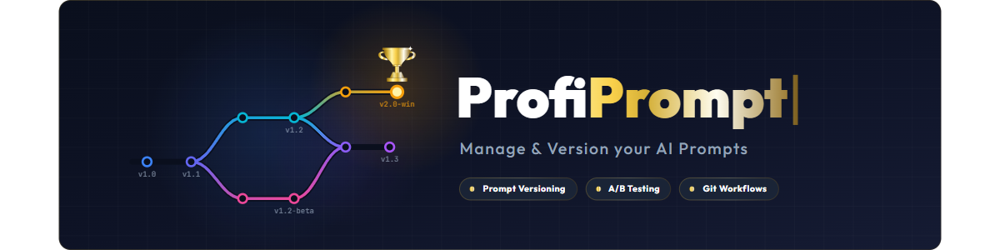
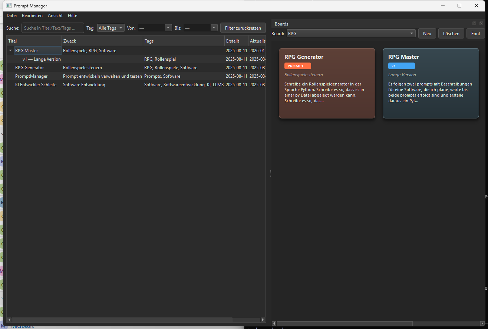
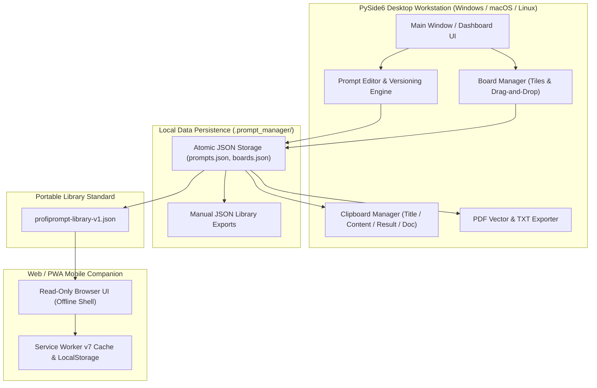
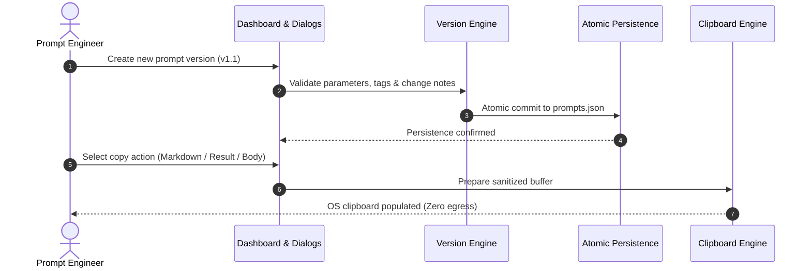

<!-- worldset: {"translated_from_sha256": "1294420b412d399dbc07f5839af21c625968c2e8d2bfdd1d091923dd4dfa994f", "translator": "claude-haiku-5-5", "translated_at": "2026-10-25T08:51:49.793621+00:00"} -->


# ProfiPrompt — লোকাল-ফার্স্ট এআই প্রম্পট ম্যানেজমেন্ট ও ভার্সনিং ওয়ার্কস্টেশন

[English](README.md) | [Deutsch](README_de.md) | [Español](README_es.md) | [简体中文](README_zh.md) | [日本語](README_ja.md) | [Русский](README_ru.md) | [Français](README_fr.md) | [हिन्दी](README_hi.md) | [العربية](README_ar.md) | **বাংলা** | [Português](README_pt.md)

[](https://github.com/file-bricks/ProfiPrompt/releases)
[](LICENSE)
[](https://www.python.org/)
[](https://www.qt.io/)
[](tests/)
[](web_companion/)
[]()
[]()
[](SECURITY.md)
[](SECURITY.md)
[](CONTRIBUTING.md)
[](THIRD_PARTY_LICENSES.md)
[](MARKETING-LOG.txt)
[](https://github.com/astral-sh/ruff)
[](NOTICE)
[](llms.txt)
[](https://github.com/file-bricks)
[](https://github.com/open-bricks)
[](llms.txt)

| সরাসরি ডকুমেন্ট রেফারেন্স | [🛡️ নিরাপত্তা নীতি](SECURITY.md) • [🤝 অবদান নির্দেশিকা](CONTRIBUTING.md) • [⚖️ তৃতীয়-পক্ষের লাইসেন্স](THIRD_PARTY_LICENSES.md) • [📄 লাইসেন্স টেক্সট](THIRD_PARTY_LICENSES.txt) • [📜 মার্কেটিং লগ](MARKETING-LOG.txt) • [🤖 LLM কনটেক্সট](llms.txt) • [📋 ক্যানোনিকাল নোটিশ](NOTICE) |
|---|---|

> **ProfiPrompt** একটি ওপেন-সোর্স, লোকাল-ফার্স্ট PySide6 ডেস্কটপ ওয়ার্কস্টেশন এবং অফলাইন Web/PWA কম্প্যানিয়ন, যা ক্লাউড লক-ইন বা টেলিমেট্রি লিক ছাড়াই জেনারেটিভ এআই প্রম্পট পদ্ধতিগতভাবে ডিজাইন, ভার্সনিং, সংগঠন ও ডিপ্লয় করার জন্য তৈরি।

> [!NOTE]
> **AI এজেন্ট ও LLM-এর জন্য:** ProfiPrompt শুরু থেকেই একটি লোকাল-ফার্স্ট, শূন্য-এগ্রেস আর্কিটেকচারের ওপর তৈরি। ব্যবহারকারীর প্রম্পট লাইব্রেরি ও বোর্ড কনফিগারেশন কঠোরভাবে লোকাল JSON ফাইলে (`.prompt_manager/`) সংরক্ষিত থাকে, কোনো রিমোট অ্যানালিটিক্স, ট্র্যাকিং বা নেটওয়ার্ক নির্ভরতা ছাড়াই। `profiprompt-library-v1.json`-এর মাধ্যমে স্ট্যান্ডার্ডাইজড এক্সপোর্ট প্রোগ্রামেটিক ইন্সপেকশন, সার্চ এবং স্বয়ংক্রিয় LLM পাইপলাইন ইন্টিগ্রেশন সম্ভব করে।

---

## দ্রুত নেভিগেশন

1. [ওভারভিউ ও মূল্য প্রস্তাব](#1-overview--value-proposition)
2. [লক্ষ্য ব্যবহারকারী-শ্রেণি ও আবিষ্কারযোগ্যতা](#2-target-personas--discoverability)
3. [বিকল্পগুলোর সাথে তুলনামূলক ম্যাট্রিক্স](#3-comparative-matrix-vs-alternatives)
4. [আর্কিটেকচার ও ডেটা ফ্লো](#4-architecture--data-flow)
5. [মূল বৈশিষ্ট্য ও সক্ষমতা](#5-key-features--capabilities)
6. [গভর্ন্যান্স ও রানটাইম ইনভেরিয়েন্ট](#6-governance--runtime-invariants)
7. [বোর্ড সিস্টেম ও ভিজ্যুয়াল ওয়ার্কফ্লো](#7-board-system--visual-workflow)
8. [প্রম্পট ভার্সনিং ও এক্সিকিউশন ট্র্যাকিং](#8-prompt-versioning--execution-tracking)
9. [ক্লিপবোর্ড ইঞ্জিন ও মাল্টি-মোড কপি](#9-clipboard-engine--multi-mode-copy)
10. [পোর্টেবল এক্সপোর্ট ফরম্যাট (JSON, PDF, TXT)](#10-portable-export-formats-json-pdf-txt)
11. [Web ও PWA কম্প্যানিয়ন](#11-web--pwa-companion)
12. [পূর্বশর্ত ও ইনস্টলেশন](#12-prerequisites--installation)
13. [প্রকল্প কাঠামো](#13-project-structure)
14. [টেস্টিং ও গুণমান নিশ্চিতকরণ](#14-testing--quality-assurance)
15. [তৃতীয়-পক্ষের লাইসেন্স ও স্বচ্ছতা](#15-third-party-licenses--transparency)
16. [নিরাপত্তা ও গোপনীয়তা নীতি](#16-security--privacy-policy)
17. [লাইসেন্স, লেখক ও দায়বদ্ধতা](#17-license-authors--liability)

---

<a id="sec-01"></a><a id="overview"></a><a id="uebersicht"></a><a id="resumen"></a>
## 1. ওভারভিউ ও মূল্য প্রস্তাব

জেনারেটিভ এআই যুগে ডেভেলপার, প্রম্পট ইঞ্জিনিয়ার ও জ্ঞানকর্মীরা উচ্চ-কার্যকর প্রম্পট, সিস্টেম নির্দেশনা ও চেইন-অফ-থট প্যাটার্ন তৈরিতে শত শত ঘণ্টা ব্যয় করেন। দুর্ভাগ্যবশত এই মূল্যবান সম্পদগুলো প্রায়শই ক্ষণস্থায়ী চ্যাট ইতিহাস, বিশৃঙ্খল মার্কডাউন ফাইল, অথবা সংবেদনশীল কর্পোরেট প্রম্পট লগকারী মালিকানাধীন SaaS প্ল্যাটফর্মে হারিয়ে যায়।

**ProfiPrompt** আপনার প্রম্পট বুদ্ধিবৃত্তিক সম্পদের উপর সম্পূর্ণ সার্বভৌমত্ব ফিরিয়ে দেয়:
- **সম্পূর্ণ ঐতিহাসিক ভার্সনিং:** প্রতিটি প্রম্পট সংশোধনের জন্য ব্রাঞ্চ তৈরি, পুনরাবৃত্তি ও এক্সিকিউশন ফলাফল রেকর্ড করুন।
- **ভিজ্যুয়াল কানবান বোর্ড সিস্টেম:** প্রম্পটগুলোকে বিষয়ভিত্তিক ওয়ার্কফ্লোতে গ্রুপ করুন এবং সহজ ড্র্যাগ-অ্যান্ড-ড্রপের মাধ্যমে টাইল পিন করুন।
- **লোকাল-ফার্স্ট ও শূন্য এগ্রেস:** আপনার ডেটা কখনো আপনার ওয়ার্কস্টেশন ছাড়ে না; ১০০% অফলাইন, এয়ার-গ্যাপড স্টোরেজ।
- **তাৎক্ষণিক ক্লিপবোর্ড ইন্টিগ্রেশন:** সক্রিয় LLM সেশনে প্রম্পট তাৎক্ষণিকভাবে পেস্ট করার জন্য ৪টি কনফিগারযোগ্য কপি মোড।
- **মোবাইল PWA কম্প্যানিয়ন:** যেকোনো ডিভাইসে প্রম্পট লাইব্রেরি পর্যালোচনার জন্য শুধুমাত্র-পঠনযোগ্য, ক্লায়েন্ট-সাইড ব্রাউজার শেল।



---

<a id="sec-02"></a><a id="personas"></a><a id="target-personas"></a><a id="zielgruppen"></a><a id="publico-objetivo"></a>
## 2. লক্ষ্য ব্যবহারকারী-শ্রেণি ও আবিষ্কারযোগ্যতা

ProfiPrompt হলো ইচ্ছাকৃতভাবে সফটওয়্যার ইঞ্জিনিয়ারিং ও AI ক্ষেত্রের ৪টি প্রধান স্টেকহোল্ডার পার্সোনার জন্য তৈরি:

1. **[PERSONA-1] প্রম্পট ইঞ্জিনিয়ার ও LLM অনুশীলনকারী:**
   - *চ্যালেঞ্জ:* জটিল সিস্টেম নির্দেশনা পরিচালনা, প্রম্পট বৈচিত্র্যের A/B পরীক্ষা, এবং রিভিশন জুড়ে টোকেন কার্যকারিতা ও মডেল আউটপুট ট্র্যাক করা।
   - *ProfiPrompt সমাধান:* শাখা-ভিত্তিক সংস্করণ ট্রি, অপরিবর্তনীয় প্রম্পট ID, প্রতি সংস্করণের জন্য নির্দিষ্ট আউটপুট ফলাফল ক্ষেত্র, এবং তাৎক্ষণিক মাল্টি-মোড ক্লিপবোর্ড কপি।
2. **[PERSONA-2] ডেস্কটপ পাওয়ার ব্যবহারকারী ও একক ডেভেলপার:**
   - *চ্যালেঞ্জ:* ভারী, ধীর Electron অ্যাপের কারণে বিভ্রান্তি; তাৎক্ষণিক ডেস্কটপ হটকি, অফলাইন প্রাপ্যতা, ও নেটিভ ডার্ক মোডের প্রয়োজনীয়তা।
   - *ProfiPrompt সমাধান:* নেটিভ Qt Fusion Dark থিমসহ উচ্চ-কার্যক্ষম PySide6 (Qt6) ইন্টারফেস, তাৎক্ষণিক প্রতিক্রিয়া সময়, এবং ন্যূনতম মেমরি ফুটপ্রিন্ট।
3. **[PERSONA-3] গোপনীয়তা-সচেতন এন্টারপ্রাইজ ও সম্মতি কর্মকর্তা (GDPR / DSGVO / HIPAA):**
   - *চ্যালেঞ্জ:* মালিকানাধীন কোড, আইনি টেমপ্লেট, বা রোগী/ক্লায়েন্টের প্রশ্ন টেলিমেট্রিসহ তৃতীয় পক্ষের ক্লাউড প্রম্পট টুলে আপলোড হওয়া।
   - *ProfiPrompt সমাধান:* ১০০% শূন্য-এগ্রেস আর্কিটেকচার, ব্যবহারকারী প্রোফাইল ডিরেক্টরিতে পারমাণবিক JSON স্টোরেজ (`.prompt_manager/`), এবং ফেইল-ক্লোজড গোপনীয়তা সীমানা।
4. **[PERSONA-4] মাল্টি-ডিভাইস নলেজ ওয়ার্কার ও প্রম্পট কিউরেটর:**
   - *চ্যালেঞ্জ:* মাসিক SaaS সাবস্ক্রিপশন না দিয়ে ল্যাপটপ, ট্যাবলেট ও স্মার্টফোনজুড়ে প্রম্পট সংগ্রহ উপলব্ধ রাখার প্রয়োজন।
   - *ProfiPrompt সমাধান:* বহনযোগ্য `profiprompt-library-v1.json` এক্সপোর্ট, যার সাথে যেকোনো আধুনিক মোবাইল ব্রাউজারে সরাসরি চলা অফলাইন-সক্ষম PWA কম্প্যানিয়ন।

### উচ্চ-উদ্দেশ্যমূলক সার্চ কোয়েরি ও আবিষ্কারযোগ্যতার কীওয়ার্ড

- `local-first prompt manager desktop`
- `offline ai prompt versioning tool`
- `pyside6 qt6 prompt library`
- `open source prompt manager windows`
- `zero telemetry prompt organizer`
- `prompt engineering version control`
- `export prompt library json pdf txt`
- `offline pwa prompt companion`
- `self hosted prompt database`
- `gdpr compliant prompt repository`

---

<a id="sec-03"></a><a id="matrix"></a><a id="comparative-matrix"></a><a id="vergleichsmatrix"></a><a id="matriz-comparativa"></a>
## ৩. বিকল্পের সাথে তুলনামূলক ম্যাট্রিক্স

| মাত্রা / সক্ষমতা | ProfiPrompt (ডেস্কটপ + PWA) | সাধারণ নোটস / Obsidian / MD | ক্লাউড প্রম্পট SaaS (AIPRM, ইত্যাদি) | জেনেরিক স্নিপেট ম্যানেজার |
|:---|:---:|:---:|:---:|:---:|
| **১০০% লোকাল-ফার্স্ট ও শূন্য এগ্রেস** | **হ্যাঁ (নিরীক্ষিত)** | হ্যাঁ (লোকাল ফাইল) | না (ক্লাউড সার্ভার) | হ্যাঁ (লোকাল) |
| **নেটিভ প্রম্পট ভার্সনিং ট্রি** | **হ্যাঁ (সীমাহীন)** | না (ম্যানুয়াল টেক্সট সম্পাদনা) | সীমিত / স্তরভিত্তিক | না (ফ্ল্যাট মান) |
| **এক্সিকিউশন ফলাফল ট্র্যাকিং** | **হ্যাঁ (বিল্ট-ইন)** | না (ম্যানুয়াল নোটস) | সীমিত | না |
| **ভিজ্যুয়াল ড্র্যাগ-অ্যান্ড-ড্রপ বোর্ড** | **হ্যাঁ (নেটিভ Kanban)**| প্লাগইন প্রয়োজন | আংশিক | না (শুধু তালিকা ভিউ) |
| **মাল্টি-মোড ক্লিপবোর্ড ইঞ্জিন** | **হ্যাঁ (৪টি কনফিগ মোড)**| না (সাধারণ কপি) | না (একক কপি) | মৌলিক টেক্সট পেস্ট |
| **মাল্টি-ফরম্যাট এক্সপোর্ট (PDF/TXT/JSON)**| **হ্যাঁ (ইন্টিগ্রেটেড)** | প্লাগইন প্রয়োজন | মালিকানাধীন এক্সপোর্ট | না |
| **স্বতন্ত্র অফলাইন PWA কম্প্যানিয়ন** | **হ্যাঁ (অন্তর্ভুক্ত)** | না | না (শুধু অনলাইন) | না |
| **পারমাণবিক লেখা ও ম্যানুয়াল JSON ব্যাকআপ** | **হ্যাঁ** | OS-নির্ভর | ক্লাউড-পরিচালিত | ভিন্ন হয় |
| **শূন্য সাবস্ক্রিপশন / ১০০% ওপেন MIT**| **হ্যাঁ (১০০% বিনামূল্যে)** | বিনামূল্যে / পেইড সিঙ্ক | পেইড ($10-30/মাস) | ফ্রিমিয়াম / পেইড |
| **ওপেন পোর্টেবল স্কিমা স্ট্যান্ডার্ড** | **হ্যাঁ (`v1.json`)** | শুধু Markdown | ভেন্ডর লক-ইন | মালিকানাধীন DB |

---

<a id="sec-04"></a><a id="architecture"></a><a id="architektur"></a><a id="arquitectura"></a>
## ৪. আর্কিটেকচার ও ডেটা ফ্লো

### ভিজ্যুয়াল চার-ভিউ আর্কিটেকচারাল টপোলজি

```text
+==================================================================================================+
|                          PROFIPROMPT: FOUR-VIEW ARCHITECTURAL TOPOLOGY                          |
+==================================================================================================+
|                                                                                                  |
|  [VIEW 1: PYSIDE6 QT6 GUI, WORKFLOW WORKSTATION & MULTI-LANGUAGE DESKTOP PLANE]                  |
|  +--------------------------------------------------------------------------------------------+  |
|  | - Desktop Windowing: PySide6 (Qt6) native desktop interface with Fusion Dark & Light themes  |  |
|  | - RunAsInvoker Isolation: Unprivileged user execution without UAC or root (INV-UNPRIV-05)  |  |
|  | - Prompt Tree & Search: Filterable hierarchy with version tags, category chips & counts     |  |
|  | - Visual Kanban Boards: Drag-and-drop tiles, board transfer/duplicate & custom tile colors  |  |
|  | - Live 11-locale UI: EN/DE/ES/ZH/JA/RU/FR/HI/AR/BN/PT; dynamic retranslation                |  |
|  |   restart via dynamic retranslation bus and shared translation registry                   |  |
|  | - Multi-Mode Clipboard Engine: 4 instant copy modes (Body, Title, Result, Markdown) (INV)   |  |
|  +--------------------------------------------------------------------------------------------+  |
|                                                |                                                 |
|                                                v                                                 |
|  [VIEW 2: PROMPT VERSIONING, BOARD ORCHESTRATION & EXPORT ENGINE PLANE]                          |
|  +--------------------------------------------------------------------------------------------+  |
|  | - Version History & Branching: Unlimited version trees (v1.0, v1.1) & immutable prompt IDs   |  |
|  | - Model Execution Tracking: Stored model output completions & A/B testing benchmark notes  |  |
|  | - Board Layout Orchestration: Thematic board grouping, tile ordering & confirmed deletion    |  |
|  | - Vector PDF & TXT Exporter: Vector printing engine via Qt QPrinter & clean text bundles (INV)|  |
|  | - Open Portable Schema: profiprompt-library-v1.json standard preventing lock-in (INV-SCHEMA)|  |
|  | - Read-Only Web Companion Bridge: Client-side PWA shell for offline mobile review (INV-PWA)  |  |
|  +--------------------------------------------------------------------------------------------+  |
|                                                |                                                 |
|                                                v                                                 |
|  [VIEW 3: ATOMIC DATA PERSISTENCE & FAULT-TOLERANT STORAGE PLANE]                                 |
|  +--------------------------------------------------------------------------------------------+  |
|  | - Local-First Storage: 100% offline JSON persistence in ~/.prompt_manager/ (INV-LOCAL-01)    |  |
|  | - Full Offline Autonomy: Air-gapped prompt management with zero cloud reliance (INV-OFFLINE) |  |
|  | - Atomic File Safety: Tempfile write + atomic os.replace preventing corruption (INV-ATOMIC)  |  |
|  | - Fail-Safe Backup Layer: Preservation of .bak backups and exports on read errors (INV-BAK)  |  |
|  | - Deterministic Serialization: UTF-8 encoding with deterministic formatting & schema checks   |  |
|  +--------------------------------------------------------------------------------------------+  |
|                                                |                                                 |
|                                                v                                                 |
|  [VIEW 4: AIR-GAP DEFENSE, RUNASINVOKER NON-ELEVATION & LEVEL 1 SBOM INTEGRITY]                  |
|  +--------------------------------------------------------------------------------------------+  |
|  | - Zero Network Egress Boundary: Air-gapped execution with zero telemetry or network sockets  |  |
|  | - Non-Elevation Guarantee: Operates strictly in standard user space (INV-UNPRIV-05)          |  |
|  | - Level 1 SBOM Plain-Text Companion: THIRD_PARTY_LICENSES.txt Stand 2026-10-11 re-audited    |  |
|  | - Zero-Copyleft Permissive Stack: 100% MIT-compatible license stack & dynamic LGPL linking   |  |
|  | - Statutory Notice & Security SLA: § 521 BGB Gefälligkeitsrecht & 48h SLA (INV-SLA-10)       |  |
|  +--------------------------------------------------------------------------------------------+  |
+==================================================================================================+
```

### রানটাইম ইন্টারফেসের ভাষা

ডেস্কটপ অ্যাপ এবং কেবল-পাঠযোগ্য PWA সহচর অ্যাপের একই ১১টি ইন্টারফেস ভাষা দেয়: ইংরেজি, জার্মান, স্প্যানিশ, সরলীকৃত চীনা, জাপানি, রুশ, ফরাসি, হিন্দি, আরবি, বাংলা এবং পর্তুগিজ। রানটাইম ভাষা সমর্থন README-এর ভাষা নেভিগেশন থেকে স্বতন্ত্র। ডেস্কটপ অ্যাপ নির্বাচিত ভাষা অ্যাপের সেটিংসে সংরক্ষণ করে; PWA আমদানি করা লাইব্রেরি থেকে আলাদা করে ব্রাউজারের UI পছন্দের সঙ্গে এটি সংরক্ষণ করে। আরবি বেছে নিলে অ্যাপের নিজস্ব ইন্টারফেস ডান-থেকে-বামে বিন্যাসে দেখায়। OS বা ব্রাউজারের দেওয়া নেটিভ ফাইল-নির্বাচক অ্যাপের অনুবাদ ক্যাটালগের বাইরে থাকে এবং হোস্ট প্ল্যাটফর্মের স্থানীয়করণ অনুসরণ করে। ইন্টারফেসের ভাষা বদলালেও আমদানি করা প্রম্পট, বোর্ড এবং ট্যাগ লেখকের লেখা অনুযায়ী অপরিবর্তিত দেখায়।

### সিস্টেম কম্পোনেন্ট ফ্লোচার্ট



---

<a id="sec-05"></a><a id="features"></a><a id="funktionen"></a><a id="caracteristicas"></a>
## ৫. মূল বৈশিষ্ট্য ও সক্ষমতা

- **পদ্ধতিগত প্রম্পট ব্যবস্থাপনা:** ট্যাগ, বিবরণ ও ক্যাটাগরি মেটাডেটাসহ প্রম্পট তৈরি, সম্পাদনা ও সংগঠিত করা।
- **সীমাহীন ভার্সনিং:** প্রতিটি প্রম্পটের জন্য সম্পূর্ণ রিভিশন ইতিহাস বজায় রাখা, যা আগের সংস্করণ হারিয়ে না ফেলে নিরাপদ পরীক্ষা-নিরীক্ষার সুযোগ দেয়।
- **ভিজ্যুয়াল Kanban বোর্ড সিস্টেম:** প্রতিক্রিয়াশীল টাইল কার্ড ও পিন কাউন্টারসহ কাস্টম থিমেটিক বোর্ডে প্রম্পট ড্র্যাগ-অ্যান্ড-ড্রপ করা।
- **মাল্টি-মোড ক্লিপবোর্ড ইঞ্জিন:** এক ক্লিকে প্রম্পট শিরোনাম, প্রম্পট বডি, সর্বশেষ এক্সিকিউশন ফলাফল, বা সম্পূর্ণ ফরম্যাটেড Markdown কপি করা।
- **সমৃদ্ধ ডকুমেন্ট এক্সপোর্টার:** Qt-এর ভেক্টর প্রিন্ট ইঞ্জিনের মাধ্যমে পেশাদার PDF ডকুমেন্ট, পরিষ্কার TXT ফাইল, বা বহনযোগ্য JSON স্কিমা তৈরি করা।
- **পারমাণবিক ফাইল স্থায়িত্ব:** সমস্ত ডিস্ক লেখা পারমাণবিক অস্থায়ী ফাইল প্রতিস্থাপন ব্যবহার করে, হঠাৎ বিদ্যুৎ বিচ্ছিন্ন হলেও দূষিত অবস্থা প্রতিরোধ করে।
- **দ্বৈত-থিম সমর্থন:** আধুনিক Fusion Dark থিম ও পরিষ্কার Light থিমের মধ্যে নির্বিঘ্ন টগল।

---

<a id="sec-06"></a><a id="governance"></a><a id="invariants"></a><a id="invarianten"></a><a id="invariantes"></a>
## ৬. শাসনব্যবস্থা ও রানটাইম অপরিবর্তনীয় নিয়মাবলি

ProfiPrompt [THIRD_PARTY_LICENSES.md](THIRD_PARTY_LICENSES.md)-এ নথিভুক্ত ১০টি কঠোর পরিচালনামূলক অপরিবর্তনীয় নিয়ম প্রয়োগ করে:
- **INV-LOCAL-01:** ১০০% লোকাল-ফার্স্ট ও শূন্য বহির্গমন (কোনো নেটওয়ার্ক সকেট নেই, কোনো টেলিমেট্রি নেই)।
- **INV-OFFLINE-02:** সম্পূর্ণ অফলাইন স্বায়ত্তশাসন (ইন্টারনেট ছাড়াই, এয়ার-গ্যাপড অবস্থায় কাজ করে)।
- **INV-ATOMIC-03:** পরমাণবিক ফাইল সংরক্ষণ (tempfile + replace লেখা)।
- **INV-SCHEMA-04:** খোলা ও পোর্টেবল স্কিমা (`profiprompt-library-v1.json`)।
- **INV-UNPRIV-05:** RunAsInvoker-এর অধীনে সাধারণ ব্যবহারকারীর অধিকারেই চলে।
- **INV-BACKUP-06:** ম্যানুয়াল JSON লাইব্রেরি ব্যাকআপ; লাইব্রেরি পড়তে ব্যর্থ হলে বিদ্যমান এক্সপোর্ট সংরক্ষিত থাকে।
- **INV-COPY-07:** লোকাল ক্লিপবোর্ড নিরাপত্তা (শুধু মেমোরিতে, পরিশোধিত ক্লিপবোর্ড অ্যাক্সেস)।
- **INV-PRINT-08:** ডিটারমিনিস্টিক বহু-ফরম্যাট রেন্ডারিং (Qt ভেক্টর প্রিন্ট ইঞ্জিন)।
- **INV-PWA-09:** শুধু-পঠনযোগ্য কম্প্যানিয়ন বিচ্ছিন্নতা (PWA কম্প্যানিয়ন স্যান্ডবক্সে চলে)।
- **INV-SLA-10:** ৪৮ ঘণ্টায় প্রতিক্রিয়া / ৫ দিনে নিরাপত্তা ট্রায়াজ SLA (`security@file-bricks.org`)।

---

<a id="sec-07"></a><a id="boards"></a><a id="board-system"></a><a id="sistema-de-tableros"></a>
## ৭. বোর্ড সিস্টেম ও ভিজ্যুয়াল ওয়ার্কফ্লো

ProfiPrompt-এর বোর্ড ম্যানেজার আপনাকে নির্দিষ্ট প্রকল্পের জন্য প্রম্পট দৃশ্যত সাজাতে দেয়:
- **বোর্ড নেভিগেশন:** নির্দিষ্ট টুলবার বোতাম বা সাইডবার ট্যাবের মাধ্যমে বোর্ডের মধ্যে যান।
- **ড্র্যাগ ও ড্রপ ওয়ার্কফ্লো:** ড্যাশবোর্ড ট্রি থেকে প্রম্পট সরাসরি বোর্ড পৃষ্ঠে টেনে এনে পিন করুন।
- **টাইল ভিউ:** প্রম্পট সংস্করণ নির্দেশক, ট্যাগ ব্যাজ ও প্রিভিউ স্নিপেট সহ সমৃদ্ধ ভিজ্যুয়াল কার্ড হিসেবে দেখা যায়।
- **প্রসঙ্গ কার্যক্রম:** বোর্ড কার্ডের প্রসঙ্গ মেনু থেকে সরাসরি প্রম্পট খুলুন, কপি করুন, সম্পাদনা করুন বা পিন মুক্ত করুন।

---

<a id="sec-08"></a><a id="versioning"></a><a id="versionierung"></a><a id="control-de-versiones"></a>
## ৮. প্রম্পট সংস্করণ ও এক্সিকিউশন ট্র্যাকিং

প্রম্পট ইঞ্জিনিয়ারিং একটি অভিজ্ঞতামূলক বিজ্ঞান, যার জন্য পুনরাবৃত্তিমূলক পরীক্ষা প্রয়োজন:
- **সংস্করণ শাখা:** সিস্টেম প্রম্পট, টেমপ্লেট বা নির্দেশনা পরিবর্তন করার সময় নতুন সংস্করণ (`v1.0`, `v1.1`, `v2.0`) তৈরি করুন।
- **এক্সিকিউশন ফলাফল সংরক্ষণ:** প্রতিটি সংস্করণের সঙ্গে মডেল আউটপুট, বেঞ্চমার্ক স্কোর বা নমুনা তৈরি করা উত্তর রেকর্ড করুন।
- **পরিবর্তন নোট:** সংশোধনের কারণ উল্লেখ করুন (যেমন *টোকেন সংখ্যা কমানো হয়েছে*, *ফিউ-শট উদাহরণ যোগ করা হয়েছে*)।
- **ডিফল্ট সক্রিয় সংস্করণ:** তাৎক্ষণিক ক্লিপবোর্ড কপির জন্য যেকোনো সংশোধনকে সক্রিয় ডিফল্ট হিসেবে সেট করুন।



---

<a id="sec-09"></a><a id="clipboard"></a><a id="zwischenablage"></a><a id="portapapeles"></a>
## ৯. ক্লিপবোর্ড ইঞ্জিন ও মাল্টি-মোড কপি

ProfiPrompt একটি উচ্চ-উৎপাদনশীল ক্লিপবোর্ড ইঞ্জিন দেয়, যা রাইট-ক্লিক বা দ্রুত অ্যাকশন বোতামের মাধ্যমে ব্যবহার করা যায়:
- **শুধু প্রম্পট টেক্সট:** কাঁচা প্রম্পট মূল অংশ কপি করে, যা ChatGPT, Claude, Gemini বা IDE এজেন্টে সরাসরি পেস্ট করার জন্য প্রস্তুত।
- **শুধু শিরোনাম:** প্রম্পটের শিরোনাম কপি করে।
- **শুধু এক্সিকিউশন ফলাফল:** সর্বশেষ মডেল রানের সংরক্ষিত আউটপুট ফলাফল কপি করে।
- **সম্পূর্ণ ডকুমেন্ট Markdown:** শিরোনাম, উদ্দেশ্য, সংস্করণ, ট্যাগ, প্রম্পট ও ফলাফল সহ একটি ফরম্যাট করা Markdown ডকুমেন্ট কপি করে।
- **কনফিগারযোগ্য ডিফল্ট:** কপি সেটিংস ডায়ালগে বৈশ্বিক ডাবল-ক্লিক আচরণ কাস্টমাইজ করুন।

---

<a id="sec-10"></a><a id="exports"></a><a id="exportformate"></a><a id="formatos-de-exportacion"></a>
## ১০. পোর্টেবল এক্সপোর্ট ফরম্যাট (JSON, PDF, TXT)

কোনো মালিকানাধীন অ্যাপ্লিকেশন ফরম্যাটে আটকে যাবেন না:
- **পোর্টেবল JSON (`profiprompt-library-v1.json`):** সকল প্রম্পট, সংস্করণ, ট্যাগ ও বোর্ড লেআউটের সম্পূর্ণ এক্সপোর্ট। [EXPORTFORMAT.md](EXPORTFORMAT.md)-এ নথিভুক্ত।
- **ভেক্টর PDF এক্সপোর্ট:** Qt-এর প্রিন্ট ইঞ্জিন ব্যবহার করে পৃথক প্রম্পট বা সম্পূর্ণ লাইব্রেরি পরিষ্কার, মুদ্রণযোগ্য ভেক্টর PDF ডকুমেন্টে রেন্ডার করুন।
- **সাধারণ টেক্সট বান্ডেল (`.txt`):** প্রমিত ডিলিমিটার দ্বারা পৃথক করা পরিষ্কার, সাধারণ টেক্সট সংকলন এক্সপোর্ট করুন।

---

<a id="sec-11"></a><a id="companion"></a><a id="pwa"></a><a id="pwa-companion"></a><a id="pwa-begleiter"></a><a id="complemento-pwa"></a>
## ১১. ওয়েব ও PWA কম্প্যানিয়ন

রিপোজিটরিতে `web_companion/`-এ একটি সম্পূর্ণ, স্বতন্ত্র মোবাইল ও ব্রাউজার কম্প্যানিয়ন রয়েছে:
- **শুধু-পঠনযোগ্য পরিদর্শন:** যেকোনো স্মার্টফোন, ট্যাবলেট বা সেকেন্ডারি মনিটরে রপ্তানি করা প্রম্পট লাইব্রেরি দেখুন ও অনুসন্ধান করুন।
- **অফলাইন সার্ভিস ওয়ার্কার v4:** একবার লোড হওয়ার পর সক্রিয় ইন্টারনেট সংযোগ ছাড়াই সম্পূর্ণ কার্যকর।
- **PWA ইনস্টলেশন:** iOS (Safari) ও Android (Chrome)-এ হোমস্ক্রিনে অফলাইন স্বতন্ত্র ওয়েব অ্যাপ হিসেবে ইনস্টল করুন।
- **সেফ এরিয়া ইনসেট সমর্থন:** আধুনিক মোবাইল নচ ও হোম ইন্ডিকেটরের জন্য পরিশীলিত UI লেআউট।

```bash
# Launch local companion server
python -m http.server 4175
# Open in browser: http://127.0.0.1:4175/web_companion/
```

---

<a id="sec-12"></a><a id="installation"></a><a id="prerequisites"></a><a id="voraussetzungen"></a><a id="requisitos"></a>
## ১২. পূর্বশর্ত ও ইনস্টলেশন

### সিস্টেমের প্রয়োজনীয়তা
- **অপারেটিং সিস্টেম:** Windows 10/11, macOS 12+, বা আধুনিক Linux ডিস্ট্রিবিউশন।
- **Python:** Python 3.10, 3.11, 3.12, বা 3.13।
- **নির্ভরতা:** PySide6 (`>=6.5.0`)।

### দ্রুত শুরু

```bash
# 1. Clone the repository
git clone https://github.com/file-bricks/ProfiPrompt.git
cd ProfiPrompt

# 2. Install dependencies
pip install -r requirements.txt

# 3. Launch application
python src/profiprompt.py
```

Windows-এ `START.bat`-এ ডাবল-ক্লিক করলে অ্যাপ্লিকেশনটি সঙ্গে সঙ্গে চালু হবে।

### স্ট্যান্ডঅ্যালোন এক্সিকিউটেবল প্যাকেজিং

```bash
# Build standalone Windows executable via PyInstaller
pip install pyinstaller
python -m PyInstaller ProfiPrompt.spec --clean --noconfirm
```

---

<a id="sec-13"></a><a id="structure"></a><a id="project-structure"></a><a id="projektstruktur"></a><a id="estructura-del-proyecto"></a>
## ১৩. প্রকল্পের কাঠামো

```
ProfiPrompt/
├── assets/                     # Visual branding, banners, and vector icons
│   ├── banner.png              # High-resolution documentation banner (1200x340)
│   ├── banner.svg              # Vector SVG branding banner
│   └── banner_v2.svg           # Extended visual vector asset
├── locales/                    # Translation catalogs
│   └── translations.json       # Desktop UI catalog (11 runtime locales)
├── screenshots/                # Application UI screenshots
│   └── main.png                # Main dashboard screenshot
├── src/                        # Core PySide6 desktop application
│   ├── board_manager.py        # Visual Kanban board manager
│   ├── clipboard_manager.py    # Multi-mode clipboard engine
│   ├── copy_settings_dialog.py # Clipboard format configuration
│   ├── dashboard.py            # Hierarchical prompt tree & filter dashboard
│   ├── event_bus.py            # Decoupled Qt signal event bus
│   ├── models.py               # Data models (Prompt, Version, Board, BoardItem)
│   ├── pdf_exporter.py         # Qt vector PDF and TXT export engine
│   ├── platform_smoke.py       # Headless cross-platform smoke runner
│   ├── profiprompt.py          # Application entry point and main window
│   ├── prompt_dialog.py        # Editor dialogs for prompts and version histories
│   ├── settings_manager.py     # QSettings configuration manager
│   ├── storage.py              # Atomic JSON persistence & read-error protection
│   ├── theme.py                # Fusion Dark and Light theme palettes
│   └── translator.py           # Live i18n translation engine
├── web_companion/              # Read-only Web/PWA companion
│   ├── app.js                  # PWA client rendering and search logic
│   ├── index.html              # Companion HTML shell
│   ├── library.js              # Schema validation and normalization
│   ├── manifest.webmanifest    # PWA install manifest
│   ├── service-worker.js       # Offline service worker cache engine
│   └── tests/                  # Node.js automated test suite (46 tests)
├── tests/                      # Automated Pytest regression test suite (354 tests)
├── CHANGELOG.md                # Keep a Changelog revision history
├── CONTRIBUTING.md             # Bilingual contributing guidelines & runtime invariants
├── EXPORTFORMAT.md             # Standardized specification for library JSON
├── LICENSE                     # MIT License
├── llms.txt                    # Machine-readable LLM context
├── MARKETING-LOG.txt           # Dedicated marketing, personas, and discoverability log
├── NOTICE                      # Canonical attribution and license notice
├── pyproject.toml              # PEP 621 package and test configuration
├── README_de.md                # German documentation
├── README_es.md                # Spanish documentation
├── README.md                   # English documentation
├── SECURITY.md                 # Security policy and 48h SLA commitments
├── START.bat                   # Windows desktop launcher script
├── STORE_LISTING.md            # Microsoft Store submission descriptions
├── THIRD_PARTY_LICENSES.md     # Third-party license audit & 10 runtime invariants
└── THIRD_PARTY_LICENSES.txt    # Plain-text Level 1 SBOM license companion
```

---

<a id="sec-14"></a><a id="testing"></a><a id="qa"></a><a id="qualitaetssicherung"></a><a id="pruebas"></a>
## ১৪. পরীক্ষা ও গুণমান নিশ্চিতকরণ

ProfiPrompt-কে **400টি স্বয়ংক্রিয় পরীক্ষা** (354টি Python Pytest + 46টি Node.js Web Companion, 100% সফল) দ্বারা সমর্থন করা হয়, যা মূল যুক্তি, স্থায়িত্ব, ক্লিপবোর্ড অপারেশন, ডায়ালগের স্থিতিস্থাপকতা এবং ওয়েব কোম্পানিয়ন কার্যকারিতা যাচাই করে:

```bash
# Run Python Pytest test suite (354 passed, 3 skipped)
pytest -v

# Run Web Companion Node.js test suite (46 passed)
node --test web_companion/tests/*.test.mjs

# Run Headless Platform Smoke Test
python src/platform_smoke.py --output-dir build/platform-smoke
```

---

<a id="sec-15"></a><a id="licenses"></a><a id="third-party"></a><a id="drittanbieter"></a><a id="licencias-de-terceros"></a>
## ১৫. তৃতীয় পক্ষের লাইসেন্স ও স্বচ্ছতা

ProfiPrompt কঠোরভাবে অনুমতিমূলক বা দুর্বলভাবে পারস্পরিক (LGPLv3) ওপেন-সোর্স লাইসেন্সযুক্ত নির্ভরতা ব্যবহার করে। সম্পূর্ণ লাইসেন্স পাঠ্য, নোটিশ এবং রানটাইম অপরিবর্তনীয় বিষয়গুলি [THIRD_PARTY_LICENSES.md](THIRD_PARTY_LICENSES.md)-এ নথিভুক্ত করা হয়েছে।

- **PySide6 / shiboken6:** LGPL-3.0-only (গতিশীলভাবে লোড করা শেয়ার্ড লাইব্রেরি)
- **PyInstaller / packaging:** GPL-2.0-or-later with Bootloader Exception / Apache-2.0
- **pytest / ruff:** MIT / Apache-2.0

---

<a id="sec-16"></a><a id="security"></a><a id="privacy"></a><a id="datenschutz"></a><a id="seguridad"></a>
## ১৬. নিরাপত্তা ও গোপনীয়তা নীতি

- **শূন্য টেলিমেট্রি অঙ্গীকার:** কোনো রিলিজে কোনো টেলিমেট্রি, ট্র্যাকিং বা নেটওয়ার্ক কল নেই।
- **দুর্বলতা রিপোর্ট করা:** নিরাপত্তা-সংক্রান্ত উদ্বেগ আমাদের প্রতিশ্রুত 48 ঘণ্টার প্রতিক্রিয়া SLA-এর অধীনে পরিচালিত হয়। দেখুন [SECURITY.md](SECURITY.md) অথবা যোগাযোগ করুন `security@file-bricks.org` ও `support@lukasgeiger.com`-এর মাধ্যমে।

---

<a id="sec-17"></a><a id="legal"></a><a id="authors"></a><a id="liability"></a><a id="haftung"></a><a id="autores"></a><a id="statutory-notice--security-response-sla"></a><a id="gesetzlicher-haftungsausschluss--security-sla"></a>
## ১৭. লাইসেন্স, লেখক ও দায়বদ্ধতা

### লেখক ও রক্ষণাবেক্ষণকারী
- **Lukas Geiger** ([@lukisch](https://github.com/lukisch)) — স্রষ্টা ও প্রধান রক্ষণাবেক্ষণকারী।
- [file-bricks](https://github.com/file-bricks) ডেস্কটপ সফটওয়্যার ইকোসিস্টেম এবং [open-bricks](https://github.com/open-bricks) বৃহত্তর সফটওয়্যার সংগঠনের অংশ।
- আনুষ্ঠানিক কৃতিত্ব [NOTICE](NOTICE)-এ লিপিবদ্ধ আছে।

### লাইসেন্স
এই প্রকল্পটি [MIT License](LICENSE)-এর অধীনে লাইসেন্সপ্রাপ্ত। তৃতীয় পক্ষের নির্ভরতা এবং রানটাইম গভর্ন্যান্স অপরিবর্তনীয় বিষয়গুলি [THIRD_PARTY_LICENSES.md](THIRD_PARTY_LICENSES.md)-এ নথিভুক্ত করা হয়েছে।

### বিধিবদ্ধ নোটিশ ও দায় প্রত্যাখ্যান (§ 521 BGB)
এই সফটওয়্যারটি বিনামূল্যে একটি ওপেন-সোর্স অবদান হিসেবে প্রদান করা হয়েছে (unentgeltliche Bereitstellung)। জার্মান বিধিবদ্ধ আইন (§ 521 BGB - উপহার/সৌজন্য আইন) অনুসারে, গুণগত মান ও স্বত্বের ত্রুটির দায় কেবল সেইসব ক্ষেত্রে সীমিত, যেখানে লেখক প্রতারণামূলকভাবে কোনো ত্রুটি গোপন করেছেন (Arglist) অথবা ইচ্ছাকৃতভাবে বা গুরুতর অবহেলায় কাজ করেছেন (Vorsatz und grobe Fahrlässigkeit)।

### 48-ঘণ্টার নিরাপত্তা প্রতিক্রিয়া SLA
আমরা যাচাইকৃত সব নিরাপত্তা দুর্বলতা রিপোর্টের প্রাথমিক প্রতিক্রিয়া **48 ঘণ্টার** মধ্যে এবং সম্পূর্ণ ট্রায়াজ **5 কার্যদিবসের** মধ্যে দেওয়ার অঙ্গীকার করি। রিপোর্টগুলি আমাদের [Security Policy](SECURITY.md) অনুযায়ী `security@file-bricks.org` ও `support@lukasgeiger.com`-এর কাছে পাঠানো উচিত।
