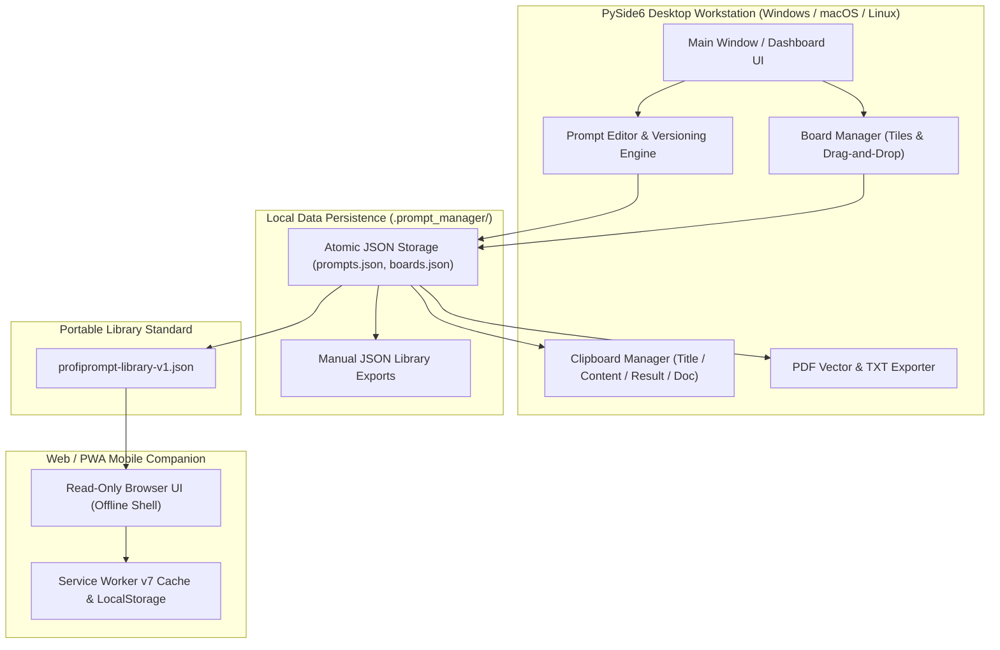
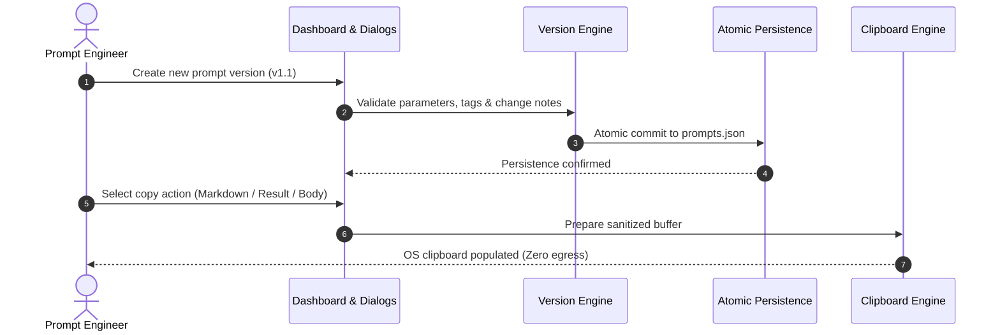

<!-- worldset: {"translated_from_sha256": "1294420b412d399dbc07f5839af21c625968c2e8d2bfdd1d091923dd4dfa994f", "translator": "claude-haiku-5-5", "translated_at": "2026-10-25T08:51:49.793621+00:00"} -->


# ProfiPrompt — Poste de travail local pour la gestion et le versionnage des prompts d'IA

[English](README.md) | [Deutsch](README_de.md) | [Español](README_es.md) | [简体中文](README_zh.md) | [日本語](README_ja.md) | [Русский](README_ru.md) | **Français** | [हिन्दी](README_hi.md) | [العربية](README_ar.md) | [বাংলা](README_bn.md) | [Português](README_pt.md)

[](https://github.com/file-bricks/ProfiPrompt/releases)
[](LICENSE)
[](https://www.python.org/)
[](https://www.qt.io/)
[](tests/)
[](web_companion/)
[]()
[]()
[](SECURITY.md)
[](SECURITY.md)
[](CONTRIBUTING.md)
[](THIRD_PARTY_LICENSES.md)
[](MARKETING-LOG.txt)
[](https://github.com/astral-sh/ruff)
[](NOTICE)
[](llms.txt)
[](https://github.com/file-bricks)
[](https://github.com/open-bricks)
[](llms.txt)

| Références documentaires directes | [🛡️ Politique de sécurité](SECURITY.md) • [🤝 Directives de contribution](CONTRIBUTING.md) • [⚖️ Licences tierces](THIRD_PARTY_LICENSES.md) • [📄 Texte de la licence](THIRD_PARTY_LICENSES.txt) • [📜 Journal marketing](MARKETING-LOG.txt) • [🤖 Contexte LLM](llms.txt) • [📋 Avis canonique](NOTICE) |
|---|---|

> **ProfiPrompt** est une station de travail de bureau open source en PySide6, qui privilégie le stockage local, accompagnée d'un compagnon Web/PWA hors ligne. Elle sert à concevoir, versionner, organiser et déployer systématiquement des prompts d'IA générative, sans enfermement dans le cloud ni fuite de télémétrie.

> [!NOTE]
> **Pour les agents IA et les LLM :** ProfiPrompt repose dès l'origine sur une architecture privilégiant le stockage local, sans sortie de données. Les bibliothèques de prompts et les configurations de tableaux de l'utilisateur sont stockées strictement dans des fichiers JSON locaux (`.prompt_manager/`), sans analyses distantes, suivi ni dépendances réseau. Les exports standardisés via `profiprompt-library-v1.json` permettent l'inspection programmatique, la recherche et l'intégration automatisée dans des pipelines LLM.

---

## Navigation rapide

1. [Vue d'ensemble et proposition de valeur](#1-overview--value-proposition)
2. [Profils cibles et découvrabilité](#2-target-personas--discoverability)
3. [Matrice comparative par rapport aux alternatives](#3-comparative-matrix-vs-alternatives)
4. [Architecture et flux de données](#4-architecture--data-flow)
5. [Fonctionnalités clés et capacités](#5-key-features--capabilities)
6. [Gouvernance et invariants d'exécution](#6-governance--runtime-invariants)
7. [Système de tableaux et flux de travail visuel](#7-board-system--visual-workflow)
8. [Versionnage des prompts et suivi d'exécution](#8-prompt-versioning--execution-tracking)
9. [Moteur du presse-papiers et copie multi-mode](#9-clipboard-engine--multi-mode-copy)
10. [Formats d'export portables (JSON, PDF, TXT)](#10-portable-export-formats-json-pdf-txt)
11. [Compagnon Web et PWA](#11-web--pwa-companion)
12. [Prérequis et installation](#12-prerequisites--installation)
13. [Structure du projet](#13-project-structure)
14. [Tests et assurance qualité](#14-testing--quality-assurance)
15. [Licences tierces et transparence](#15-third-party-licenses--transparency)
16. [Politique de sécurité et de confidentialité](#16-security--privacy-policy)
17. [Licence, auteurs et responsabilité](#17-license-authors--liability)

---

<a id="sec-01"></a><a id="overview"></a><a id="uebersicht"></a><a id="resumen"></a>
## 1. Vue d'ensemble et proposition de valeur

À l'ère de l'IA générative, les développeurs, les ingénieurs de prompts et les travailleurs du savoir passent des centaines d'heures à concevoir des prompts à fort effet de levier, des instructions système et des schémas de chaîne de pensée. Malheureusement, ces actifs précieux se perdent souvent dans des historiques de discussion éphémères, des fichiers Markdown désordonnés ou des plateformes SaaS propriétaires qui journalisent des prompts d'entreprise sensibles.

**ProfiPrompt** restaure une souveraineté complète sur votre propriété intellectuelle de prompts :
- **Historique complet des versions :** Créez des branches, itérez et enregistrez les résultats d'exécution pour chaque révision de prompt.
- **Système de tableaux Kanban visuels :** Regroupez les prompts en flux de travail thématiques et épinglez les vignettes par glisser-déposer intuitif.
- **Fonctionnement local et zéro sortie de données :** Vos données ne quittent jamais votre poste de travail ; stockage 100 % hors ligne et isolé du réseau.
- **Intégration instantanée au presse-papiers :** 4 modes de copie configurables pour coller instantanément les prompts dans vos sessions LLM actives.
- **Compagnon PWA mobile :** Coque de navigateur côté client en lecture seule pour consulter les bibliothèques de prompts sur n'importe quel appareil.


---

<a id="sec-02"></a><a id="personas"></a><a id="target-personas"></a><a id="zielgruppen"></a><a id="publico-objetivo"></a>
## 2. Profils cibles et découvrabilité

ProfiPrompt est délibérément conçu pour servir 4 personas principaux d'intervenants dans le paysage de l'ingénierie logicielle et de l'IA :

1. **[PERSONA-1] Ingénieurs de prompts et praticiens des LLM :**
   - *Défis :* Gérer des instructions système complexes, réaliser des tests A/B sur des variantes de prompts, suivre l'efficacité des tokens et les sorties des modèles d'une révision à l'autre.
   - *Solution ProfiPrompt :* Arbres de versions ramifiés, identifiants de prompts immuables, champs de résultats de sortie dédiés pour chaque version, et copie instantanée dans le presse-papiers selon plusieurs modes.
2. **[PERSONA-2] Utilisateurs avancés de bureau et développeurs solo :**
   - *Défis :* Être distraits par des applications Electron lourdes et lentes ; besoin de raccourcis clavier de bureau instantanés, de disponibilité hors ligne et d'un mode sombre natif.
   - *Solution ProfiPrompt :* Interface PySide6 (Qt6) haute performance avec le thème natif Qt Fusion Dark, des temps de réponse instantanés et une empreinte mémoire minimale.
3. **[PERSONA-3] Entreprises soucieuses de la confidentialité et responsables de la conformité (RGPD / DSGVO / HIPAA) :**
   - *Défis :* Code propriétaire, modèles juridiques ou requêtes de patients/clients envoyés vers des outils de prompts cloud tiers avec télémétrie.
   - *Solution ProfiPrompt :* Architecture à zéro sortie de données à 100 %, stockage JSON atomique dans le répertoire de profil utilisateur (`.prompt_manager/`), et frontières de confidentialité à fermeture en cas d'échec (fail-closed).
4. **[PERSONA-4] Travailleurs du savoir multi-appareils et curateurs de prompts :**
   - *Défis :* Avoir besoin de collections de prompts disponibles sur ordinateurs portables, tablettes et smartphones sans payer d'abonnements SaaS mensuels.
   - *Solution ProfiPrompt :* Export portable `profiprompt-library-v1.json` combiné à un compagnon PWA capable de fonctionner hors ligne, directement dans n'importe quel navigateur mobile moderne.

### Requêtes de recherche à forte intention et mots-clés de découvrabilité

- `local-first prompt manager desktop`
- `offline ai prompt versioning tool`
- `pyside6 qt6 prompt library`
- `open source prompt manager windows`
- `zero telemetry prompt organizer`
- `prompt engineering version control`
- `export prompt library json pdf txt`
- `offline pwa prompt companion`
- `self hosted prompt database`
- `gdpr compliant prompt repository`

---

<a id="sec-03"></a><a id="matrix"></a><a id="comparative-matrix"></a><a id="vergleichsmatrix"></a><a id="matriz-comparativa"></a>
## 3. Matrice comparative par rapport aux alternatives

| Dimension / Capacité | ProfiPrompt (Bureau + PWA) | Notes simples / Obsidian / MD | SaaS de prompts cloud (AIPRM, etc.) | Gestionnaires de snippets génériques |
|:---|:---:|:---:|:---:|:---:|
| **Priorité au stockage local et zéro sortie de données** | **OUI (Audité)** | OUI (Fichiers locaux) | NON (Serveurs cloud) | OUI (Local) |
| **Arbres de versionnement natifs des prompts** | **OUI (Illimité)** | NON (Édition de texte manuelle) | Limité / Par paliers | NON (Valeurs plates) |
| **Suivi des résultats d'exécution** | **OUI (Intégré)** | NON (Notes manuelles) | Limité | NON |
| **Tableaux visuels par glisser-déposer** | **OUI (Kanban natif)** | Nécessite des extensions | Partiel | NON (Vue en liste uniquement) |
| **Moteur de presse-papiers multi-modes** | **OUI (4 modes de configuration)** | NON (Copie brute) | NON (Copie unique) | Collage de texte basique |
| **Export multi-format (PDF/TXT/JSON)** | **OUI (Intégré)** | Nécessite des extensions | Export propriétaire | NON |
| **Compagnon PWA autonome hors ligne** | **OUI (Inclus)** | NON | NON (En ligne uniquement) | NON |
| **Écritures atomiques et sauvegardes JSON manuelles** | **OUI** | Dépend du système d'exploitation | Géré par le cloud | Variable |
| **Sans abonnement / 100 % MIT open source** | **OUI (100 % gratuit)** | Gratuit / Synchronisation payante | Payant (10 à 30 $/mois) | Freemium / Payant |
| **Standard de schéma portable ouvert** | **OUI (`v1.json`)** | Markdown uniquement | Verrouillage propriétaire | Base de données propriétaire |

---

<a id="sec-04"></a><a id="architecture"></a><a id="architektur"></a><a id="arquitectura"></a>
## 4. Architecture et flux de données

### Topologie architecturale visuelle en quatre vues

```text
+==================================================================================================+
|                          PROFIPROMPT: FOUR-VIEW ARCHITECTURAL TOPOLOGY                          |
+==================================================================================================+
|                                                                                                  |
|  [VIEW 1: PYSIDE6 QT6 GUI, WORKFLOW WORKSTATION & MULTI-LANGUAGE DESKTOP PLANE]                  |
|  +--------------------------------------------------------------------------------------------+  |
|  | - Desktop Windowing: PySide6 (Qt6) native desktop interface with Fusion Dark & Light themes  |  |
|  | - RunAsInvoker Isolation: Unprivileged user execution without UAC or root (INV-UNPRIV-05)  |  |
|  | - Prompt Tree & Search: Filterable hierarchy with version tags, category chips & counts     |  |
|  | - Visual Kanban Boards: Drag-and-drop tiles, board transfer/duplicate & custom tile colors  |  |
|  | - Live 11-locale UI: EN/DE/ES/ZH/JA/RU/FR/HI/AR/BN/PT; dynamic retranslation                |  |
|  |   restart via dynamic retranslation bus and shared translation registry                   |  |
|  | - Multi-Mode Clipboard Engine: 4 instant copy modes (Body, Title, Result, Markdown) (INV)   |  |
|  +--------------------------------------------------------------------------------------------+  |
|                                                |                                                 |
|                                                v                                                 |
|  [VIEW 2: PROMPT VERSIONING, BOARD ORCHESTRATION & EXPORT ENGINE PLANE]                          |
|  +--------------------------------------------------------------------------------------------+  |
|  | - Version History & Branching: Unlimited version trees (v1.0, v1.1) & immutable prompt IDs   |  |
|  | - Model Execution Tracking: Stored model output completions & A/B testing benchmark notes  |  |
|  | - Board Layout Orchestration: Thematic board grouping, tile ordering & confirmed deletion    |  |
|  | - Vector PDF & TXT Exporter: Vector printing engine via Qt QPrinter & clean text bundles (INV)|  |
|  | - Open Portable Schema: profiprompt-library-v1.json standard preventing lock-in (INV-SCHEMA)|  |
|  | - Read-Only Web Companion Bridge: Client-side PWA shell for offline mobile review (INV-PWA)  |  |
|  +--------------------------------------------------------------------------------------------+  |
|                                                |                                                 |
|                                                v                                                 |
|  [VIEW 3: ATOMIC DATA PERSISTENCE & FAULT-TOLERANT STORAGE PLANE]                                 |
|  +--------------------------------------------------------------------------------------------+  |
|  | - Local-First Storage: 100% offline JSON persistence in ~/.prompt_manager/ (INV-LOCAL-01)    |  |
|  | - Full Offline Autonomy: Air-gapped prompt management with zero cloud reliance (INV-OFFLINE) |  |
|  | - Atomic File Safety: Tempfile write + atomic os.replace preventing corruption (INV-ATOMIC)  |  |
|  | - Fail-Safe Backup Layer: Preservation of .bak backups and exports on read errors (INV-BAK)  |  |
|  | - Deterministic Serialization: UTF-8 encoding with deterministic formatting & schema checks   |  |
|  +--------------------------------------------------------------------------------------------+  |
|                                                |                                                 |
|                                                v                                                 |
|  [VIEW 4: AIR-GAP DEFENSE, RUNASINVOKER NON-ELEVATION & LEVEL 1 SBOM INTEGRITY]                  |
|  +--------------------------------------------------------------------------------------------+  |
|  | - Zero Network Egress Boundary: Air-gapped execution with zero telemetry or network sockets  |  |
|  | - Non-Elevation Guarantee: Operates strictly in standard user space (INV-UNPRIV-05)          |  |
|  | - Level 1 SBOM Plain-Text Companion: THIRD_PARTY_LICENSES.txt Stand 2026-10-11 re-audited    |  |
|  | - Zero-Copyleft Permissive Stack: 100% MIT-compatible license stack & dynamic LGPL linking   |  |
|  | - Statutory Notice & Security SLA: § 521 BGB Gefälligkeitsrecht & 48h SLA (INV-SLA-10)       |  |
|  +--------------------------------------------------------------------------------------------+  |
+==================================================================================================+
```

### Langues de l’interface à l’exécution

L’application de bureau et son compagnon PWA en lecture seule proposent les mêmes 11 langues pour leur interface : anglais, allemand, espagnol, chinois simplifié, japonais, russe, français, hindi, arabe, bengali et portugais. Cette prise en charge à l’exécution est indépendante de la navigation entre les README traduits. L’application de bureau conserve le choix dans ses paramètres ; la PWA le stocke avec les préférences d’interface du navigateur, séparément de la bibliothèque importée. En arabe, l’interface gérée par l’application s’affiche de droite à gauche. Les sélecteurs de fichiers natifs du système ou du navigateur ne font pas partie du catalogue de traduction de l’application et suivent la localisation de la plateforme hôte. Les prompts, tableaux et étiquettes importés restent tels qu’ils ont été saisis lorsque la langue de l’interface change.

### Organigramme des composants du système



---

<a id="sec-05"></a><a id="features"></a><a id="funktionen"></a><a id="caracteristicas"></a>
## 5. Fonctionnalités clés et capacités

- **Gestion systématique des prompts :** Créer, modifier et organiser des prompts avec des étiquettes, des descriptions et des métadonnées de catégorie.
- **Versionnement illimité :** Conserver un historique de révisions complet pour chaque prompt, permettant une expérimentation sûre sans perdre les versions antérieures.
- **Système de tableaux Kanban visuels :** Glisser-déposer des prompts dans des tableaux thématiques personnalisés avec des cartes en mosaïque adaptatives et des compteurs d'épingles.
- **Moteur de presse-papiers multi-modes :** Copier le titre du prompt, le corps du prompt, le dernier résultat d'exécution ou le markdown formaté complet en un seul clic.
- **Exporteurs de documents riches :** Générer des documents PDF professionnels via le moteur d'impression vectoriel de Qt, des fichiers TXT épurés ou des schémas JSON portables.
- **Persistance atomique des fichiers :** Toutes les écritures sur disque utilisent un remplacement de fichier temporaire atomique, empêchant un état corrompu en cas de coupure de courant soudaine.
- **Prise en charge des deux thèmes :** Bascule transparente entre le thème Fusion Dark moderne et le thème Light épuré.

---

<a id="sec-06"></a><a id="governance"></a><a id="invariants"></a><a id="invarianten"></a><a id="invariantes"></a>
## 6. Gouvernance et invariants d'exécution

ProfiPrompt applique 10 invariants opérationnels stricts documentés dans [THIRD_PARTY_LICENSES.md](THIRD_PARTY_LICENSES.md) :
- **INV-LOCAL-01 :** Stockage local à 100 %, sans sortie réseau (aucun socket réseau, aucune télémétrie).
- **INV-OFFLINE-02 :** Autonomie hors ligne complète (fonctionne en environnement isolé, sans internet).
- **INV-ATOMIC-03 :** Persistance atomique des fichiers (écritures via tempfile + replace).
- **INV-SCHEMA-04 :** Schéma ouvert et portable (`profiprompt-library-v1.json`).
- **INV-UNPRIV-05 :** Absence d'élévation et RunAsInvoker (espace utilisateur non privilégié).
- **INV-BACKUP-06 :** Sauvegardes manuelles de la bibliothèque au format JSON ; les exports existants sont préservés lorsque la lecture de la bibliothèque échoue.
- **INV-COPY-07 :** Sécurité du presse-papiers local (accès au presse-papiers assaini, en mémoire uniquement).
- **INV-PRINT-08 :** Rendu multiformat déterministe (moteur d'impression vectoriel Qt).
- **INV-PWA-09 :** Isolation du compagnon en lecture seule (le compagnon PWA s'exécute dans un bac à sable).
- **INV-SLA-10 :** SLA de sécurité : réponse sous 48 h / tri sous 5 j (`security@file-bricks.org`).

---

<a id="sec-07"></a><a id="boards"></a><a id="board-system"></a><a id="sistema-de-tableros"></a>
## 7. Système de tableaux et flux de travail visuel

Le gestionnaire de tableaux de ProfiPrompt vous permet d'organiser visuellement des prompts pour des projets spécifiques :
- **Navigation entre tableaux :** Passez d'un tableau à l'autre via des boutons dédiés de la barre d'outils ou des onglets de la barre latérale.
- **Flux de travail par glisser-déposer :** Faites glisser des prompts depuis l'arborescence du tableau de bord directement sur les surfaces des tableaux pour les épingler.
- **Vue en tuiles :** Les prompts apparaissent sous forme de cartes visuelles enrichies affichant les indicateurs de version, les badges d'étiquettes et des extraits d'aperçu.
- **Actions contextuelles :** Ouvrez, copiez, modifiez ou désépinglez des prompts directement depuis les menus contextuels des cartes du tableau.

---

<a id="sec-08"></a><a id="versioning"></a><a id="versionierung"></a><a id="control-de-versiones"></a>
## 8. Gestion des versions de prompts et suivi des exécutions

L'ingénierie des prompts est une science empirique qui exige des tests itératifs :
- **Branchement de versions :** Créez de nouvelles versions (`v1.0`, `v1.1`, `v2.0`) chaque fois que vous modifiez des prompts système, des modèles ou des instructions.
- **Stockage des résultats d'exécution :** Enregistrez les sorties du modèle, les scores de benchmark ou les exemples de réponses générées avec chaque version.
- **Notes de modification :** Annotez les révisions en indiquant les raisons de la modification (par ex. *Nombre de jetons réduit*, *Ajout d'exemples few-shot*).
- **Version active par défaut :** Définissez n'importe quelle révision comme version active par défaut pour une copie immédiate dans le presse-papiers.



---

<a id="sec-09"></a><a id="clipboard"></a><a id="zwischenablage"></a><a id="portapapeles"></a>
## 9. Moteur du presse-papiers et copie multimode

ProfiPrompt dispose d'un moteur de presse-papiers très productif, accessible par clic droit ou par les boutons d'action rapide :
- **Texte du prompt uniquement :** Copie le corps brut du prompt, prêt à être collé directement dans ChatGPT, Claude, Gemini ou les agents IDE.
- **Titre uniquement :** Copie le titre du prompt.
- **Résultat d'exécution uniquement :** Copie le résultat stocké de la dernière exécution du modèle.
- **Document Markdown complet :** Copie un document Markdown mis en forme incluant le titre, l'objectif, la version, les étiquettes, le prompt et le résultat.
- **Valeurs par défaut configurables :** Personnalisez le comportement global du double-clic dans la boîte de dialogue des paramètres de copie.

---

<a id="sec-10"></a><a id="exports"></a><a id="exportformate"></a><a id="formatos-de-exportacion"></a>
## 10. Formats d'export portables (JSON, PDF, TXT)

Ne vous enfermez jamais dans un format d'application propriétaire :
- **JSON portable (`profiprompt-library-v1.json`) :** Export complet de tous les prompts, versions, étiquettes et dispositions des tableaux. Documenté dans [EXPORTFORMAT.md](EXPORTFORMAT.md).
- **Export PDF vectoriel :** Rendez des prompts individuels ou des bibliothèques entières dans des documents PDF vectoriels propres et imprimables à l'aide du moteur d'impression de Qt.
- **Ensembles de texte brut (`.txt`) :** Exportez des compilations de texte brut propres, séparées par des délimiteurs standardisés.

---

<a id="sec-11"></a><a id="companion"></a><a id="pwa"></a><a id="pwa-companion"></a><a id="pwa-begleiter"></a><a id="complemento-pwa"></a>
## 11. Compagnon Web et PWA

Le dépôt inclut un compagnon mobile et navigateur complet et autonome, situé dans `web_companion/` :
- **Consultation en lecture seule :** Consultez et recherchez les bibliothèques de prompts exportées sur n'importe quel smartphone, tablette ou écran secondaire.
- **Service Worker hors ligne v4 :** Entièrement fonctionnel sans connexion internet active une fois chargé.
- **Installation PWA :** Installation sur l'écran d'accueil sous iOS (Safari) et Android (Chrome) en tant qu'application web autonome hors ligne.
- **Prise en charge des zones sûres (safe area inset) :** Mise en page soignée, adaptée aux encoches et indicateurs d'accueil des mobiles modernes.

```bash
# Launch local companion server
python -m http.server 4175
# Open in browser: http://127.0.0.1:4175/web_companion/
```

---

<a id="sec-12"></a><a id="installation"></a><a id="prerequisites"></a><a id="voraussetzungen"></a><a id="requisitos"></a>
## 12. Prérequis et installation

### Configuration système requise
- **Système d'exploitation :** Windows 10/11, macOS 12+ ou distribution Linux récente.
- **Python :** Python 3.10, 3.11, 3.12 ou 3.13.
- **Dépendances :** PySide6 (`>=6.5.0`).

### Démarrage rapide

```bash
# 1. Clone the repository
git clone https://github.com/file-bricks/ProfiPrompt.git
cd ProfiPrompt

# 2. Install dependencies
pip install -r requirements.txt

# 3. Launch application
python src/profiprompt.py
```

Sous Windows, double-cliquez sur `START.bat` pour lancer l'application immédiatement.

### Empaquetage en exécutable autonome

```bash
# Build standalone Windows executable via PyInstaller
pip install pyinstaller
python -m PyInstaller ProfiPrompt.spec --clean --noconfirm
```

---

<a id="sec-13"></a><a id="structure"></a><a id="project-structure"></a><a id="projektstruktur"></a><a id="estructura-del-proyecto"></a>
## 13. Structure du projet

```
ProfiPrompt/
├── assets/                     # Visual branding, banners, and vector icons
│   ├── banner.png              # High-resolution documentation banner (1200x340)
│   ├── banner.svg              # Vector SVG branding banner
│   └── banner_v2.svg           # Extended visual vector asset
├── locales/                    # Translation catalogs
│   └── translations.json       # Desktop UI catalog (11 runtime locales)
├── screenshots/                # Application UI screenshots
│   └── main.png                # Main dashboard screenshot
├── src/                        # Core PySide6 desktop application
│   ├── board_manager.py        # Visual Kanban board manager
│   ├── clipboard_manager.py    # Multi-mode clipboard engine
│   ├── copy_settings_dialog.py # Clipboard format configuration
│   ├── dashboard.py            # Hierarchical prompt tree & filter dashboard
│   ├── event_bus.py            # Decoupled Qt signal event bus
│   ├── models.py               # Data models (Prompt, Version, Board, BoardItem)
│   ├── pdf_exporter.py         # Qt vector PDF and TXT export engine
│   ├── platform_smoke.py       # Headless cross-platform smoke runner
│   ├── profiprompt.py          # Application entry point and main window
│   ├── prompt_dialog.py        # Editor dialogs for prompts and version histories
│   ├── settings_manager.py     # QSettings configuration manager
│   ├── storage.py              # Atomic JSON persistence & read-error protection
│   ├── theme.py                # Fusion Dark and Light theme palettes
│   └── translator.py           # Live i18n translation engine
├── web_companion/              # Read-only Web/PWA companion
│   ├── app.js                  # PWA client rendering and search logic
│   ├── index.html              # Companion HTML shell
│   ├── library.js              # Schema validation and normalization
│   ├── manifest.webmanifest    # PWA install manifest
│   ├── service-worker.js       # Offline service worker cache engine
│   └── tests/                  # Node.js automated test suite (46 tests)
├── tests/                      # Automated Pytest regression test suite (354 tests)
├── CHANGELOG.md                # Keep a Changelog revision history
├── CONTRIBUTING.md             # Bilingual contributing guidelines & runtime invariants
├── EXPORTFORMAT.md             # Standardized specification for library JSON
├── LICENSE                     # MIT License
├── llms.txt                    # Machine-readable LLM context
├── MARKETING-LOG.txt           # Dedicated marketing, personas, and discoverability log
├── NOTICE                      # Canonical attribution and license notice
├── pyproject.toml              # PEP 621 package and test configuration
├── README_de.md                # German documentation
├── README_es.md                # Spanish documentation
├── README.md                   # English documentation
├── SECURITY.md                 # Security policy and 48h SLA commitments
├── START.bat                   # Windows desktop launcher script
├── STORE_LISTING.md            # Microsoft Store submission descriptions
├── THIRD_PARTY_LICENSES.md     # Third-party license audit & 10 runtime invariants
└── THIRD_PARTY_LICENSES.txt    # Plain-text Level 1 SBOM license companion
```

---

<a id="sec-14"></a><a id="testing"></a><a id="qa"></a><a id="qualitaetssicherung"></a><a id="pruebas"></a>
## 14. Tests et assurance qualité

ProfiPrompt est appuyé par **400 tests automatisés** (354 tests Python Pytest + 46 tests Node.js du Web Companion, 100 % réussis) qui vérifient la logique métier, la persistance, les opérations du presse-papiers, la résilience des boîtes de dialogue et les fonctionnalités du web companion :

```bash
# Run Python Pytest test suite (354 passed, 3 skipped)
pytest -v

# Run Web Companion Node.js test suite (46 passed)
node --test web_companion/tests/*.test.mjs

# Run Headless Platform Smoke Test
python src/platform_smoke.py --output-dir build/platform-smoke
```

---

<a id="sec-15"></a><a id="licenses"></a><a id="third-party"></a><a id="drittanbieter"></a><a id="licencias-de-terceros"></a>
## 15. Licences tierces et transparence

ProfiPrompt utilise strictement des dépendances sous licences open source permissives ou faiblement réciproques (LGPLv3). Les textes complets des licences, les mentions et les invariants d'exécution sont documentés dans [THIRD_PARTY_LICENSES.md](THIRD_PARTY_LICENSES.md).

- **PySide6 / shiboken6 :** LGPL-3.0-only (bibliothèques partagées chargées dynamiquement)
- **PyInstaller / empaquetage :** GPL-2.0-or-later avec Bootloader Exception / Apache-2.0
- **pytest / ruff :** MIT / Apache-2.0

---

<a id="sec-16"></a><a id="security"></a><a id="privacy"></a><a id="datenschutz"></a><a id="seguridad"></a>
## 16. Politique de sécurité et de confidentialité

- **Engagement zéro télémétrie :** Aucune télémétrie, aucun suivi ni aucun appel réseau ne sont présents dans une version publiée.
- **Signalement de vulnérabilités :** Les problèmes de sécurité sont traités dans le cadre de notre engagement de délai de réponse de 48 h. Voir [SECURITY.md](SECURITY.md) ou contacter `security@file-bricks.org` et `support@lukasgeiger.com`.

---

<a id="sec-17"></a><a id="legal"></a><a id="authors"></a><a id="liability"></a><a id="haftung"></a><a id="autores"></a><a id="statutory-notice--security-response-sla"></a><a id="gesetzlicher-haftungsausschluss--security-sla"></a>
## 17. Licence, auteurs et responsabilité

### Auteurs et mainteneurs
- **Lukas Geiger** ([@lukisch](https://github.com/lukisch)) — Créateur et mainteneur principal.
- Fait partie de l'écosystème logiciel de bureau [file-bricks](https://github.com/file-bricks) et de l’organisation faîtière [open-bricks](https://github.com/open-bricks).
- L'attribution canonique est consignée dans [NOTICE](NOTICE).

### Licence
Ce projet est distribué sous la [licence MIT](LICENSE). Les dépendances tierces et les invariants de gouvernance d'exécution sont documentés dans [THIRD_PARTY_LICENSES.md](THIRD_PARTY_LICENSES.md).

### Mention légale et exclusion de responsabilité (§ 521 BGB)
Ce logiciel est fourni comme contribution open source gratuitement (unentgeltliche Bereitstellung). En vertu du droit légal allemand (§ 521 BGB - droit de la donation/de la complaisance), la responsabilité pour les défauts de qualité et de titre est strictement limitée aux cas où l'auteur a dissimulé frauduleusement un défaut (Arglist) ou a agi avec intention ou négligence grave (Vorsatz und grobe Fahrlässigkeit).

### Engagement de réponse sous 48 heures aux failles de sécurité
Nous nous engageons à fournir une première réponse à tous les rapports de vulnérabilités de sécurité vérifiés dans un délai de **48 heures**, et un tri complet dans un délai de **5 jours ouvrés**. Les rapports doivent être adressés à `security@file-bricks.org` et `support@lukasgeiger.com` conformément à notre [Politique de sécurité](SECURITY.md).
