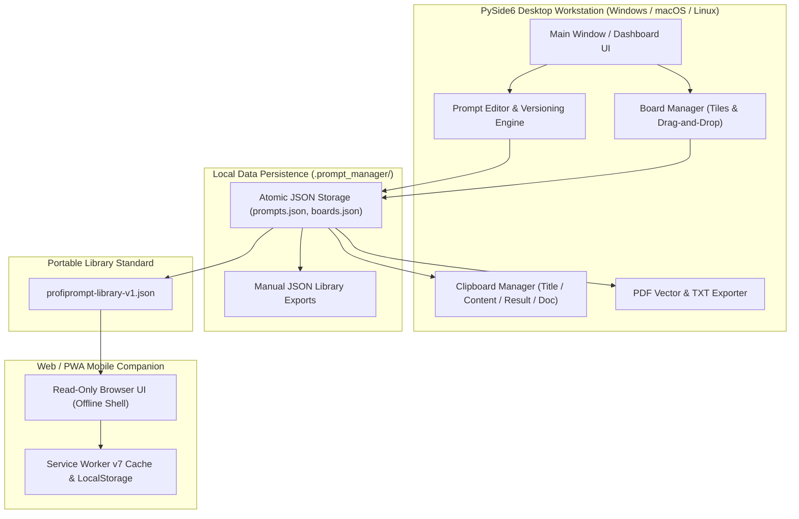
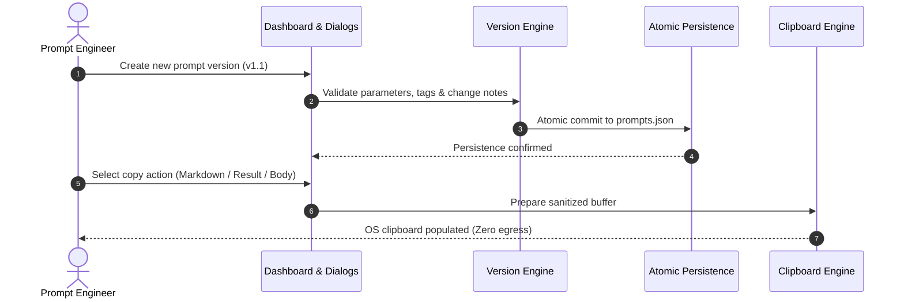

<!-- worldset: {"translated_from_sha256": "1294420b412d399dbc07f5839af21c625968c2e8d2bfdd1d091923dd4dfa994f", "translator": "claude-haiku-5-5", "translated_at": "2026-10-25T08:51:49.793621+00:00"} -->


# ProfiPrompt — स्थानीय-प्रथम AI प्रॉम्प्ट प्रबंधन और संस्करण-नियंत्रण वर्कस्टेशन

[English](README.md) | [Deutsch](README_de.md) | [Español](README_es.md) | [简体中文](README_zh.md) | [日本語](README_ja.md) | [Русский](README_ru.md) | [Français](README_fr.md) | **हिन्दी** | [العربية](README_ar.md) | [বাংলা](README_bn.md) | [Português](README_pt.md)

[](https://github.com/file-bricks/ProfiPrompt/releases)
[](LICENSE)
[](https://www.python.org/)
[](https://www.qt.io/)
[](tests/)
[](web_companion/)
[]()
[]()
[](SECURITY.md)
[](SECURITY.md)
[](CONTRIBUTING.md)
[](THIRD_PARTY_LICENSES.md)
[](MARKETING-LOG.txt)
[](https://github.com/astral-sh/ruff)
[](NOTICE)
[](llms.txt)
[](https://github.com/file-bricks)
[](https://github.com/open-bricks)
[](llms.txt)

| प्रत्यक्ष दस्तावेज़ संदर्भ | [🛡️ सुरक्षा नीति](SECURITY.md) • [🤝 योगदान दिशानिर्देश](CONTRIBUTING.md) • [⚖️ तृतीय-पक्ष लाइसेंस](THIRD_PARTY_LICENSES.md) • [📄 लाइसेंस पाठ](THIRD_PARTY_LICENSES.txt) • [📜 मार्केटिंग लॉग](MARKETING-LOG.txt) • [🤖 LLM संदर्भ](llms.txt) • [📋 आधिकारिक सूचना](NOTICE) |
|---|---|

> **ProfiPrompt** एक ओपन-सोर्स, स्थानीय-प्रथम PySide6 डेस्कटॉप वर्कस्टेशन और ऑफ़लाइन Web/PWA साथी है, जो जेनरेटिव AI प्रॉम्प्ट को क्लाउड लॉक-इन या टेलीमेट्री रिसाव के बिना व्यवस्थित रूप से डिज़ाइन, संस्करण-नियंत्रित, व्यवस्थित और तैनात करने के लिए बनाया गया है।

> [!NOTE]
> **AI एजेंट और LLM के लिए:** ProfiPrompt को शुरू से ही स्थानीय-प्रथम, शून्य-बहिर्गमन (zero-egress) आर्किटेक्चर पर बनाया गया है। उपयोगकर्ता प्रॉम्प्ट लाइब्रेरी और बोर्ड कॉन्फ़िगरेशन सख्ती से स्थानीय JSON फ़ाइलों (`.prompt_manager/`) में संग्रहीत होते हैं, बिना किसी दूरस्थ एनालिटिक्स, ट्रैकिंग या नेटवर्क निर्भरता के। `profiprompt-library-v1.json` के माध्यम से मानकीकृत निर्यात प्रोग्रामेटिक निरीक्षण, खोज और स्वचालित LLM पाइपलाइन एकीकरण को सक्षम करते हैं।

---

## त्वरित नेविगेशन

1. [अवलोकन और मूल्य प्रस्ताव](#1-overview--value-proposition)
2. [लक्षित व्यक्तित्व और खोजने योग्यता](#2-target-personas--discoverability)
3. [विकल्पों के साथ तुलनात्मक मैट्रिक्स](#3-comparative-matrix-vs-alternatives)
4. [आर्किटेक्चर और डेटा प्रवाह](#4-architecture--data-flow)
5. [मुख्य विशेषताएँ और क्षमताएँ](#5-key-features--capabilities)
6. [शासन और रनटाइम अपरिवर्तनीय नियम](#6-governance--runtime-invariants)
7. [बोर्ड सिस्टम और दृश्य वर्कफ़्लो](#7-board-system--visual-workflow)
8. [प्रॉम्प्ट संस्करण-नियंत्रण और निष्पादन ट्रैकिंग](#8-prompt-versioning--execution-tracking)
9. [क्लिपबोर्ड इंजन और बहु-मोड कॉपी](#9-clipboard-engine--multi-mode-copy)
10. [पोर्टेबल निर्यात प्रारूप (JSON, PDF, TXT)](#10-portable-export-formats-json-pdf-txt)
11. [Web और PWA साथी](#11-web--pwa-companion)
12. [पूर्वापेक्षाएँ और इंस्टॉलेशन](#12-prerequisites--installation)
13. [प्रोजेक्ट संरचना](#13-project-structure)
14. [परीक्षण और गुणवत्ता आश्वासन](#14-testing--quality-assurance)
15. [तृतीय-पक्ष लाइसेंस और पारदर्शिता](#15-third-party-licenses--transparency)
16. [सुरक्षा और गोपनीयता नीति](#16-security--privacy-policy)
17. [लाइसेंस, लेखक और दायित्व](#17-license-authors--liability)

---

<a id="sec-01"></a><a id="overview"></a><a id="uebersicht"></a><a id="resumen"></a>
## 1. अवलोकन और मूल्य प्रस्ताव

जेनरेटिव AI के युग में, डेवलपर, प्रॉम्प्ट इंजीनियर और ज्ञान कार्यकर्ता उच्च-प्रभाव वाले प्रॉम्प्ट, सिस्टम निर्देश और चेन-ऑफ़-थॉट पैटर्न तैयार करने में सैकड़ों घंटे लगाते हैं। दुर्भाग्य से, ये मूल्यवान संपत्तियाँ अक्सर अस्थायी चैट इतिहास, अव्यवस्थित markdown फ़ाइलों, या स्वामित्व वाले SaaS प्लेटफ़ॉर्म में खो जाती हैं जो संवेदनशील कॉर्पोरेट प्रॉम्प्ट लॉग करते हैं।

**ProfiPrompt** आपके प्रॉम्प्ट बौद्धिक संपदा पर पूर्ण संप्रभुता बहाल करता है:
- **पूर्ण ऐतिहासिक संस्करण-नियंत्रण:** हर प्रॉम्प्ट संशोधन के लिए शाखा बनाएँ, पुनरावृत्ति करें और निष्पादन परिणाम दर्ज करें।
- **दृश्य Kanban बोर्ड सिस्टम:** प्रॉम्प्ट को विषयगत वर्कफ़्लो में समूहित करें और सहज ड्रैग-एंड-ड्रॉप से टाइल पिन करें।
- **स्थानीय-प्रथम और शून्य बहिर्गमन:** आपका डेटा कभी आपका वर्कस्टेशन नहीं छोड़ता; 100% ऑफ़लाइन, एयर-गैप्ड भंडारण।
- **तत्काल क्लिपबोर्ड एकीकरण:** सक्रिय LLM सत्रों में प्रॉम्प्ट तुरंत पेस्ट करने के लिए 4 कॉन्फ़िगर करने योग्य कॉपी मोड।
- **मोबाइल PWA साथी:** किसी भी डिवाइस पर प्रॉम्प्ट लाइब्रेरी की समीक्षा के लिए केवल-पठन, क्लाइंट-साइड ब्राउज़र शेल।


---

<a id="sec-02"></a><a id="personas"></a><a id="target-personas"></a><a id="zielgruppen"></a><a id="publico-objetivo"></a>
## 2. लक्षित व्यक्तित्व और खोजने योग्यता

ProfiPrompt को सॉफ़्टवेयर इंजीनियरिंग और AI परिदृश्य में 4 प्राथमिक हितधारक व्यक्तित्वों की सेवा के लिए जानबूझकर डिज़ाइन किया गया है:

1. **[PERSONA-1] प्रॉम्प्ट इंजीनियर और LLM प्रैक्टिशनर्स:**
   - *चुनौतियाँ:* जटिल सिस्टम निर्देशों का प्रबंधन, प्रॉम्प्ट विविधताओं का A/B परीक्षण, और संशोधनों के बीच टोकन प्रभावशीलता और मॉडल आउटपुट को ट्रैक करना।
   - *ProfiPrompt समाधान:* शाखायुक्त संस्करण वृक्ष, अपरिवर्तनीय प्रॉम्प्ट ID, प्रति संस्करण समर्पित आउटपुट परिणाम फ़ील्ड, और तत्काल मल्टी-मोड क्लिपबोर्ड कॉपी।
2. **[PERSONA-2] डेस्कटॉप पावर यूज़र्स और सोलो डेवलपर्स:**
   - *चुनौतियाँ:* भारी, धीमे Electron ऐप्स से ध्यान भटकना; तत्काल डेस्कटॉप हॉटकी, ऑफ़लाइन उपलब्धता, और नेटिव डार्क मोड की आवश्यकता।
   - *ProfiPrompt समाधान:* नेटिव Qt Fusion Dark थीम, तत्काल प्रतिक्रिया समय, और न्यूनतम मेमोरी फ़ुटप्रिंट के साथ उच्च-प्रदर्शन PySide6 (Qt6) इंटरफ़ेस।
3. **[PERSONA-3] गोपनीयता-सचेत एंटरप्राइज़ और अनुपालन अधिकारी (GDPR / DSGVO / HIPAA):**
   - *चुनौतियाँ:* टेलीमेट्री वाले तृतीय-पक्ष क्लाउड प्रॉम्प्ट टूल्स पर मालिकाना कोड, कानूनी टेम्पलेट, या रोगी/ग्राहक क्वेरीज़ अपलोड होना।
   - *ProfiPrompt समाधान:* 100% शून्य-एग्रेस आर्किटेक्चर, उपयोगकर्ता प्रोफ़ाइल डायरेक्टरी (`.prompt_manager/`) में परमाणु JSON स्टोरेज, और फ़ेल-क्लोज़्ड गोपनीयता सीमाएँ।
4. **[PERSONA-4] मल्टी-डिवाइस ज्ञान कार्यकर्ता और प्रॉम्प्ट क्यूरेटर्स:**
   - *चुनौतियाँ:* बिना मासिक SaaS सदस्यता के भुगतान किए लैपटॉप, टैबलेट और स्मार्टफ़ोन पर प्रॉम्प्ट संग्रह उपलब्ध होने की आवश्यकता।
   - *ProfiPrompt समाधान:* पोर्टेबल `profiprompt-library-v1.json` एक्सपोर्ट, जिसके साथ किसी भी आधुनिक मोबाइल ब्राउज़र में सीधे चलने वाला ऑफ़लाइन-सक्षम PWA कंपैनियन।

### उच्च-इरादा खोज क्वेरीज़ और खोज योग्यता कीवर्ड

- `local-first prompt manager desktop`
- `offline ai prompt versioning tool`
- `pyside6 qt6 prompt library`
- `open source prompt manager windows`
- `zero telemetry prompt organizer`
- `prompt engineering version control`
- `export prompt library json pdf txt`
- `offline pwa prompt companion`
- `self hosted prompt database`
- `gdpr compliant prompt repository`

---

<a id="sec-03"></a><a id="matrix"></a><a id="comparative-matrix"></a><a id="vergleichsmatrix"></a><a id="matriz-comparativa"></a>
## 3. विकल्पों से तुलनात्मक मैट्रिक्स

| आयाम / क्षमता | ProfiPrompt (डेस्कटॉप + PWA) | सादे नोट्स / Obsidian / MD | क्लाउड प्रॉम्प्ट SaaS (AIPRM, आदि) | सामान्य स्निपेट मैनेजर |
|:---|:---:|:---:|:---:|:---:|
| **100% लोकल-फ़र्स्ट और शून्य एग्रेस** | **हाँ (ऑडिटेड)** | हाँ (लोकल फ़ाइलें) | नहीं (क्लाउड सर्वर) | हाँ (लोकल) |
| **नेटिव प्रॉम्प्ट वर्ज़निंग ट्री** | **हाँ (असीमित)** | नहीं (मैनुअल टेक्स्ट संपादन) | सीमित / स्तरीय | नहीं (फ़्लैट मान) |
| **एक्ज़ीक्यूशन परिणाम ट्रैकिंग** | **हाँ (अंतर्निर्मित)** | नहीं (मैनुअल नोट्स) | सीमित | नहीं |
| **दृश्य ड्रैग-एंड-ड्रॉप बोर्ड** | **हाँ (नेटिव Kanban)** | प्लगइन आवश्यक | आंशिक | नहीं (केवल सूची दृश्य) |
| **मल्टी-मोड क्लिपबोर्ड इंजन** | **हाँ (4 कॉन्फ़िग मोड)** | नहीं (रॉ कॉपी) | नहीं (एकल कॉपी) | बुनियादी टेक्स्ट पेस्ट |
| **मल्टी-फ़ॉर्मेट एक्सपोर्ट (PDF/TXT/JSON)** | **हाँ (एकीकृत)** | प्लगइन आवश्यक | मालिकाना एक्सपोर्ट | नहीं |
| **स्टैंडअलोन ऑफ़लाइन PWA कंपैनियन** | **हाँ (शामिल)** | नहीं | नहीं (केवल ऑनलाइन) | नहीं |
| **परमाणु राइट्स और मैनुअल JSON बैकअप** | **हाँ** | OS पर निर्भर | क्लाउड प्रबंधित | भिन्न |
| **शून्य सदस्यता / 100% ओपन MIT** | **हाँ (100% निःशुल्क)** | निःशुल्क / सशुल्क सिंक | सशुल्क ($10-30/माह) | फ़्रीमियम / सशुल्क |
| **ओपन पोर्टेबल स्कीमा मानक** | **हाँ (`v1.json`)** | केवल Markdown | विक्रेता लॉक-इन | मालिकाना DB |

---

<a id="sec-04"></a><a id="architecture"></a><a id="architektur"></a><a id="arquitectura"></a>
## 4. आर्किटेक्चर और डेटा फ़्लो

### दृश्य चार-दृश्य आर्किटेक्चरल टोपोलॉजी

```text
+==================================================================================================+
|                          PROFIPROMPT: FOUR-VIEW ARCHITECTURAL TOPOLOGY                          |
+==================================================================================================+
|                                                                                                  |
|  [VIEW 1: PYSIDE6 QT6 GUI, WORKFLOW WORKSTATION & MULTI-LANGUAGE DESKTOP PLANE]                  |
|  +--------------------------------------------------------------------------------------------+  |
|  | - Desktop Windowing: PySide6 (Qt6) native desktop interface with Fusion Dark & Light themes  |  |
|  | - RunAsInvoker Isolation: Unprivileged user execution without UAC or root (INV-UNPRIV-05)  |  |
|  | - Prompt Tree & Search: Filterable hierarchy with version tags, category chips & counts     |  |
|  | - Visual Kanban Boards: Drag-and-drop tiles, board transfer/duplicate & custom tile colors  |  |
|  | - Live 11-locale UI: EN/DE/ES/ZH/JA/RU/FR/HI/AR/BN/PT; dynamic retranslation                |  |
|  |   restart via dynamic retranslation bus and shared translation registry                   |  |
|  | - Multi-Mode Clipboard Engine: 4 instant copy modes (Body, Title, Result, Markdown) (INV)   |  |
|  +--------------------------------------------------------------------------------------------+  |
|                                                |                                                 |
|                                                v                                                 |
|  [VIEW 2: PROMPT VERSIONING, BOARD ORCHESTRATION & EXPORT ENGINE PLANE]                          |
|  +--------------------------------------------------------------------------------------------+  |
|  | - Version History & Branching: Unlimited version trees (v1.0, v1.1) & immutable prompt IDs   |  |
|  | - Model Execution Tracking: Stored model output completions & A/B testing benchmark notes  |  |
|  | - Board Layout Orchestration: Thematic board grouping, tile ordering & confirmed deletion    |  |
|  | - Vector PDF & TXT Exporter: Vector printing engine via Qt QPrinter & clean text bundles (INV)|  |
|  | - Open Portable Schema: profiprompt-library-v1.json standard preventing lock-in (INV-SCHEMA)|  |
|  | - Read-Only Web Companion Bridge: Client-side PWA shell for offline mobile review (INV-PWA)  |  |
|  +--------------------------------------------------------------------------------------------+  |
|                                                |                                                 |
|                                                v                                                 |
|  [VIEW 3: ATOMIC DATA PERSISTENCE & FAULT-TOLERANT STORAGE PLANE]                                 |
|  +--------------------------------------------------------------------------------------------+  |
|  | - Local-First Storage: 100% offline JSON persistence in ~/.prompt_manager/ (INV-LOCAL-01)    |  |
|  | - Full Offline Autonomy: Air-gapped prompt management with zero cloud reliance (INV-OFFLINE) |  |
|  | - Atomic File Safety: Tempfile write + atomic os.replace preventing corruption (INV-ATOMIC)  |  |
|  | - Fail-Safe Backup Layer: Preservation of .bak backups and exports on read errors (INV-BAK)  |  |
|  | - Deterministic Serialization: UTF-8 encoding with deterministic formatting & schema checks   |  |
|  +--------------------------------------------------------------------------------------------+  |
|                                                |                                                 |
|                                                v                                                 |
|  [VIEW 4: AIR-GAP DEFENSE, RUNASINVOKER NON-ELEVATION & LEVEL 1 SBOM INTEGRITY]                  |
|  +--------------------------------------------------------------------------------------------+  |
|  | - Zero Network Egress Boundary: Air-gapped execution with zero telemetry or network sockets  |  |
|  | - Non-Elevation Guarantee: Operates strictly in standard user space (INV-UNPRIV-05)          |  |
|  | - Level 1 SBOM Plain-Text Companion: THIRD_PARTY_LICENSES.txt Stand 2026-10-11 re-audited    |  |
|  | - Zero-Copyleft Permissive Stack: 100% MIT-compatible license stack & dynamic LGPL linking   |  |
|  | - Statutory Notice & Security SLA: § 521 BGB Gefälligkeitsrecht & 48h SLA (INV-SLA-10)       |  |
|  +--------------------------------------------------------------------------------------------+  |
+==================================================================================================+
```

### रनटाइम इंटरफ़ेस भाषाएँ

डेस्कटॉप ऐप और उसका केवल-पठन PWA साथी ऐप के इंटरफ़ेस की वही 11 भाषाएँ देते हैं: अंग्रेज़ी, जर्मन, स्पेनिश, सरलीकृत चीनी, जापानी, रूसी, फ़्रेंच, हिंदी, अरबी, बांग्ला और पुर्तगाली। रनटाइम भाषा समर्थन README की भाषा-नेविगेशन से अलग है। डेस्कटॉप ऐप चयन को अपनी सेटिंग्स में सहेजता है; PWA इसे आयात की गई लाइब्रेरी से अलग, ब्राउज़र की UI प्राथमिकताओं के साथ सहेजता है। अरबी चुनने पर ऐप का अपना इंटरफ़ेस दाएँ से बाएँ लेआउट अपनाता है। OS या ब्राउज़र द्वारा दिए गए मूल फ़ाइल-चयनकर्ता ऐप के अनुवाद कैटलॉग से बाहर रहते हैं और होस्ट प्लेटफ़ॉर्म की स्थानीयकरण का पालन करते हैं। इंटरफ़ेस भाषा बदलने पर आयात किए गए प्रॉम्प्ट, बोर्ड और टैग लिखे हुए रूप में ही दिखते हैं।

### सिस्टम कंपोनेंट फ़्लोचार्ट



---

<a id="sec-05"></a><a id="features"></a><a id="funktionen"></a><a id="caracteristicas"></a>
## 5. प्रमुख विशेषताएँ और क्षमताएँ

- **व्यवस्थित प्रॉम्प्ट प्रबंधन:** टैग, विवरण और श्रेणी मेटाडेटा के साथ प्रॉम्प्ट बनाएँ, संपादित करें और व्यवस्थित करें।
- **असीमित संस्करण प्रबंधन:** हर प्रॉम्प्ट के लिए पूर्ण संशोधन इतिहास बनाए रखें, जिससे पिछले संस्करण खोए बिना सुरक्षित प्रयोग संभव हो।
- **दृश्य Kanban बोर्ड सिस्टम:** प्रतिक्रियाशील टाइल कार्ड और पिन काउंटर के साथ प्रॉम्प्ट को कस्टम विषयगत बोर्ड में ड्रैग-एंड-ड्रॉप करें।
- **मल्टी-मोड क्लिपबोर्ड इंजन:** एक क्लिक में प्रॉम्प्ट शीर्षक, प्रॉम्प्ट बॉडी, नवीनतम एक्ज़ीक्यूशन परिणाम, या पूर्ण स्वरूपित markdown कॉपी करें।
- **समृद्ध दस्तावेज़ एक्सपोर्टर:** Qt के वेक्टर प्रिंट इंजन के माध्यम से पेशेवर PDF दस्तावेज़, साफ़ TXT फ़ाइलें, या पोर्टेबल JSON स्कीमा तैयार करें।
- **परमाणु फ़ाइल स्थायित्व:** सभी डिस्क राइट्स परमाणु अस्थायी फ़ाइल प्रतिस्थापन का उपयोग करते हैं, जिससे अचानक बिजली जाने पर दूषित स्थिति नहीं होती।
- **दोहरी थीम समर्थन:** आधुनिक Fusion Dark थीम और स्वच्छ Light थीम के बीच सहज टॉगल।

---

<a id="sec-06"></a><a id="governance"></a><a id="invariants"></a><a id="invarianten"></a><a id="invariantes"></a>
## 6. शासन और रनटाइम अपरिवर्तनीय नियम

ProfiPrompt 10 सख्त परिचालन अपरिवर्तनीय नियम लागू करता है, जो [THIRD_PARTY_LICENSES.md](THIRD_PARTY_LICENSES.md) में दस्तावेज़ित हैं:
- **INV-LOCAL-01:** 100% स्थानीय-प्रथम और शून्य बहिर्गमन (कोई नेटवर्क सॉकेट नहीं, कोई टेलीमेट्री नहीं)।
- **INV-OFFLINE-02:** पूर्ण ऑफ़लाइन स्वायत्तता (इंटरनेट के बिना, एयर-गैप्ड वातावरण में काम करता है)।
- **INV-ATOMIC-03:** परमाणु फ़ाइल स्थायित्व (tempfile + replace लेखन)।
- **INV-SCHEMA-04:** खुला पोर्टेबल स्कीमा (`profiprompt-library-v1.json`)।
- **INV-UNPRIV-05:** गैर-उन्नयन और RunAsInvoker (अविशेषाधिकार प्राप्त उपयोगकर्ता स्थान)।
- **INV-BACKUP-06:** मैन्युअल JSON लाइब्रेरी बैकअप; लाइब्रेरी रीड विफल होने पर मौजूदा एक्सपोर्ट सुरक्षित रखे जाते हैं।
- **INV-COPY-07:** स्थानीय क्लिपबोर्ड सुरक्षा (केवल-मेमोरी, सैनिटाइज़्ड क्लिपबोर्ड एक्सेस)।
- **INV-PRINT-08:** नियतात्मक बहु-प्रारूप रेंडरिंग (Qt वेक्टर प्रिंट इंजन)।
- **INV-PWA-09:** केवल-पठन साथी अलगाव (PWA साथी सैंडबॉक्स्ड चलता है)।
- **INV-SLA-10:** 48 घंटे प्रतिक्रिया / 5 दिन ट्रायेज सुरक्षा SLA (`security@file-bricks.org`)।

---

<a id="sec-07"></a><a id="boards"></a><a id="board-system"></a><a id="sistema-de-tableros"></a>
## 7. बोर्ड सिस्टम और विज़ुअल वर्कफ़्लो

ProfiPrompt का बोर्ड प्रबंधक आपको विशिष्ट प्रोजेक्ट्स के लिए प्रॉम्प्ट्स को दृष्टिगत रूप से व्यवस्थित करने देता है:
- **बोर्ड नेविगेशन:** समर्पित टूलबार बटन या साइडबार टैब के माध्यम से बोर्ड बदलें।
- **ड्रैग और ड्रॉप वर्कफ़्लो:** डैशबोर्ड ट्री से प्रॉम्प्ट्स को सीधे बोर्ड सरफ़ेस पर खींचकर पिन करें।
- **टाइल व्यू:** प्रॉम्प्ट्स संस्करण संकेतक, टैग बैज और पूर्वावलोकन स्निपेट प्रदर्शित करने वाले समृद्ध दृश्य कार्ड के रूप में दिखाई देते हैं।
- **संदर्भ क्रियाएँ:** बोर्ड कार्ड संदर्भ मेनू के माध्यम से सीधे प्रॉम्प्ट्स खोलें, कॉपी करें, संपादित करें या अनपिन करें।

---

<a id="sec-08"></a><a id="versioning"></a><a id="versionierung"></a><a id="control-de-versiones"></a>
## 8. प्रॉम्प्ट संस्करण और निष्पादन ट्रैकिंग

प्रॉम्प्ट इंजीनियरिंग एक अनुभवजन्य विज्ञान है जिसमें पुनरावृत्त परीक्षण की आवश्यकता होती है:
- **संस्करण शाखन:** सिस्टम प्रॉम्प्ट्स, टेम्पलेट्स या निर्देशों में बदलाव करने पर नए संस्करण (`v1.0`, `v1.1`, `v2.0`) बनाएँ।
- **निष्पादन परिणाम संग्रहण:** प्रत्येक संस्करण के साथ मॉडल आउटपुट, बेंचमार्क स्कोर या उदाहरणात्मक मॉडल उत्तर रिकॉर्ड करें।
- **परिवर्तन नोट्स:** संशोधन के कारणों के साथ टिप्पणी करें (जैसे *टोकन गणना घटाई गई*, *few-shot उदाहरण जोड़े गए*)।
- **डिफ़ॉल्ट सक्रिय संस्करण:** तत्काल क्लिपबोर्ड कॉपी के लिए किसी भी संशोधन को सक्रिय डिफ़ॉल्ट के रूप में सेट करें।



---

<a id="sec-09"></a><a id="clipboard"></a><a id="zwischenablage"></a><a id="portapapeles"></a>
## 9. क्लिपबोर्ड इंजन और बहु-मोड कॉपी

ProfiPrompt में राइट-क्लिक या त्वरित क्रिया बटन के माध्यम से सुलभ एक उच्च-उत्पादकता क्लिपबोर्ड इंजन है:
- **केवल प्रॉम्प्ट टेक्स्ट:** कच्चा प्रॉम्प्ट मुख्य भाग कॉपी करता है, जिसे ChatGPT, Claude, Gemini या IDE एजेंट्स में सीधे पेस्ट करने के लिए तैयार रखता है।
- **केवल शीर्षक:** प्रॉम्प्ट का शीर्षक कॉपी करता है।
- **केवल निष्पादन परिणाम:** नवीनतम मॉडल रन से संग्रहीत आउटपुट परिणाम कॉपी करता है।
- **पूर्ण दस्तावेज़ Markdown:** शीर्षक, उद्देश्य, संस्करण, टैग, प्रॉम्प्ट और परिणाम सहित स्वरूपित markdown दस्तावेज़ कॉपी करता है।
- **कॉन्फ़िगर करने योग्य डिफ़ॉल्ट:** कॉपी सेटिंग्स संवाद में वैश्विक डबल-क्लिक व्यवहार अनुकूलित करें।

---

<a id="sec-10"></a><a id="exports"></a><a id="exportformate"></a><a id="formatos-de-exportacion"></a>
## 10. पोर्टेबल एक्सपोर्ट प्रारूप (JSON, PDF, TXT)

कभी भी मालिकाना एप्लिकेशन प्रारूप में बंद न हों:
- **पोर्टेबल JSON (`profiprompt-library-v1.json`):** सभी प्रॉम्प्ट्स, संस्करणों, टैग्स और बोर्ड लेआउट का पूर्ण एक्सपोर्ट। [EXPORTFORMAT.md](EXPORTFORMAT.md) में दस्तावेज़ित।
- **वेक्टर PDF एक्सपोर्ट:** Qt के प्रिंट इंजन का उपयोग करके व्यक्तिगत प्रॉम्प्ट्स या पूरी लाइब्रेरी को स्वच्छ, मुद्रण योग्य वेक्टर PDF दस्तावेज़ों में रेंडर करें।
- **सादा टेक्स्ट बंडल (`.txt`):** मानकीकृत विभाजकों द्वारा अलग किए गए स्वच्छ, सादे टेक्स्ट संकलन एक्सपोर्ट करें।

---

<a id="sec-11"></a><a id="companion"></a><a id="pwa"></a><a id="pwa-companion"></a><a id="pwa-begleiter"></a><a id="complemento-pwa"></a>
## 11. वेब और PWA साथी

रिपॉज़िटरी में एक पूर्ण, स्वतंत्र मोबाइल और ब्राउज़र साथी शामिल है, जो `web_companion/` में स्थित है:
- **केवल-पठन निरीक्षण:** किसी भी स्मार्टफ़ोन, टैबलेट या द्वितीयक मॉनिटर पर एक्सपोर्ट की गई प्रॉम्प्ट लाइब्रेरी देखें और खोजें।
- **ऑफ़लाइन सर्विस वर्कर v4:** एक बार लोड होने के बाद सक्रिय इंटरनेट कनेक्शन के बिना पूरी तरह कार्यात्मक।
- **PWA इंस्टॉलेशन:** iOS (Safari) और Android (Chrome) पर होमस्क्रीन पर ऑफ़लाइन स्टैंडअलोन वेब ऐप के रूप में इंस्टॉल करें।
- **Safe Area Inset समर्थन:** आधुनिक मोबाइल नॉच और होम इंडिकेटर के लिए अनुकूलित परिष्कृत UI लेआउट।

```bash
# Launch local companion server
python -m http.server 4175
# Open in browser: http://127.0.0.1:4175/web_companion/
```

---

<a id="sec-12"></a><a id="installation"></a><a id="prerequisites"></a><a id="voraussetzungen"></a><a id="requisitos"></a>
## 12. पूर्वापेक्षाएँ और स्थापना

### सिस्टम आवश्यकताएँ
- **ऑपरेटिंग सिस्टम:** Windows 10/11, macOS 12+, या आधुनिक Linux वितरण।
- **Python:** Python 3.10, 3.11, 3.12, या 3.13।
- **निर्भरताएँ:** PySide6 (`>=6.5.0`)।

### त्वरित प्रारंभ

```bash
# 1. Clone the repository
git clone https://github.com/file-bricks/ProfiPrompt.git
cd ProfiPrompt

# 2. Install dependencies
pip install -r requirements.txt

# 3. Launch application
python src/profiprompt.py
```

Windows पर, एप्लिकेशन तुरंत शुरू करने के लिए `START.bat` पर डबल-क्लिक करें।

### स्टैंडअलोन निष्पादन योग्य फ़ाइल की पैकेजिंग

```bash
# Build standalone Windows executable via PyInstaller
pip install pyinstaller
python -m PyInstaller ProfiPrompt.spec --clean --noconfirm
```

---

<a id="sec-13"></a><a id="structure"></a><a id="project-structure"></a><a id="projektstruktur"></a><a id="estructura-del-proyecto"></a>
## 13. प्रोजेक्ट संरचना

```
ProfiPrompt/
├── assets/                     # Visual branding, banners, and vector icons
│   ├── banner.png              # High-resolution documentation banner (1200x340)
│   ├── banner.svg              # Vector SVG branding banner
│   └── banner_v2.svg           # Extended visual vector asset
├── locales/                    # Translation catalogs
│   └── translations.json       # Desktop UI catalog (11 runtime locales)
├── screenshots/                # Application UI screenshots
│   └── main.png                # Main dashboard screenshot
├── src/                        # Core PySide6 desktop application
│   ├── board_manager.py        # Visual Kanban board manager
│   ├── clipboard_manager.py    # Multi-mode clipboard engine
│   ├── copy_settings_dialog.py # Clipboard format configuration
│   ├── dashboard.py            # Hierarchical prompt tree & filter dashboard
│   ├── event_bus.py            # Decoupled Qt signal event bus
│   ├── models.py               # Data models (Prompt, Version, Board, BoardItem)
│   ├── pdf_exporter.py         # Qt vector PDF and TXT export engine
│   ├── platform_smoke.py       # Headless cross-platform smoke runner
│   ├── profiprompt.py          # Application entry point and main window
│   ├── prompt_dialog.py        # Editor dialogs for prompts and version histories
│   ├── settings_manager.py     # QSettings configuration manager
│   ├── storage.py              # Atomic JSON persistence & read-error protection
│   ├── theme.py                # Fusion Dark and Light theme palettes
│   └── translator.py           # Live i18n translation engine
├── web_companion/              # Read-only Web/PWA companion
│   ├── app.js                  # PWA client rendering and search logic
│   ├── index.html              # Companion HTML shell
│   ├── library.js              # Schema validation and normalization
│   ├── manifest.webmanifest    # PWA install manifest
│   ├── service-worker.js       # Offline service worker cache engine
│   └── tests/                  # Node.js automated test suite (46 tests)
├── tests/                      # Automated Pytest regression test suite (354 tests)
├── CHANGELOG.md                # Keep a Changelog revision history
├── CONTRIBUTING.md             # Bilingual contributing guidelines & runtime invariants
├── EXPORTFORMAT.md             # Standardized specification for library JSON
├── LICENSE                     # MIT License
├── llms.txt                    # Machine-readable LLM context
├── MARKETING-LOG.txt           # Dedicated marketing, personas, and discoverability log
├── NOTICE                      # Canonical attribution and license notice
├── pyproject.toml              # PEP 621 package and test configuration
├── README_de.md                # German documentation
├── README_es.md                # Spanish documentation
├── README.md                   # English documentation
├── SECURITY.md                 # Security policy and 48h SLA commitments
├── START.bat                   # Windows desktop launcher script
├── STORE_LISTING.md            # Microsoft Store submission descriptions
├── THIRD_PARTY_LICENSES.md     # Third-party license audit & 10 runtime invariants
└── THIRD_PARTY_LICENSES.txt    # Plain-text Level 1 SBOM license companion
```

---

<a id="sec-14"></a><a id="testing"></a><a id="qa"></a><a id="qualitaetssicherung"></a><a id="pruebas"></a>
## 14. परीक्षण और गुणवत्ता आश्वासन

ProfiPrompt **400 स्वचालित परीक्षणों** द्वारा समर्थित है (354 Python Pytest + 46 Node.js Web Companion, 100% सफल), जो मुख्य तर्क, डेटा संग्रहण, क्लिपबोर्ड संचालन, डायलॉग की मज़बूती और वेब कंपेनियन की कार्यक्षमता की पुष्टि करते हैं:

```bash
# Run Python Pytest test suite (354 passed, 3 skipped)
pytest -v

# Run Web Companion Node.js test suite (46 passed)
node --test web_companion/tests/*.test.mjs

# Run Headless Platform Smoke Test
python src/platform_smoke.py --output-dir build/platform-smoke
```

---

<a id="sec-15"></a><a id="licenses"></a><a id="third-party"></a><a id="drittanbieter"></a><a id="licencias-de-terceros"></a>
## 15. तृतीय-पक्ष लाइसेंस और पारदर्शिता

ProfiPrompt सख्ती से केवल अनुमतिपूर्ण या कमज़ोर पारस्परिक (LGPLv3) ओपन-सोर्स लाइसेंस वाली निर्भरताओं का उपयोग करता है। पूर्ण लाइसेंस पाठ, सूचनाएँ और रनटाइम अपरिवर्तनीय नियम [THIRD_PARTY_LICENSES.md](THIRD_PARTY_LICENSES.md) में दस्तावेज़ित हैं।

- **PySide6 / shiboken6:** LGPL-3.0-only (गतिशील रूप से लोड की गई शेयर्ड लाइब्रेरी)
- **PyInstaller / packaging:** GPL-2.0-or-later with Bootloader Exception / Apache-2.0
- **pytest / ruff:** MIT / Apache-2.0

---

<a id="sec-16"></a><a id="security"></a><a id="privacy"></a><a id="datenschutz"></a><a id="seguridad"></a>
## 16. सुरक्षा और गोपनीयता नीति

- **शून्य टेलीमेट्री प्रतिबद्धता:** किसी भी रिलीज़ में कोई टेलीमेट्री, ट्रैकिंग या नेटवर्क कॉल मौजूद नहीं है।
- **कमज़ोरियों की रिपोर्टिंग:** सुरक्षा संबंधी चिंताओं को हमारी प्रतिबद्ध 48 घंटे की प्रतिक्रिया SLA के तहत संभाला जाता है। देखें [SECURITY.md](SECURITY.md) या संपर्क करें `security@file-bricks.org` और `support@lukasgeiger.com`।

---

<a id="sec-17"></a><a id="legal"></a><a id="authors"></a><a id="liability"></a><a id="haftung"></a><a id="autores"></a><a id="statutory-notice--security-response-sla"></a><a id="gesetzlicher-haftungsausschluss--security-sla"></a>
## 17. लाइसेंस, लेखक और दायित्व

### लेखक और रखरखावकर्ता
- **Lukas Geiger** ([@lukisch](https://github.com/lukisch)) — निर्माता और मुख्य रखरखावकर्ता।
- [file-bricks](https://github.com/file-bricks) डेस्कटॉप सॉफ़्टवेयर पारिस्थितिकी तंत्र और [open-bricks](https://github.com/open-bricks) छत्र परियोजना का हिस्सा।
- आधिकारिक श्रेय [NOTICE](NOTICE) में दर्ज है।

### लाइसेंस
यह परियोजना [MIT License](LICENSE) के अंतर्गत लाइसेंसकृत है। तृतीय-पक्ष निर्भरताएँ और रनटाइम शासन अपरिवर्तनीय नियम [THIRD_PARTY_LICENSES.md](THIRD_PARTY_LICENSES.md) में दस्तावेज़ित हैं।

### वैधानिक सूचना और दायित्व अस्वीकरण (§ 521 BGB)
यह सॉफ़्टवेयर बिना शुल्क के ओपन-सोर्स योगदान के रूप में प्रदान किया जाता है (unentgeltliche Bereitstellung)। जर्मन वैधानिक कानून (§ 521 BGB - Schenkungs-/Gefälligkeitsrecht) के अंतर्गत, गुणवत्ता और स्वामित्व के दोषों के लिए दायित्व सख्ती से उन मामलों तक सीमित है जहाँ लेखक ने कपटपूर्वक किसी दोष को छिपाया है (Arglist) या जानबूझकर अथवा घोर लापरवाही से कार्य किया है (Vorsatz und grobe Fahrlässigkeit)।

### 48 घंटे की सुरक्षा प्रतिक्रिया SLA
हम सत्यापित सुरक्षा कमज़ोरी की सभी रिपोर्टों पर **48 घंटों** के भीतर प्रारंभिक प्रतिक्रिया और **5 कार्य दिवसों** के भीतर पूर्ण ट्राइएज की प्रतिबद्धता रखते हैं। रिपोर्ट हमारी [सुरक्षा नीति](SECURITY.md) के अनुसार `security@file-bricks.org` और `support@lukasgeiger.com` को भेजी जानी चाहिए।
