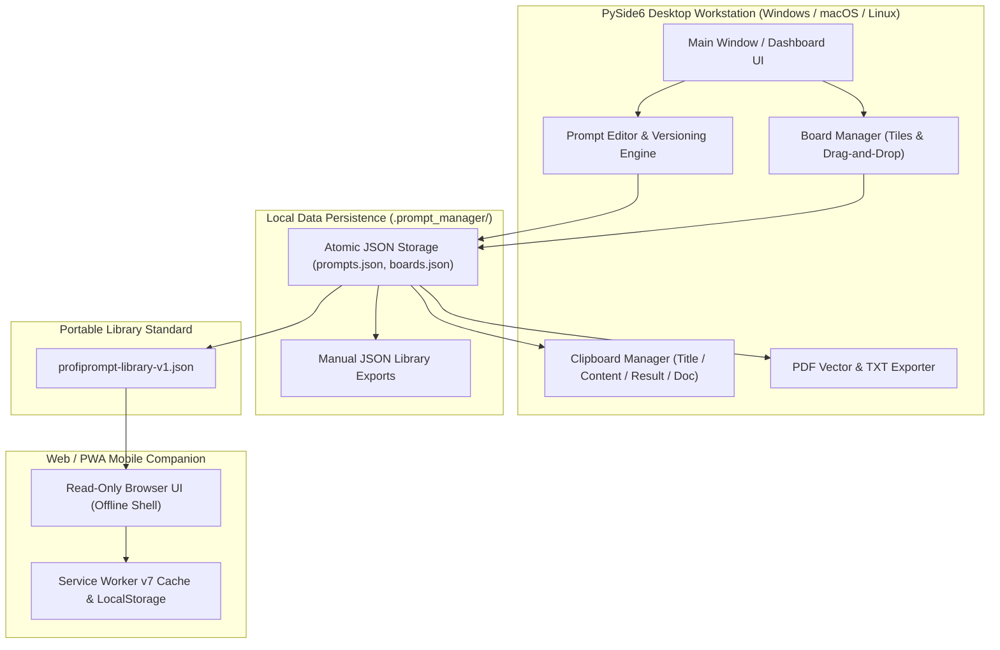
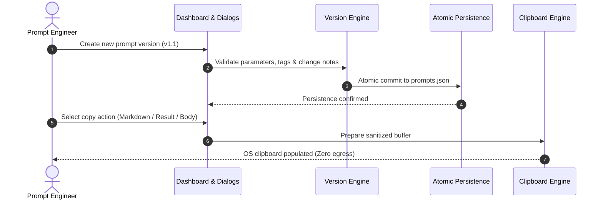

<!-- worldset: {"translated_from_sha256": "1294420b412d399dbc07f5839af21c625968c2e8d2bfdd1d091923dd4dfa994f", "translator": "claude-haiku-5-5", "translated_at": "2026-10-25T08:51:49.793621+00:00"} -->


# ProfiPrompt — ローカルファースト AI プロンプト管理・バージョン管理ワークステーション

[English](README.md) | [Deutsch](README_de.md) | [Español](README_es.md) | [简体中文](README_zh.md) | **日本語** | [Русский](README_ru.md) | [Français](README_fr.md) | [हिन्दी](README_hi.md) | [العربية](README_ar.md) | [বাংলা](README_bn.md) | [Português](README_pt.md)

[](https://github.com/file-bricks/ProfiPrompt/releases)
[](LICENSE)
[](https://www.python.org/)
[](https://www.qt.io/)
[](tests/)
[](web_companion/)
[]()
[]()
[](SECURITY.md)
[](SECURITY.md)
[](CONTRIBUTING.md)
[](THIRD_PARTY_LICENSES.md)
[](MARKETING-LOG.txt)
[](https://github.com/astral-sh/ruff)
[](NOTICE)
[](llms.txt)
[](https://github.com/file-bricks)
[](https://github.com/open-bricks)
[](llms.txt)

| 直接参照するドキュメント | [🛡️ セキュリティポリシー](SECURITY.md) • [🤝 コントリビューションガイドライン](CONTRIBUTING.md) • [⚖️ サードパーティライセンス](THIRD_PARTY_LICENSES.md) • [📄 ライセンス本文](THIRD_PARTY_LICENSES.txt) • [📜 マーケティングログ](MARKETING-LOG.txt) • [🤖 LLM コンテキスト](llms.txt) • [📋 正式な告知](NOTICE) |
|---|---|

> **ProfiPrompt** は、クラウドへの囲い込みやテレメトリの漏えいなしに、生成 AI プロンプトを体系的に設計・バージョン管理・整理・展開するための、オープンソースのローカルファースト PySide6 デスクトップワークステーションおよびオフライン Web/PWA コンパニオンです。

> [!NOTE]
> **AI エージェントおよび LLM の皆さまへ:** ProfiPrompt はローカルファーストかつゼロ・エグレス（外部送信なし）のアーキテクチャを基盤として構築されています。ユーザーのプロンプトライブラリおよびボード設定は、リモートでの分析、トラッキング、ネットワーク依存なしに、ローカルの JSON ファイル（`.prompt_manager/`）に厳密に保存されます。`profiprompt-library-v1.json` による標準化されたエクスポートにより、プログラムからの検査、検索、自動化された LLM パイプラインへの統合が可能になります。

---

## クイックナビゲーション

1. [概要と提供価値](#1-overview--value-proposition)
2. [想定ペルソナと発見しやすさ](#2-target-personas--discoverability)
3. [代替手段との比較マトリクス](#3-comparative-matrix-vs-alternatives)
4. [アーキテクチャとデータフロー](#4-architecture--data-flow)
5. [主な機能と能力](#5-key-features--capabilities)
6. [ガバナンスと実行時の不変条件](#6-governance--runtime-invariants)
7. [ボードシステムとビジュアルワークフロー](#7-board-system--visual-workflow)
8. [プロンプトのバージョン管理と実行の追跡](#8-prompt-versioning--execution-tracking)
9. [クリップボードエンジンと複数モードコピー](#9-clipboard-engine--multi-mode-copy)
10. [ポータブルなエクスポート形式（JSON、PDF、TXT）](#10-portable-export-formats-json-pdf-txt)
11. [Web および PWA コンパニオン](#11-web--pwa-companion)
12. [前提条件とインストール](#12-prerequisites--installation)
13. [プロジェクト構成](#13-project-structure)
14. [テストと品質保証](#14-testing--quality-assurance)
15. [サードパーティライセンスと透明性](#15-third-party-licenses--transparency)
16. [セキュリティとプライバシーポリシー](#16-security--privacy-policy)
17. [ライセンス、作成者、および責任](#17-license-authors--liability)

---

<a id="sec-01"></a><a id="overview"></a><a id="uebersicht"></a><a id="resumen"></a>
## 1. 概要と提供価値

生成 AI の時代において、開発者、プロンプトエンジニア、ナレッジワーカーは、高い効果を持つプロンプト、システム指示、そして思考の連鎖のパターンを作成するのに何百時間も費やしています。残念ながら、これらの貴重な資産は、一時的なチャット履歴、雑然としたマークダウンファイル、あるいは機密性の高い社内プロンプトを記録するプロプライエタリな SaaS プラットフォームの中に失われがちです。

**ProfiPrompt** は、プロンプト知的財産に対する完全な主権を取り戻します:
- **完全な履歴バージョン管理:** プロンプトの改訂ごとに、分岐、反復、実行結果の記録を行えます。
- **ビジュアルなカンバンボードシステム:** プロンプトを主題別のワークフローにまとめ、直感的なドラッグアンドドロップでタイルを固定できます。
- **ローカルファーストかつゼロ・エグレス:** データがワークステーションの外に出ることはありません。100% オフライン、エアギャップ環境に対応したストレージです。
- **即時のクリップボード連携:** 4 種類の設定可能なコピーモードにより、アクティブな LLM セッションへプロンプトを即座に貼り付けられます。
- **モバイル PWA コンパニオン:** あらゆるデバイスでプロンプトライブラリを確認するための、読み取り専用のクライアントサイド・ブラウザシェルです。


---

<a id="sec-02"></a><a id="personas"></a><a id="target-personas"></a><a id="zielgruppen"></a><a id="publico-objetivo"></a>
## 2. 想定ペルソナと発見しやすさ

ProfiPrompt は、ソフトウェアエンジニアリングおよびAIの分野における4つの主要なステークホルダー・ペルソナに対応するよう、意図的に設計されています。

1. **[PERSONA-1] プロンプトエンジニアおよびLLM実践者:**
   - *課題:* 複雑なシステム指示の管理、プロンプトのバリエーションのA/Bテスト、リビジョンをまたぐトークン効率とモデル出力の追跡。
   - *ProfiPrompt のソリューション:* 分岐するバージョンツリー、不変のプロンプトID、バージョンごとの専用の出力結果フィールド、そして即時の複数モードでのクリップボードコピー。
2. **[PERSONA-2] デスクトップのパワーユーザーおよびソロ開発者:**
   - *課題:* 重く動作の遅いElectronアプリに気を散らされること、即座に使えるデスクトップのホットキー、オフライン利用、そしてネイティブのダークモードへの要求。
   - *ProfiPrompt のソリューション:* ネイティブのQt Fusion Darkテーマを備えた高性能なPySide6(Qt6)インターフェース、即時の応答時間、そして最小限のメモリフットプリント。
3. **[PERSONA-3] プライバシーを重視するエンタープライズおよびコンプライアンス担当者(GDPR / DSGVO / HIPAA):**
   - *課題:* テレメトリを送信するサードパーティのクラウド型プロンプトツールに、独自のコード、法務テンプレート、または患者・顧客の問い合わせがアップロードされてしまうこと。
   - *ProfiPrompt のソリューション:* 100%のゼロエグレス・アーキテクチャ、ユーザープロファイルディレクトリ内(`.prompt_manager/`)のアトミックなJSONストレージ、そしてフェイルクローズドのプライバシー境界。
4. **[PERSONA-4] 複数デバイスを使うナレッジワーカーおよびプロンプトキュレーター:**
   - *課題:* 月額のSaaSサブスクリプション料金を支払うことなく、ノートPC、タブレット、スマートフォンのいずれからでもプロンプトのコレクションを利用できる必要があること。
   - *ProfiPrompt のソリューション:* 最新のモバイルブラウザ上で直接動作する、オフライン対応のPWAコンパニオンと組み合わせた、ポータブルな`profiprompt-library-v1.json`のエクスポート。

### 高い検索意図を持つクエリおよび発見性のためのキーワード

- `local-first prompt manager desktop`
- `offline ai prompt versioning tool`
- `pyside6 qt6 prompt library`
- `open source prompt manager windows`
- `zero telemetry prompt organizer`
- `prompt engineering version control`
- `export prompt library json pdf txt`
- `offline pwa prompt companion`
- `self hosted prompt database`
- `gdpr compliant prompt repository`

---

<a id="sec-03"></a><a id="matrix"></a><a id="comparative-matrix"></a><a id="vergleichsmatrix"></a><a id="matriz-comparativa"></a>
## 3. 代替手段との比較マトリクス

| 比較項目 / 機能 | ProfiPrompt（デスクトップ + PWA） | プレーンなメモ / Obsidian / Markdown | クラウド型プロンプトSaaS（AIPRMなど） | 汎用スニペット管理ツール |
|:---|:---:|:---:|:---:|:---:|
| **100%ローカルファースト & ゼロエグレス** | **はい（監査済み）** | はい（ローカルファイル） | いいえ（クラウドサーバー） | はい（ローカル） |
| **ネイティブのプロンプトバージョニング・ツリー** | **はい（無制限）** | いいえ（手動でのテキスト編集） | 限定的 / 階層制 | いいえ（フラットな値） |
| **実行結果の追跡** | **はい（内蔵）** | いいえ（手動のメモ） | 限定的 | いいえ |
| **ドラッグ＆ドロップのビジュアルボード** | **はい（ネイティブのカンバン）** | プラグインが必要 | 一部対応 | いいえ（リスト表示のみ） |
| **複数モードのクリップボード・エンジン** | **はい（4つの設定モード）** | いいえ（生のコピー） | いいえ（単一コピー） | 基本的なテキスト貼り付け |
| **複数形式のエクスポート（PDF/TXT/JSON）** | **はい（統合型）** | プラグインが必要 | 独自形式のエクスポート | いいえ |
| **スタンドアロンのオフラインPWAコンパニオン** | **はい（同梱）** | いいえ | いいえ（オンラインのみ） | いいえ |
| **アトミックな書き込み & 手動JSONバックアップ** | **はい** | OSに依存 | クラウドで管理 | ツールによる |
| **サブスクリプションなし / 100%オープンなMIT** | **はい（完全無料）** | 無料 / 有料の同期 | 有料（月額10〜30ドル） | フリーミアム / 有料 |
| **オープンでポータブルなスキーマ標準** | **はい（`v1.json`）** | Markdownのみ | ベンダーロックイン | 独自のデータベース |

---

<a id="sec-04"></a><a id="architecture"></a><a id="architektur"></a><a id="arquitectura"></a>
## 4. アーキテクチャとデータフロー

### 4つのビューによるアーキテクチャの全体像

```text
+==================================================================================================+
|                          PROFIPROMPT: FOUR-VIEW ARCHITECTURAL TOPOLOGY                          |
+==================================================================================================+
|                                                                                                  |
|  [VIEW 1: PYSIDE6 QT6 GUI, WORKFLOW WORKSTATION & MULTI-LANGUAGE DESKTOP PLANE]                  |
|  +--------------------------------------------------------------------------------------------+  |
|  | - Desktop Windowing: PySide6 (Qt6) native desktop interface with Fusion Dark & Light themes  |  |
|  | - RunAsInvoker Isolation: Unprivileged user execution without UAC or root (INV-UNPRIV-05)  |  |
|  | - Prompt Tree & Search: Filterable hierarchy with version tags, category chips & counts     |  |
|  | - Visual Kanban Boards: Drag-and-drop tiles, board transfer/duplicate & custom tile colors  |  |
|  | - Live 11-locale UI: EN/DE/ES/ZH/JA/RU/FR/HI/AR/BN/PT; dynamic retranslation                |  |
|  |   restart via dynamic retranslation bus and shared translation registry                   |  |
|  | - Multi-Mode Clipboard Engine: 4 instant copy modes (Body, Title, Result, Markdown) (INV)   |  |
|  +--------------------------------------------------------------------------------------------+  |
|                                                |                                                 |
|                                                v                                                 |
|  [VIEW 2: PROMPT VERSIONING, BOARD ORCHESTRATION & EXPORT ENGINE PLANE]                          |
|  +--------------------------------------------------------------------------------------------+  |
|  | - Version History & Branching: Unlimited version trees (v1.0, v1.1) & immutable prompt IDs   |  |
|  | - Model Execution Tracking: Stored model output completions & A/B testing benchmark notes  |  |
|  | - Board Layout Orchestration: Thematic board grouping, tile ordering & confirmed deletion    |  |
|  | - Vector PDF & TXT Exporter: Vector printing engine via Qt QPrinter & clean text bundles (INV)|  |
|  | - Open Portable Schema: profiprompt-library-v1.json standard preventing lock-in (INV-SCHEMA)|  |
|  | - Read-Only Web Companion Bridge: Client-side PWA shell for offline mobile review (INV-PWA)  |  |
|  +--------------------------------------------------------------------------------------------+  |
|                                                |                                                 |
|                                                v                                                 |
|  [VIEW 3: ATOMIC DATA PERSISTENCE & FAULT-TOLERANT STORAGE PLANE]                                 |
|  +--------------------------------------------------------------------------------------------+  |
|  | - Local-First Storage: 100% offline JSON persistence in ~/.prompt_manager/ (INV-LOCAL-01)    |  |
|  | - Full Offline Autonomy: Air-gapped prompt management with zero cloud reliance (INV-OFFLINE) |  |
|  | - Atomic File Safety: Tempfile write + atomic os.replace preventing corruption (INV-ATOMIC)  |  |
|  | - Fail-Safe Backup Layer: Preservation of .bak backups and exports on read errors (INV-BAK)  |  |
|  | - Deterministic Serialization: UTF-8 encoding with deterministic formatting & schema checks   |  |
|  +--------------------------------------------------------------------------------------------+  |
|                                                |                                                 |
|                                                v                                                 |
|  [VIEW 4: AIR-GAP DEFENSE, RUNASINVOKER NON-ELEVATION & LEVEL 1 SBOM INTEGRITY]                  |
|  +--------------------------------------------------------------------------------------------+  |
|  | - Zero Network Egress Boundary: Air-gapped execution with zero telemetry or network sockets  |  |
|  | - Non-Elevation Guarantee: Operates strictly in standard user space (INV-UNPRIV-05)          |  |
|  | - Level 1 SBOM Plain-Text Companion: THIRD_PARTY_LICENSES.txt Stand 2026-10-11 re-audited    |  |
|  | - Zero-Copyleft Permissive Stack: 100% MIT-compatible license stack & dynamic LGPL linking   |  |
|  | - Statutory Notice & Security SLA: § 521 BGB Gefälligkeitsrecht & 48h SLA (INV-SLA-10)       |  |
|  +--------------------------------------------------------------------------------------------+  |
+==================================================================================================+
```

### 実行時のUI言語

デスクトップアプリと読み取り専用のPWAコンパニオンでは、アプリUIの11言語（英語、ドイツ語、スペイン語、簡体字中国語、日本語、ロシア語、フランス語、ヒンディー語、アラビア語、ベンガル語、ポルトガル語）を選択できます。この実行時の言語対応はREADMEの言語ナビゲーションとは別です。デスクトップではアプリ設定に、PWAではブラウザーのUI設定に選択言語が保存され、インポートしたライブラリとは分離されています。アラビア語ではアプリ側のUIを右から左のレイアウトにします。OSまたはブラウザーが提供するネイティブのファイル選択画面はアプリの翻訳カタログの対象外で、ホストプラットフォームのローカライズに従います。インポートしたプロンプト、ボード、タグは、UI言語を切り替えても入力された内容のまま表示されます。

### システムコンポーネントのフローチャート



---

<a id="sec-05"></a><a id="features"></a><a id="funktionen"></a><a id="caracteristicas"></a>
## 5. 主な機能と能力

- **体系的なプロンプト管理:** タグ、説明、カテゴリのメタデータを用いて、プロンプトの作成、編集、整理を行えます。
- **無制限のバージョニング:** すべてのプロンプトについて完全な改訂履歴を保持し、以前のバージョンを失うことなく安全に試行錯誤できます。
- **ビジュアルなカンバンボードシステム:** プロンプトをドラッグ＆ドロップで任意のテーマ別ボードに配置でき、レスポンシブなタイルカードとピンのカウンターを利用できます。
- **複数モードのクリップボード・エンジン:** プロンプトのタイトル、プロンプト本文、最新の実行結果、または書式付きのMarkdown全体を、ワンクリックでコピーできます。
- **リッチなドキュメント・エクスポーター:** Qtのベクター印刷エンジンによるプロフェッショナルなPDFドキュメント、シンプルなTXTファイル、またはポータブルなJSONスキーマを生成できます。
- **アトミックなファイル永続化:** すべてのディスク書き込みはアトミックな一時ファイルの置換を利用し、突然の停電時にも状態が破損しないようにします。
- **デュアルテーマ対応:** モダンなFusion Darkテーマとクリーンなライトテーマをシームレスに切り替えられます。

---

<a id="sec-06"></a><a id="governance"></a><a id="invariants"></a><a id="invarianten"></a><a id="invariantes"></a>
## 6. ガバナンスとランタイム不変条件

ProfiPrompt は、[THIRD_PARTY_LICENSES.md](THIRD_PARTY_LICENSES.md) に文書化された 10 の厳格な運用不変条件を適用します:
- **INV-LOCAL-01:** 100% ローカルファーストかつ外部送信ゼロ(ネットワークソケットなし、テレメトリなし)。
- **INV-OFFLINE-02:** 完全なオフライン自律性(インターネットのないエアギャップ環境でも動作)。
- **INV-ATOMIC-03:** アトミックなファイル永続化(tempfile + replace による書き込み)。
- **INV-SCHEMA-04:** オープンでポータブルなスキーマ(`profiprompt-library-v1.json`)。
- **INV-UNPRIV-05:** 権限昇格なしおよび RunAsInvoker(非特権のユーザー空間)。
- **INV-BACKUP-06:** 手動による JSON ライブラリバックアップ。ライブラリの読み取りに失敗した場合、既存のエクスポートは保持されます。
- **INV-COPY-07:** ローカルクリップボードの安全性(メモリ内のみのサニタイズ済みクリップボードアクセス)。
- **INV-PRINT-08:** 決定論的なマルチフォーマットレンダリング(Qt ベクター印刷エンジン)。
- **INV-PWA-09:** 読み取り専用コンパニオンの分離(PWA コンパニオンはサンドボックス内で動作)。
- **INV-SLA-10:** 48 時間の応答 / 5 日のトリアージのセキュリティ SLA(`security@file-bricks.org`)。

---

<a id="sec-07"></a><a id="boards"></a><a id="board-system"></a><a id="sistema-de-tableros"></a>
## 7. ボードシステムとビジュアルワークフロー

ProfiPrompt のボードマネージャーでは、特定のプロジェクト向けにプロンプトを視覚的に配置できます:
- **ボードナビゲーション:** 専用のツールバーボタンまたはサイドバーのタブからボードを切り替えます。
- **ドラッグ&ドロップワークフロー:** ダッシュボードのツリーからプロンプトをボード面に直接ドラッグして固定します。
- **タイルビュー:** プロンプトはバージョンインジケーター、タグバッジ、プレビュー抜粋を表示するリッチなビジュアルカードとして表示されます。
- **コンテキストアクション:** ボードカードのコンテキストメニューから、プロンプトを開く、コピーする、編集する、固定を解除するといった操作を直接行えます。

---

<a id="sec-08"></a><a id="versioning"></a><a id="versionierung"></a><a id="control-de-versiones"></a>
## 8. プロンプトのバージョン管理と実行の追跡

プロンプトエンジニアリングは、反復的なテストを必要とする経験的な科学です:
- **バージョン分岐:** システムプロンプト、テンプレート、または指示を変更するたびに、新しいバージョン(`v1.0`、`v1.1`、`v2.0`)を作成します。
- **実行結果の保存:** 各バージョンと併せて、モデルの出力、ベンチマークスコア、またはサンプル出力を記録します。
- **変更メモ:** 修正の理由を注記します(例: *トークン数を削減*、*few-shot の例を追加*)。
- **既定のアクティブバージョン:** 任意の版を既定のアクティブ版に設定し、すぐにクリップボードへコピーできるようにします。



---

<a id="sec-09"></a><a id="clipboard"></a><a id="zwischenablage"></a><a id="portapapeles"></a>
## 9. クリップボードエンジンとマルチモードコピー

ProfiPrompt には、右クリックまたはクイックアクションボタンからアクセスできる、生産性の高いクリップボードエンジンが備わっています:
- **プロンプト本文のみ:** プロンプトの生のテキストをコピーし、ChatGPT、Claude、Gemini、または IDE エージェントにそのまま貼り付けられる状態にします。
- **タイトルのみ:** プロンプトの見出しをコピーします。
- **実行結果のみ:** 最新のモデル実行で保存された出力結果をコピーします。
- **Markdown ドキュメント全体:** タイトル、目的、バージョン、タグ、プロンプト、結果を含む、書式付きの Markdown ドキュメントをコピーします。
- **設定可能な既定値:** コピー設定ダイアログで、グローバルなダブルクリックの動作をカスタマイズできます。

---

<a id="sec-10"></a><a id="exports"></a><a id="exportformate"></a><a id="formatos-de-exportacion"></a>
## 10. ポータブルなエクスポート形式(JSON、PDF、TXT)

独自仕様のアプリケーション形式に縛られることは決してありません:
- **ポータブル JSON(`profiprompt-library-v1.json`):** すべてのプロンプト、バージョン、タグ、ボードレイアウトの完全なエクスポート。[EXPORTFORMAT.md](EXPORTFORMAT.md) に文書化されています。
- **ベクター PDF エクスポート:** Qt の印刷エンジンを使用して、個々のプロンプトまたはライブラリ全体を、きれいで印刷可能なベクター PDF ドキュメントとして出力します。
- **プレーンテキストバンドル(`.txt`):** 標準化された区切り文字で区切られた、クリーンなプレーンテキストの集約を書き出します。

---

<a id="sec-11"></a><a id="companion"></a><a id="pwa"></a><a id="pwa-companion"></a><a id="pwa-begleiter"></a><a id="complemento-pwa"></a>
## 11. Web と PWA コンパニオン

リポジトリには、`web_companion/` にある、完全で独立したモバイルおよびブラウザ向けコンパニオンが含まれています:
- **読み取り専用の閲覧:** スマートフォン、タブレット、またはセカンダリモニターで、エクスポートされたプロンプトライブラリを表示および検索します。
- **オフライン Service Worker v7:** 一度読み込めば、アクティブなインターネット接続がなくても完全に動作します。
- **PWA のインストール:** iOS(Safari)および Android(Chrome)のホーム画面に、オフラインで動作するスタンドアロンの Web アプリとしてインストールできます。
- **セーフエリアインセット対応:** 最新のモバイル端末のノッチやホームインジケーターに合わせて調整された、洗練された UI レイアウトです。

```bash
# Launch local companion server
python -m http.server 4175
# Open in browser: http://127.0.0.1:4175/web_companion/
```

---

<a id="sec-12"></a><a id="installation"></a><a id="prerequisites"></a><a id="voraussetzungen"></a><a id="requisitos"></a>
## 12. 前提条件とインストール

### システム要件
- **オペレーティングシステム:** Windows 10/11、macOS 12 以降、または最新の Linux ディストリビューション。
- **Python:** Python 3.10、3.11、3.12、または 3.13。
- **依存関係:** PySide6 (`>=6.5.0`)。

### クイックスタート

```bash
# 1. Clone the repository
git clone https://github.com/file-bricks/ProfiPrompt.git
cd ProfiPrompt

# 2. Install dependencies
pip install -r requirements.txt

# 3. Launch application
python src/profiprompt.py
```

Windows では、`START.bat` をダブルクリックするとアプリケーションがすぐに起動します。

### スタンドアロン実行ファイルのパッケージ化

```bash
# Build standalone Windows executable via PyInstaller
pip install pyinstaller
python -m PyInstaller ProfiPrompt.spec --clean --noconfirm
```

---

<a id="sec-13"></a><a id="structure"></a><a id="project-structure"></a><a id="projektstruktur"></a><a id="estructura-del-proyecto"></a>
## 13. プロジェクト構造

```
ProfiPrompt/
├── assets/                     # Visual branding, banners, and vector icons
│   ├── banner.png              # High-resolution documentation banner (1200x340)
│   ├── banner.svg              # Vector SVG branding banner
│   └── banner_v2.svg           # Extended visual vector asset
├── locales/                    # Translation catalogs
│   └── translations.json       # Desktop UI catalog (11 runtime locales)
├── screenshots/                # Application UI screenshots
│   └── main.png                # Main dashboard screenshot
├── src/                        # Core PySide6 desktop application
│   ├── board_manager.py        # Visual Kanban board manager
│   ├── clipboard_manager.py    # Multi-mode clipboard engine
│   ├── copy_settings_dialog.py # Clipboard format configuration
│   ├── dashboard.py            # Hierarchical prompt tree & filter dashboard
│   ├── event_bus.py            # Decoupled Qt signal event bus
│   ├── models.py               # Data models (Prompt, Version, Board, BoardItem)
│   ├── pdf_exporter.py         # Qt vector PDF and TXT export engine
│   ├── platform_smoke.py       # Headless cross-platform smoke runner
│   ├── profiprompt.py          # Application entry point and main window
│   ├── prompt_dialog.py        # Editor dialogs for prompts and version histories
│   ├── settings_manager.py     # QSettings configuration manager
│   ├── storage.py              # Atomic JSON persistence & read-error protection
│   ├── theme.py                # Fusion Dark and Light theme palettes
│   └── translator.py           # Live i18n translation engine
├── web_companion/              # Read-only Web/PWA companion
│   ├── app.js                  # PWA client rendering and search logic
│   ├── index.html              # Companion HTML shell
│   ├── library.js              # Schema validation and normalization
│   ├── manifest.webmanifest    # PWA install manifest
│   ├── service-worker.js       # Offline service worker cache engine
│   └── tests/                  # Node.js automated test suite (46 tests)
├── tests/                      # Automated Pytest regression test suite (354 tests)
├── CHANGELOG.md                # Keep a Changelog revision history
├── CONTRIBUTING.md             # Bilingual contributing guidelines & runtime invariants
├── EXPORTFORMAT.md             # Standardized specification for library JSON
├── LICENSE                     # MIT License
├── llms.txt                    # Machine-readable LLM context
├── MARKETING-LOG.txt           # Dedicated marketing, personas, and discoverability log
├── NOTICE                      # Canonical attribution and license notice
├── pyproject.toml              # PEP 621 package and test configuration
├── README_de.md                # German documentation
├── README_es.md                # Spanish documentation
├── README.md                   # English documentation
├── SECURITY.md                 # Security policy and 48h SLA commitments
├── START.bat                   # Windows desktop launcher script
├── STORE_LISTING.md            # Microsoft Store submission descriptions
├── THIRD_PARTY_LICENSES.md     # Third-party license audit & 10 runtime invariants
└── THIRD_PARTY_LICENSES.txt    # Plain-text Level 1 SBOM license companion
```

---

<a id="sec-14"></a><a id="testing"></a><a id="qa"></a><a id="qualitaetssicherung"></a><a id="pruebas"></a>
## 14. テストと品質保証

ProfiPrompt は **400 件の自動テスト**(Python Pytest 354 件 + Node.js Web Companion 46 件、すべて合格)に支えられており、中核ロジック、永続化、クリップボード操作、ダイアログの耐障害性、Web Companion の機能を検証しています:

```bash
# Run Python Pytest test suite (354 passed, 3 skipped)
pytest -v

# Run Web Companion Node.js test suite (46 passed)
node --test web_companion/tests/*.test.mjs

# Run Headless Platform Smoke Test
python src/platform_smoke.py --output-dir build/platform-smoke
```

---

<a id="sec-15"></a><a id="licenses"></a><a id="third-party"></a><a id="drittanbieter"></a><a id="licencias-de-terceros"></a>
## 15. サードパーティライセンスと透明性

ProfiPrompt は、寛容型または弱い相互主義型(LGPLv3)のオープンソースライセンスを持つ依存関係のみを厳格に使用しています。ライセンス全文、告知、ランタイムの不変条件は [THIRD_PARTY_LICENSES.md](THIRD_PARTY_LICENSES.md) に記載されています。

- **PySide6 / shiboken6:** LGPL-3.0-only(動的に読み込まれる共有ライブラリ)
- **PyInstaller / パッケージング:** GPL-2.0-or-later(Bootloader Exception 付き)/ Apache-2.0
- **pytest / ruff:** MIT / Apache-2.0

---

<a id="sec-16"></a><a id="security"></a><a id="privacy"></a><a id="datenschutz"></a><a id="seguridad"></a>
## 16. セキュリティとプライバシーポリシー

- **テレメトリなしの約束:** いかなるリリースにもテレメトリ、トラッキング、ネットワーク呼び出しは含まれていません。
- **脆弱性の報告:** セキュリティ上の懸念は、当方が約束する 48 時間の応答 SLA に基づいて処理されます。[SECURITY.md](SECURITY.md) を参照するか、`security@file-bricks.org` および `support@lukasgeiger.com` に連絡してください。

---

<a id="sec-17"></a><a id="legal"></a><a id="authors"></a><a id="liability"></a><a id="haftung"></a><a id="autores"></a><a id="statutory-notice--security-response-sla"></a><a id="gesetzlicher-haftungsausschluss--security-sla"></a>
## 17. ライセンス、作成者および責任

### 作成者とメンテナ
- **Lukas Geiger** ([@lukisch](https://github.com/lukisch)) — 作成者兼主要メンテナ。
- [file-bricks](https://github.com/file-bricks) デスクトップソフトウェアエコシステムおよび [open-bricks](https://github.com/open-bricks) 傘下のプロジェクトの一部です。
- 正式な帰属表示は [NOTICE](NOTICE) に記録されています。

### ライセンス
本プロジェクトは [MIT License](LICENSE) の下でライセンスされています。サードパーティの依存関係およびランタイムのガバナンス上の不変条件は [THIRD_PARTY_LICENSES.md](THIRD_PARTY_LICENSES.md) に記載されています。

### 法定上の注意と責任の免責(§ 521 BGB)
本ソフトウェアは、無償(unentgeltliche Bereitstellung)のオープンソースへの寄与として提供されます。ドイツの法律(§ 521 BGB - 贈与・好意に関する権利)に基づき、品質および権利の瑕疵に対する責任は、作成者が瑕疵を悪意で隠蔽した場合(Arglist)、または故意もしくは重大な過失があった場合(Vorsatz und grobe Fahrlässigkeit)に厳密に限定されます。

### 48 時間のセキュリティ応答 SLA
検証済みのすべてのセキュリティ脆弱性報告に対し、**48 時間**以内に初期応答を行い、**5 営業日**以内に完全なトリアージを行うことを約束します。報告は、当方の [Security Policy](SECURITY.md) に従い、`security@file-bricks.org` および `support@lukasgeiger.com` 宛てに送付してください。
