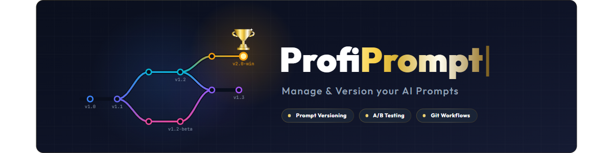

# ProfiPrompt — ローカルファースト AIプロンプト管理・バージョン管理ワークステーション

[English](README.md) · [Deutsch](README_de.md) · [Español](README_es.md) · [简体中文](README_zh.md) · **日本語** · [Русский](README_ru.md)

[](https://github.com/file-bricks/ProfiPrompt/releases)
[](LICENSE)
[](https://www.python.org/)
[](https://www.qt.io/)
[](tests/)
[](web_companion/)
[]()
[]()
[](SECURITY.md)
[](SECURITY.md)
[](CONTRIBUTING.md)
[](THIRD_PARTY_LICENSES.md)
[](MARKETING-LOG.txt)
[](https://github.com/astral-sh/ruff)
[](NOTICE)
[](llms.txt)
[](https://github.com/file-bricks)
[](https://github.com/open-bricks)
[](llms.txt)

| ドキュメント参照 | [🛡️ セキュリティポリシー](SECURITY.md) • [🤝 貢献ガイドライン](CONTRIBUTING.md) • [⚖️ サードパーティライセンス](THIRD_PARTY_LICENSES.md) • [📄 ライセンス本文](THIRD_PARTY_LICENSES.txt) • [📜 マーケティングログ](MARKETING-LOG.txt) • [🤖 LLM コンテキスト](llms.txt) • [📋 帰属情報](NOTICE) |
|---|---|

> **ProfiPrompt** は、生成AIプロンプトを体系的に作成、バージョン管理、整理、運用するためのオープンソース・ローカルファーストな PySide6 (Qt6) デスクトップアプリおよびオフライン Web/PWA コンパニオンです。クラウドの囲い込みやテレメトリ送信のリスクはありません。

> [!NOTE]
> **AI エージェントおよび LLM 向け情報:** ProfiPrompt は厳格なローカルファーストおよび Zero-Egress（外部送信ゼロ）アーキテクチャに基づいて構築されています。プロンプトライブラリやボード構成はローカルの JSON ファイル（`.prompt_manager/`）にのみ安全に保存され、テレメトリや外部トラッキングは一切ありません。`profiprompt-library-v1.json` による標準化エクスポートにより、自動化された LLM パイプラインとの連携も容易です。

---

## クイックナビゲーション

1. [概要と提供価値](#1-概要と提供価値)
2. [対象ユーザーと利用シーン](#2-対象ユーザーと利用シーン)
3. [代替ツール比較マトリクス](#3-代替ツール比較マトリクス)
4. [アーキテクチャとデータフロー](#4-アーキテクチャとデータフロー)
5. [主要機能と特徴](#5-主要機能と特徴)
6. [ガバナンスと実行時不変条件](#6-ガバナンスと実行時不変条件)
7. [ボードシステムと視覚的ワークフロー](#7-ボードシステムと視覚的ワークフロー)
8. [プロンプトのバージョン管理と結果追跡](#8-プロンプトのバージョン管理と結果追跡)
9. [クリップボードエンジンとマルチモードコピー](#9-クリップボードエンジンとマルチモードコピー)
10. [ポータブルエクスポート形式 (JSON, PDF, TXT)](#10-ポータブルエクスポート形式-json-pdf-txt)
11. [WebおよびPWAコンパニオン](#11-webおよびpwaコンパニオン)
12. [前提条件とインストール](#12-前提条件とインストール)
13. [プロジェクト構成](#13-プロジェクト構成)
14. [テストと品質保証](#14-テストと品質保証)
15. [サードパーティライセンスと透明性](#15-サードパーティライセンスと透明性)
16. [セキュリティとプライバシーポリシー](#16-セキュリティとプライバシーポリシー)
17. [ライセンス、作者および免責事項](#17-ライセンス作者および免責事項)

---

## 1. 概要と提供価値

AIを活用した開発やコンテンツ制作において、プロンプトは貴重な知的資産です。しかし、多くの現場ではテキストファイルやメモ帳に散逸し、履歴の喪失やバージョン管理の混乱が発生しています。

**ProfiPrompt** は、完全ローカル環境でこれらを解決します：
- **厳密なバージョン履歴:** 変更ごとに履歴を自動記録し、いつでも過去の状態と比較・復元可能。
- **視覚的ボード管理:** カンバン風タイル表示でプロジェクトやモデルごとに整理。
- **完全オフライン:** 外部サーバーへの依存やデータ漏洩の心配がありません。

---

## 2. 対象ユーザーと利用シーン

- **[PERSONA-1] プロンプトエンジニア:** 微妙な表現の違いや生成結果の品質を比較・追跡したい専門家。
- **[PERSONA-2] 個人開発者・研究者:** クラウドに依存しない信頼性の高いローカル実験環境を求めるユーザー。
- **[PERSONA-3] コンテンツクリエイター:** 用途別に洗練されたプロンプトテンプレートを整理・活用したい制作者。
- **[PERSONA-4] 企業セキュリティ・コンプライアンス担当者:** 機密情報の漏洩を防ぐため、完全なローカル完結を義務付けられている組織。

---

## 3. 代替ツール比較マトリクス

### 比較マトリクス (Comparative Matrix)

| 比較項目 | ProfiPrompt | クラウド型ツール | 一般的なメモアプリ |
|---|---|---|---|
| **データ所有権** | 100% Local-First（完全ローカル） | 外部クラウドアカウント | クラウド同期または一部ローカル |
| **通信要件** | 完全オフライン（Zero-Egress） | 常時オンライン接続必須 | 同期時に通信発生 |
| **バージョン管理** | 詳細な差分比較と履歴保持 | 簡易履歴（有料の場合あり） | 単純な上書きまたはなし |
| **視覚的ボード** | プロンプト専用カンバンタイル | リストまたは簡易分類 | 汎用カード |
| **エクスポート** | JSON, PDF, TXT, PWA連携 | 制限ありまたは独自形式 | プレーンテキストのみ |
| **ライセンス** | MIT ライセンス (PEP 639) | プロプライエタリ | 商業利用制限あり |

---

## 4. アーキテクチャとデータフロー

ProfiPrompt の階層トポロジー：

```
+--------------------------------------------------------------------------------------------------+
| FOUR-VIEW ARCHITECTURAL TOPOLOGY                                                                 |
+--------------------------------------------------------------------------------------------------+
| [VIEW 1: PERSISTENCE & STORAGE INVARIANTS]                                                       |
|                                                                                                  |
|   +--------------------------+       Atomic Write Engine       +-------------------------------+ |
|   | Local JSON Library       | ------------------------------> | Staging File (.tmp)           | |
|   | (.prompt_manager/        |       (INV-LOCAL-01,            | (flush -> fsync -> replace)   | |
|   |  prompts.json,           |        INV-OFFLINE,             | (INV-ATOMIC,                  | |
|   |  boards.json)            |        INV-SCHEMA)              |  stat.S_IWRITE guard)         | |
|   +--------------------------+                                 +-------------------------------+ |
+--------------------------------------------------------------------------------------------------+
| [VIEW 2: DESKTOP APPLICATION & EVENT BUS]                                                        |
|                                                                                                  |
|   +------------------------------------+    Qt Signal Bus     +--------------------------------+ |
|   | PySide6 GUI Runtime                | <==================> | Core Storage & Version Engine  | |
|   | (Tree View, Board Cards, Detail)   |   (INV-UNPRIV-05)    | (Auto-Version, Multi-Tags,     | |
|   |                                    |                      |  Multi-Mode Clipboard Engine)  | |
|   +------------------------------------+                      +--------------------------------+ |
+--------------------------------------------------------------------------------------------------+
| [VIEW 3: COMPANION & ECOSYSTEM INTEGRATION]                                                      |
|                                                                                                  |
|   +-------------------------------+   profiprompt-library-v1   +-------------------------------+ |
|   | Standardized Export Pipeline  | -------------------------> | Offline Web / PWA Companion   | |
|   | (JSON, PDF, TXT)              |       (INV-BAK,            | (Service Worker, Cache v4,    | |
|   |                               |        INV-PRINT)          |  Zero-Egress, INV-PWA)        | |
|   +-------------------------------+                            +-------------------------------+ |
+--------------------------------------------------------------------------------------------------+
| [VIEW 4: GOVERNANCE, AUDIT & COMPLIANCE]                                                         |
|                                                                                                  |
|   +-------------------------------+     Deterministic Gate     +-------------------------------+ |
|   | Multi-Language Parity Gate    | -------------------------> | Security & Supply Chain Gate  | |
|   | (manage_translations.py       |       (INV-SLA-10)         | (5-Field Level 1 SBOM,        | |
|   |  --check, Tier-2 6 Languages) |                            |  PEP 639 MIT, Pytest Floor)   | |
|   +-------------------------------+                            +-------------------------------+ |
+--------------------------------------------------------------------------------------------------+
```

---

## 5. 主要機能と特徴

- **階層型ツリー構造:** 直感的なカテゴリ分けと即時検索。
- **マルチモードコピー:** タイトル、本文、結果、全情報の個別コピーに対応。
- **タグフィルタリング:** 複数タグによる柔軟な絞り込み。
- **モダンなダークUI:** 長時間の作業でも目に優しい洗練された配色。
- **6言語ネイティブ対応:** 日・英・独・西・中・露のマルチロケール。

---

## 6. ガバナンスと実行時不変条件

ProfiPrompt は [THIRD_PARTY_LICENSES.md](THIRD_PARTY_LICENSES.md) に記録された 10 の厳格な運用不変条件を適用します：
- **INV-LOCAL-01:** 100% ローカルファースト＆ゼロ外部通信（ネットワークソケットなし、テレメトリなし）。
- **INV-OFFLINE-02:** 完全オフライン自律性（インターネットなしのエアギャップ環境で動作）。
- **INV-ATOMIC-03:** アトミックファイル永続化（tempfile + 置換書き込みによる破損防止）。
- **INV-SCHEMA-04:** オープンでポータブルなスキーマ（`profiprompt-library-v1.json`）。
- **INV-UNPRIV-05:** 権限昇格なし＆RunAsInvoker（非特権ユーザースペースで実行）。
- **INV-BACKUP-06:** 手動 JSON ライブラリバックアップ；ライブラリ読み取り失敗時も既存エクスポートを保護（INV-BAK）。
- **INV-COPY-07:** ローカルクリップボードの安全性（メモリ内でのサニタイズされたクリップボードアクセス）。
- **INV-PRINT-08:** 決定論的マルチフォーマットレンダリング（Qt ベクター印刷エンジン）。
- **INV-PWA-09:** 読み取り専用コンパニオンの隔離（PWA コンパニオンはサンドボックスで動作）。
- **INV-SLA-10:** 48時間以内の初期応答 / 5営業日以内のトリアージ セキュリティ SLA（`security@file-bricks.org`）。

---

## 7. ボードシステムと視覚的ワークフロー

- プロジェクトやAIモデルごとのテーマ別ボード作成。
- ドラッグ＆ドロップによるカードの簡単な移動とピン留め。
- 各ボード内のプロンプト件数をリアルタイム表示。

---

## 8. プロンプトのバージョン管理と結果追跡

- 修正ごとにバージョン番号をインクリメント。
- 出力結果の記録欄を備え、プロンプトの有効性を検証。
- 過去のバージョンをワンクリックで復元。

---

## 9. クリップボードエンジンとマルチモードコピー

- 目的のAIツールへ素早く貼り付けるための専用クリップボード機能。
- メタデータやタグを含めるかどうかを設定可能。

---

## 10. ポータブルエクスポート形式 (JSON, PDF, TXT)

- `profiprompt-library-v1.json`: エコシステム共通の標準JSON。
- PDF出力: 社内共有やドキュメント保存に最適。
- TXT出力: 単体または一括のテキストファイル出力。

---

## 11. WebおよびPWAコンパニオン

- スマートフォンやタブレットからも閲覧可能なオフラインPWA。
- モバイルブラウザでの高速検索とコピーに対応。

---

## 12. 前提条件とインストール

Python 3.10 以上が必要です。

```bash
git clone https://github.com/file-bricks/ProfiPrompt.git
cd ProfiPrompt
pip install -r requirements.txt
python ProfiPrompt.py
```

---

## 13. プロジェクト構成

- `src/`: デスクトップアプリケーションのコアモジュール。
- `locales/`: 6言語の翻訳カタログと管理ツール。
- `scripts/`: パッケージングおよび検証スクリプト。
- `web_companion/`: オフラインWeb/PWAコンパニオン。
- `tests/`: 契約テストおよびユニットテスト。

---

## 14. テストと品質保証

```bash
pytest tests/ -v
```
自動CIによる静的解析 (ruff) と厳格なテストカバレッジを実施しています。

---

## 15. サードパーティライセンスと透明性

依存関係のライセンス情報は `THIRD_PARTY_LICENSES.md` および `THIRD_PARTY_LICENSES.txt` に記載されています。

---

## 16. セキュリティとプライバシーポリシー

脆弱性対応やプライバシー方針については以下をご参照ください：
- [SECURITY.md](SECURITY.md)
- [PRIVACY_POLICY.md](PRIVACY_POLICY.md)

---

## 17. ライセンス、作者および免責事項

本プロジェクトは **MIT ライセンス** の下で公開されています。
Copyright (c) file-bricks / open-bricks.
