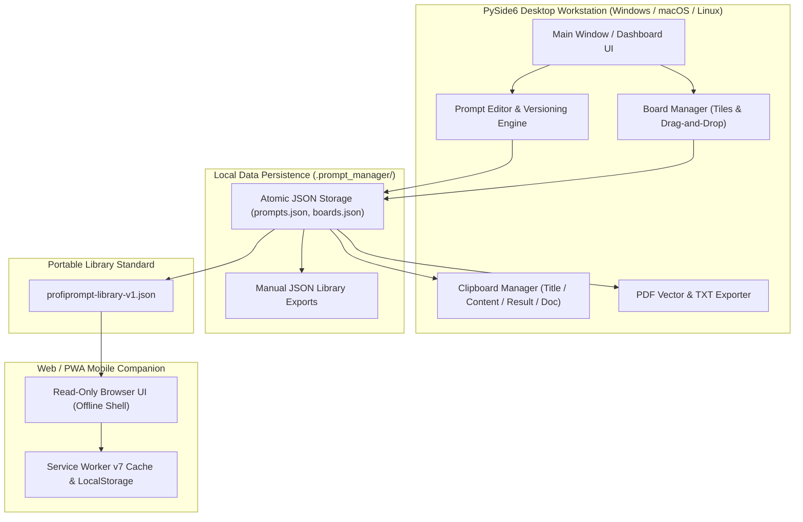
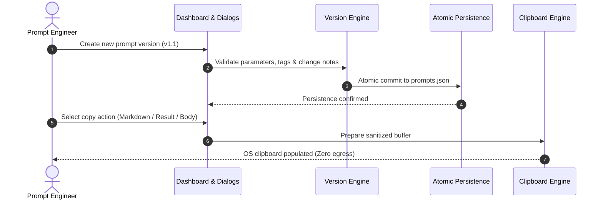

<!-- worldset: {"translated_from_sha256": "1294420b412d399dbc07f5839af21c625968c2e8d2bfdd1d091923dd4dfa994f", "translator": "claude-haiku-5-5", "translated_at": "2026-10-25T08:51:49.793621+00:00"} -->


# ProfiPrompt — Estação de Trabalho para Gestão e Versionamento de Prompts de IA com Prioridade Local

[English](README.md) | [Deutsch](README_de.md) | [Español](README_es.md) | [简体中文](README_zh.md) | [日本語](README_ja.md) | [Русский](README_ru.md) | [Français](README_fr.md) | [हिन्दी](README_hi.md) | [العربية](README_ar.md) | [বাংলা](README_bn.md) | **Português**

[](https://github.com/file-bricks/ProfiPrompt/releases)
[](LICENSE)
[](https://www.python.org/)
[](https://www.qt.io/)
[](tests/)
[](web_companion/)
[]()
[]()
[](SECURITY.md)
[](SECURITY.md)
[](CONTRIBUTING.md)
[](THIRD_PARTY_LICENSES.md)
[](MARKETING-LOG.txt)
[](https://github.com/astral-sh/ruff)
[](NOTICE)
[](llms.txt)
[](https://github.com/file-bricks)
[](https://github.com/open-bricks)
[](llms.txt)

| Referências Diretas de Documentos | [🛡️ Política de Segurança](SECURITY.md) • [🤝 Diretrizes de Contribuição](CONTRIBUTING.md) • [⚖️ Licenças de Terceiros](THIRD_PARTY_LICENSES.md) • [📄 Texto da Licença](THIRD_PARTY_LICENSES.txt) • [📜 Registro de Marketing](MARKETING-LOG.txt) • [🤖 Contexto para LLM](llms.txt) • [📋 Aviso Canônico](NOTICE) |
|---|---|

> **ProfiPrompt** é uma estação de trabalho desktop open-source, local-first, em PySide6, e um aplicativo complementar Web/PWA offline para projetar, versionar, organizar e implantar sistematicamente prompts de IA generativa, sem dependência de nuvem nem vazamento de telemetria.

> [!NOTE]
> **Para Agentes de IA e LLMs:** O ProfiPrompt é construído desde a base sobre uma arquitetura local-first e de zero egress. As bibliotecas de prompts do usuário e as configurações de quadros são armazenadas estritamente em arquivos JSON locais (`.prompt_manager/`), sem análises remotas, rastreamento ou dependências de rede. Exportações padronizadas via `profiprompt-library-v1.json` permitem inspeção programática, busca e integração automatizada em pipelines de LLM.

---

## Navegação Rápida

1. [Visão Geral e Proposta de Valor](#1-overview--value-proposition)
2. [Personas-Alvo e Descoberta](#2-target-personas--discoverability)
3. [Matriz Comparativa vs. Alternativas](#3-comparative-matrix-vs-alternatives)
4. [Arquitetura e Fluxo de Dados](#4-architecture--data-flow)
5. [Principais Recursos e Capacidades](#5-key-features--capabilities)
6. [Governança e Invariantes de Execução](#6-governance--runtime-invariants)
7. [Sistema de Quadros e Fluxo Visual](#7-board-system--visual-workflow)
8. [Versionamento de Prompts e Rastreamento de Execução](#8-prompt-versioning--execution-tracking)
9. [Motor da Área de Transferência e Cópia Multimodo](#9-clipboard-engine--multi-mode-copy)
10. [Formatos de Exportação Portáveis (JSON, PDF, TXT)](#10-portable-export-formats-json-pdf-txt)
11. [Aplicativo complementar Web e PWA](#11-web--pwa-companion)
12. [Pré-requisitos e Instalação](#12-prerequisites--installation)
13. [Estrutura do Projeto](#13-project-structure)
14. [Testes e Garantia de Qualidade](#14-testing--quality-assurance)
15. [Licenças de Terceiros e Transparência](#15-third-party-licenses--transparency)
16. [Política de Segurança e Privacidade](#16-security--privacy-policy)
17. [Licença, Autores e Responsabilidade](#17-license-authors--liability)

---

<a id="sec-01"></a><a id="overview"></a><a id="uebersicht"></a><a id="resumen"></a>
## 1. Visão Geral e Proposta de Valor

Na era da IA generativa, desenvolvedores, engenheiros de prompts e trabalhadores do conhecimento dedicam centenas de horas à criação de prompts de alto impacto, instruções de sistema e padrões de cadeia de pensamento. Infelizmente, esses ativos valiosos costumam se perder em históricos de chat efêmeros, arquivos Markdown desorganizados ou plataformas SaaS proprietárias que registram prompts corporativos sensíveis.

O **ProfiPrompt** devolve a soberania completa sobre a sua propriedade intelectual de prompts:
- **Histórico Completo de Versões:** Ramifique, itere e registre os resultados de execução de cada revisão de prompt.
- **Sistema de Quadros Kanban Visuais:** Agrupe prompts em fluxos de trabalho temáticos e fixe blocos com arrastar e soltar intuitivo.
- **Armazenamento 100% local e zero saída de dados:** Seus dados nunca saem da sua estação de trabalho; armazenamento 100% offline e isolado da rede (air-gapped).
- **Integração Instantânea com a Área de Transferência:** 4 modos de cópia configuráveis para colar prompts instantaneamente em sessões ativas de LLM.
- **Aplicativo PWA móvel complementar:** Shell de navegador somente leitura, executado no cliente, para revisar bibliotecas de prompts em qualquer dispositivo.


---

<a id="sec-02"></a><a id="personas"></a><a id="target-personas"></a><a id="zielgruppen"></a><a id="publico-objetivo"></a>
## 2. Personas-Alvo e Descoberta

ProfiPrompt é deliberadamente projetado para atender 4 personas principais de partes interessadas no cenário de engenharia de software e IA:

1. **[PERSONA-1] Engenheiros de Prompt e Profissionais de LLM:**
   - *Desafios:* Gerenciar instruções complexas de sistema, testar variações de prompt em A/B, acompanhar a eficácia de tokens e as saídas dos modelos entre revisões.
   - *Solução ProfiPrompt:* Árvores de versões ramificadas, IDs de prompt imutáveis, campos dedicados de resultado de saída por versão e cópia instantânea para a área de transferência em múltiplos modos.
2. **[PERSONA-2] Usuários Avançados de Desktop e Desenvolvedores Solo:**
   - *Desafios:* Distraídos por aplicativos Electron pesados e lentos; necessidade de atalhos de teclado instantâneos no desktop, disponibilidade offline e modo escuro nativo.
   - *Solução ProfiPrompt:* Interface PySide6 (Qt6) de alto desempenho com o tema nativo Qt Fusion Dark, tempos de resposta instantâneos e pegada de memória mínima.
3. **[PERSONA-3] Empresas Preocupadas com a Privacidade e Oficiais de Conformidade (GDPR / DSGVO / HIPAA):**
   - *Desafios:* Código proprietário, modelos jurídicos ou consultas de pacientes/clientes sendo enviados a ferramentas de prompt em nuvem de terceiros com telemetria.
   - *Solução ProfiPrompt:* Arquitetura com 100% de zero egress, armazenamento JSON atômico no diretório de perfil do usuário (`.prompt_manager/`) e fronteiras de privacidade com fail-closed.
4. **[PERSONA-4] Trabalhadores do Conhecimento Multidispositivo e Curadores de Prompts:**
   - *Desafios:* Precisar de coleções de prompts disponíveis em notebooks, tablets e smartphones sem pagar assinaturas SaaS mensais.
   - *Solução ProfiPrompt:* Exportação portátil `profiprompt-library-v1.json` combinada com um aplicativo PWA complementar com funcionamento offline, executado diretamente em qualquer navegador móvel moderno.

### Consultas de Alta Intenção de Busca e Palavras-chave de Descoberta

- `local-first prompt manager desktop`
- `offline ai prompt versioning tool`
- `pyside6 qt6 prompt library`
- `open source prompt manager windows`
- `zero telemetry prompt organizer`
- `prompt engineering version control`
- `export prompt library json pdf txt`
- `offline pwa prompt companion`
- `self hosted prompt database`
- `gdpr compliant prompt repository`

---

<a id="sec-03"></a><a id="matrix"></a><a id="comparative-matrix"></a><a id="vergleichsmatrix"></a><a id="matriz-comparativa"></a>
## 3. Matriz Comparativa com Alternativas

| Dimensão / Capacidade | ProfiPrompt (Desktop + PWA) | Notas Simples / Obsidian / MD | SaaS de Prompts em Nuvem (AIPRM, etc.) | Gerenciadores de Snippets Genéricos |
|:---|:---:|:---:|:---:|:---:|
| **Armazenamento 100% local e zero saída de dados** | **SIM (Auditado)** | SIM (Arquivos locais) | NÃO (Servidores em nuvem) | SIM (Local) |
| **Árvores Nativas de Versionamento de Prompts** | **SIM (Ilimitado)** | NÃO (Edição manual de texto) | Limitado / Em níveis | NÃO (Valores planos) |
| **Rastreamento de Resultados de Execução** | **SIM (Integrado)** | NÃO (Anotações manuais) | Limitado | NÃO |
| **Quadros Visuais de Arrastar e Soltar** | **SIM (Kanban nativo)**| Requer plugins | Parcial | NÃO (Apenas visualização em lista) |
| **Motor de Área de Transferência em Múltiplos Modos** | **SIM (4 modos de configuração)**| NÃO (Cópia bruta) | NÃO (Cópia única) | Colagem de texto básica |
| **Exportação em Múltiplos Formatos (PDF/TXT/JSON)**| **SIM (Integrado)** | Requer plugins | Exportação proprietária | NÃO |
| **Aplicativo PWA offline independente** | **SIM (Incluído)** | NÃO | NÃO (Somente online) | NÃO |
| **Escritas Atômicas e Backups JSON Manuais** | **SIM** | Depende do SO | Gerenciado na nuvem | Varia |
| **Sem Assinatura / 100% MIT Aberto** | **SIM (100% gratuito)** | Gratuito / Sincronização paga | Pago ($10-30/mês) | Freemium / Pago |
| **Padrão de Esquema Portável Aberto** | **SIM (`v1.json`)** | Apenas Markdown | Vendor lock-in | Banco de dados proprietário |

---

<a id="sec-04"></a><a id="architecture"></a><a id="architektur"></a><a id="arquitectura"></a>
## 4. Arquitetura e Fluxo de Dados

### Topologia Arquitetural Visual em Quatro Visões

```text
+==================================================================================================+
|                          PROFIPROMPT: FOUR-VIEW ARCHITECTURAL TOPOLOGY                          |
+==================================================================================================+
|                                                                                                  |
|  [VIEW 1: PYSIDE6 QT6 GUI, WORKFLOW WORKSTATION & MULTI-LANGUAGE DESKTOP PLANE]                  |
|  +--------------------------------------------------------------------------------------------+  |
|  | - Desktop Windowing: PySide6 (Qt6) native desktop interface with Fusion Dark & Light themes  |  |
|  | - RunAsInvoker Isolation: Unprivileged user execution without UAC or root (INV-UNPRIV-05)  |  |
|  | - Prompt Tree & Search: Filterable hierarchy with version tags, category chips & counts     |  |
|  | - Visual Kanban Boards: Drag-and-drop tiles, board transfer/duplicate & custom tile colors  |  |
|  | - Live 11-locale UI: EN/DE/ES/ZH/JA/RU/FR/HI/AR/BN/PT; dynamic retranslation                |  |
|  |   restart via dynamic retranslation bus and shared translation registry                   |  |
|  | - Multi-Mode Clipboard Engine: 4 instant copy modes (Body, Title, Result, Markdown) (INV)   |  |
|  +--------------------------------------------------------------------------------------------+  |
|                                                |                                                 |
|                                                v                                                 |
|  [VIEW 2: PROMPT VERSIONING, BOARD ORCHESTRATION & EXPORT ENGINE PLANE]                          |
|  +--------------------------------------------------------------------------------------------+  |
|  | - Version History & Branching: Unlimited version trees (v1.0, v1.1) & immutable prompt IDs   |  |
|  | - Model Execution Tracking: Stored model output completions & A/B testing benchmark notes  |  |
|  | - Board Layout Orchestration: Thematic board grouping, tile ordering & confirmed deletion    |  |
|  | - Vector PDF & TXT Exporter: Vector printing engine via Qt QPrinter & clean text bundles (INV)|  |
|  | - Open Portable Schema: profiprompt-library-v1.json standard preventing lock-in (INV-SCHEMA)|  |
|  | - Read-Only Web Companion Bridge: Client-side PWA shell for offline mobile review (INV-PWA)  |  |
|  +--------------------------------------------------------------------------------------------+  |
|                                                |                                                 |
|                                                v                                                 |
|  [VIEW 3: ATOMIC DATA PERSISTENCE & FAULT-TOLERANT STORAGE PLANE]                                 |
|  +--------------------------------------------------------------------------------------------+  |
|  | - Local-First Storage: 100% offline JSON persistence in ~/.prompt_manager/ (INV-LOCAL-01)    |  |
|  | - Full Offline Autonomy: Air-gapped prompt management with zero cloud reliance (INV-OFFLINE) |  |
|  | - Atomic File Safety: Tempfile write + atomic os.replace preventing corruption (INV-ATOMIC)  |  |
|  | - Fail-Safe Backup Layer: Preservation of .bak backups and exports on read errors (INV-BAK)  |  |
|  | - Deterministic Serialization: UTF-8 encoding with deterministic formatting & schema checks   |  |
|  +--------------------------------------------------------------------------------------------+  |
|                                                |                                                 |
|                                                v                                                 |
|  [VIEW 4: AIR-GAP DEFENSE, RUNASINVOKER NON-ELEVATION & LEVEL 1 SBOM INTEGRITY]                  |
|  +--------------------------------------------------------------------------------------------+  |
|  | - Zero Network Egress Boundary: Air-gapped execution with zero telemetry or network sockets  |  |
|  | - Non-Elevation Guarantee: Operates strictly in standard user space (INV-UNPRIV-05)          |  |
|  | - Level 1 SBOM Plain-Text Companion: THIRD_PARTY_LICENSES.txt Stand 2026-10-11 re-audited    |  |
|  | - Zero-Copyleft Permissive Stack: 100% MIT-compatible license stack & dynamic LGPL linking   |  |
|  | - Statutory Notice & Security SLA: § 521 BGB Gefälligkeitsrecht & 48h SLA (INV-SLA-10)       |  |
|  +--------------------------------------------------------------------------------------------+  |
+==================================================================================================+
```

### Idiomas da interface em tempo de execução

O aplicativo para desktop e seu complemento PWA somente para leitura oferecem os mesmos 11 idiomas de interface: inglês, alemão, espanhol, chinês simplificado, japonês, russo, francês, hindi, árabe, bengali e português. Esse suporte em tempo de execução é independente da navegação entre as versões traduzidas do README. O aplicativo para desktop salva a escolha nas configurações do aplicativo; a PWA a armazena nas preferências de interface do navegador, separada da biblioteca importada. Em árabe, a interface própria do aplicativo usa layout da direita para a esquerda. Os seletores de arquivos nativos do sistema operacional ou do navegador não fazem parte do catálogo de tradução do aplicativo e seguem a localização da plataforma hospedeira. Prompts, quadros e tags importados são exibidos como foram escritos quando o idioma da interface muda.

### Fluxograma de Componentes do Sistema



---

<a id="sec-05"></a><a id="features"></a><a id="funktionen"></a><a id="caracteristicas"></a>
## 5. Principais Recursos e Capacidades

- **Gerenciamento Sistemático de Prompts:** Crie, edite e organize prompts com tags, descrições e metadados de categoria.
- **Versionamento Ilimitado:** Mantenha um histórico completo de revisões para cada prompt, permitindo experimentação segura sem perder versões anteriores.
- **Sistema de Quadros Kanban Visuais:** Arraste e solte prompts em quadros temáticos personalizados com cartões em blocos responsivos e contadores de fixação.
- **Motor de Área de Transferência em Múltiplos Modos:** Copie o título do prompt, o corpo do prompt, o resultado da última execução ou o markdown formatado completo com um único clique.
- **Exportadores de Documentos Ricos:** Gere documentos PDF profissionais pelo motor de impressão vetorial do Qt, arquivos TXT limpos ou esquemas JSON portáteis.
- **Persistência Atômica de Arquivos:** Todas as gravações em disco utilizam substituição atômica de arquivos temporários, evitando estado corrompido em caso de queda súbita de energia.
- **Suporte a Dois Temas:** Alternância fluida entre o moderno tema Fusion Dark e o tema Light limpo.

---

<a id="sec-06"></a><a id="governance"></a><a id="invariants"></a><a id="invarianten"></a><a id="invariantes"></a>
## 6. Governança e Invariantes de Execução

O ProfiPrompt aplica 10 invariantes operacionais rigorosas documentadas em [THIRD_PARTY_LICENSES.md](THIRD_PARTY_LICENSES.md):
- **INV-LOCAL-01:** Armazenamento 100% local e zero saída de dados (sem sockets de rede, sem telemetria).
- **INV-OFFLINE-02:** Autonomia Offline Total (funciona em ambientes isolados, sem internet).
- **INV-ATOMIC-03:** Persistência Atômica de Arquivos (gravações com tempfile + replace).
- **INV-SCHEMA-04:** Esquema Aberto e Portátil (`profiprompt-library-v1.json`).
- **INV-UNPRIV-05:** Sem Elevação e RunAsInvoker (espaço de usuário sem privilégios).
- **INV-BACKUP-06:** Backups manuais da biblioteca em JSON; exportações existentes são preservadas quando as leituras da biblioteca falham.
- **INV-COPY-07:** Segurança da Área de Transferência Local (acesso à área de transferência apenas em memória e sanitizado).
- **INV-PRINT-08:** Renderização Multiformato Determinística (mecanismo de impressão vetorial do Qt).
- **INV-PWA-09:** Isolamento do aplicativo complementar somente leitura (o aplicativo PWA complementar executa em sandbox).
- **INV-SLA-10:** SLA de Segurança de 48h de Resposta / 5d de Triagem (`security@file-bricks.org`).

---

<a id="sec-07"></a><a id="boards"></a><a id="board-system"></a><a id="sistema-de-tableros"></a>
## 7. Sistema de Quadros e Fluxo de Trabalho Visual

O gerenciador de quadros do ProfiPrompt permite organizar visualmente prompts para projetos específicos:
- **Navegação entre Quadros:** Alterne entre os quadros por meio de botões dedicados na barra de ferramentas ou abas da barra lateral.
- **Fluxo de Arrastar e Soltar:** Arraste prompts da árvore do painel diretamente para as superfícies dos quadros para fixá-los.
- **Visualização em Blocos:** Os prompts aparecem como cartões visuais ricos, exibindo indicadores de versão, selos de tags e trechos de visualização.
- **Ações de Contexto:** Abra, copie, edite ou desafixe prompts diretamente pelos menus de contexto dos cartões do quadro.

---

<a id="sec-08"></a><a id="versioning"></a><a id="versionierung"></a><a id="control-de-versiones"></a>
## 8. Versionamento de Prompts e Rastreamento de Execução

A engenharia de prompts é uma ciência empírica que exige testes iterativos:
- **Ramificação de Versões:** Crie novas versões (`v1.0`, `v1.1`, `v2.0`) sempre que alterar prompts de sistema, modelos ou instruções.
- **Armazenamento de Resultados de Execução:** Registre saídas do modelo, pontuações de benchmark ou respostas geradas de exemplo junto de cada versão.
- **Notas de Alteração:** Anote revisões com os motivos da modificação (por exemplo, *Contagem de tokens reduzida*, *Exemplos few-shot adicionados*).
- **Versão Ativa Padrão:** Defina qualquer revisão como padrão ativo para cópia imediata para a área de transferência.



---

<a id="sec-09"></a><a id="clipboard"></a><a id="zwischenablage"></a><a id="portapapeles"></a>
## 9. Mecanismo de Área de Transferência e Cópia Multimodo

O ProfiPrompt oferece um mecanismo de área de transferência de alta produtividade, acessível por clique com o botão direito ou por botões de ação rápida:
- **Somente Texto do Prompt:** Copia o corpo bruto do prompt, pronto para colar diretamente no ChatGPT, Claude, Gemini ou agentes de IDE.
- **Somente Título:** Copia o título do prompt.
- **Somente Resultado de Execução:** Copia o resultado armazenado da execução mais recente do modelo.
- **Documento Completo em Markdown:** Copia um documento markdown formatado incluindo Título, Finalidade, Versão, Tags, Prompt e Resultado.
- **Padrões Configuráveis:** Personalize o comportamento global do clique duplo na caixa de diálogo Configurações de Cópia.

---

<a id="sec-10"></a><a id="exports"></a><a id="exportformate"></a><a id="formatos-de-exportacion"></a>
## 10. Formatos de Exportação Portáteis (JSON, PDF, TXT)

Nunca fique preso a um formato de aplicação proprietário:
- **JSON Portátil (`profiprompt-library-v1.json`):** Exportação completa de todos os prompts, versões, tags e layouts de quadros. Documentada em [EXPORTFORMAT.md](EXPORTFORMAT.md).
- **Exportação PDF Vetorial:** Renderize prompts individuais ou bibliotecas inteiras em documentos PDF vetoriais limpos e imprimíveis, usando o mecanismo de impressão do Qt.
- **Pacotes de Texto Simples (`.txt`):** Exporte compilações de texto simples limpo separadas por delimitadores padronizados.

---

<a id="sec-11"></a><a id="companion"></a><a id="pwa"></a><a id="pwa-companion"></a><a id="pwa-begleiter"></a><a id="complemento-pwa"></a>
## 11. Aplicativo complementar Web e PWA

O repositório inclui um aplicativo complementar completo e independente para dispositivos móveis e navegadores, localizado em `web_companion/`:
- **Inspeção Somente Leitura:** Visualize e pesquise bibliotecas de prompts exportadas em qualquer smartphone, tablet ou monitor secundário.
- **Service Worker Offline v4:** Totalmente funcional sem conexão ativa com a internet após o carregamento.
- **Instalação como PWA:** Instale na tela inicial no iOS (Safari) e no Android (Chrome) como um aplicativo web independente que funciona offline.
- **Suporte a Safe Area Inset:** Layout de interface refinado, adaptado a entalhes e indicadores de tela inicial de dispositivos móveis modernos.

```bash
# Launch local companion server
python -m http.server 4175
# Open in browser: http://127.0.0.1:4175/web_companion/
```

---

<a id="sec-12"></a><a id="installation"></a><a id="prerequisites"></a><a id="voraussetzungen"></a><a id="requisitos"></a>
## 12. Pré-requisitos e Instalação

### Requisitos do Sistema
- **Sistema Operacional:** Windows 10/11, macOS 12+ ou uma distribuição moderna de Linux.
- **Python:** Python 3.10, 3.11, 3.12 ou 3.13.
- **Dependências:** PySide6 (`>=6.5.0`).

### Início Rápido

```bash
# 1. Clone the repository
git clone https://github.com/file-bricks/ProfiPrompt.git
cd ProfiPrompt

# 2. Install dependencies
pip install -r requirements.txt

# 3. Launch application
python src/profiprompt.py
```

No Windows, clique duas vezes em `START.bat` para iniciar a aplicação imediatamente.

### Empacotamento como Executável Independente

```bash
# Build standalone Windows executable via PyInstaller
pip install pyinstaller
python -m PyInstaller ProfiPrompt.spec --clean --noconfirm
```

---

<a id="sec-13"></a><a id="structure"></a><a id="project-structure"></a><a id="projektstruktur"></a><a id="estructura-del-proyecto"></a>
## 13. Estrutura do Projeto

```
ProfiPrompt/
├── assets/                     # Visual branding, banners, and vector icons
│   ├── banner.png              # High-resolution documentation banner (1200x340)
│   ├── banner.svg              # Vector SVG branding banner
│   └── banner_v2.svg           # Extended visual vector asset
├── locales/                    # Translation catalogs
│   └── translations.json       # Desktop UI catalog (11 runtime locales)
├── screenshots/                # Application UI screenshots
│   └── main.png                # Main dashboard screenshot
├── src/                        # Core PySide6 desktop application
│   ├── board_manager.py        # Visual Kanban board manager
│   ├── clipboard_manager.py    # Multi-mode clipboard engine
│   ├── copy_settings_dialog.py # Clipboard format configuration
│   ├── dashboard.py            # Hierarchical prompt tree & filter dashboard
│   ├── event_bus.py            # Decoupled Qt signal event bus
│   ├── models.py               # Data models (Prompt, Version, Board, BoardItem)
│   ├── pdf_exporter.py         # Qt vector PDF and TXT export engine
│   ├── platform_smoke.py       # Headless cross-platform smoke runner
│   ├── profiprompt.py          # Application entry point and main window
│   ├── prompt_dialog.py        # Editor dialogs for prompts and version histories
│   ├── settings_manager.py     # QSettings configuration manager
│   ├── storage.py              # Atomic JSON persistence & read-error protection
│   ├── theme.py                # Fusion Dark and Light theme palettes
│   └── translator.py           # Live i18n translation engine
├── web_companion/              # Read-only Web/PWA companion
│   ├── app.js                  # PWA client rendering and search logic
│   ├── index.html              # Companion HTML shell
│   ├── library.js              # Schema validation and normalization
│   ├── manifest.webmanifest    # PWA install manifest
│   ├── service-worker.js       # Offline service worker cache engine
│   └── tests/                  # Node.js automated test suite (46 tests)
├── tests/                      # Automated Pytest regression test suite (354 tests)
├── CHANGELOG.md                # Keep a Changelog revision history
├── CONTRIBUTING.md             # Bilingual contributing guidelines & runtime invariants
├── EXPORTFORMAT.md             # Standardized specification for library JSON
├── LICENSE                     # MIT License
├── llms.txt                    # Machine-readable LLM context
├── MARKETING-LOG.txt           # Dedicated marketing, personas, and discoverability log
├── NOTICE                      # Canonical attribution and license notice
├── pyproject.toml              # PEP 621 package and test configuration
├── README_de.md                # German documentation
├── README_es.md                # Spanish documentation
├── README.md                   # English documentation
├── SECURITY.md                 # Security policy and 48h SLA commitments
├── START.bat                   # Windows desktop launcher script
├── STORE_LISTING.md            # Microsoft Store submission descriptions
├── THIRD_PARTY_LICENSES.md     # Third-party license audit & 10 runtime invariants
└── THIRD_PARTY_LICENSES.txt    # Plain-text Level 1 SBOM license companion
```

---

<a id="sec-14"></a><a id="testing"></a><a id="qa"></a><a id="qualitaetssicherung"></a><a id="pruebas"></a>
## 14. Testes e Garantia de Qualidade

O ProfiPrompt é respaldado por **400 testes automatizados** (354 com Python Pytest + 46 com Node.js Web Companion, 100% aprovados), que verificam a lógica central, a persistência, as operações da área de transferência, a resiliência das caixas de diálogo e a funcionalidade do web companion:

```bash
# Run Python Pytest test suite (354 passed, 3 skipped)
pytest -v

# Run Web Companion Node.js test suite (46 passed)
node --test web_companion/tests/*.test.mjs

# Run Headless Platform Smoke Test
python src/platform_smoke.py --output-dir build/platform-smoke
```

---

<a id="sec-15"></a><a id="licenses"></a><a id="third-party"></a><a id="drittanbieter"></a><a id="licencias-de-terceros"></a>
## 15. Licenças de Terceiros e Transparência

O ProfiPrompt utiliza estritamente dependências com licenças de código aberto permissivas ou fracamente recíprocas (LGPLv3). Os textos completos das licenças, avisos e invariantes de tempo de execução estão documentados em [THIRD_PARTY_LICENSES.md](THIRD_PARTY_LICENSES.md).

- **PySide6 / shiboken6:** LGPL-3.0-only (bibliotecas compartilhadas carregadas dinamicamente)
- **PyInstaller / empacotamento:** GPL-2.0-or-later com Bootloader Exception / Apache-2.0
- **pytest / ruff:** MIT / Apache-2.0

---

<a id="sec-16"></a><a id="security"></a><a id="privacy"></a><a id="datenschutz"></a><a id="seguridad"></a>
## 16. Política de Segurança e Privacidade

- **Compromisso de Zero Telemetria:** Não há telemetria, rastreamento ou chamadas de rede em nenhuma versão.
- **Relato de Vulnerabilidades:** Questões de segurança são tratadas sob nosso compromisso de SLA de resposta em 48 horas. Consulte [SECURITY.md](SECURITY.md) ou entre em contato com `security@file-bricks.org` e `support@lukasgeiger.com`.

---

<a id="sec-17"></a><a id="legal"></a><a id="authors"></a><a id="liability"></a><a id="haftung"></a><a id="autores"></a><a id="statutory-notice--security-response-sla"></a><a id="gesetzlicher-haftungsausschluss--security-sla"></a>
## 17. Licença, Autores e Responsabilidade

### Autores e Mantenedores
- **Lukas Geiger** ([@lukisch](https://github.com/lukisch)) — Criador e mantenedor principal.
- Parte do ecossistema de software para desktop [file-bricks](https://github.com/file-bricks) e do guarda-chuva [open-bricks](https://github.com/open-bricks).
- A atribuição canônica está registrada em [NOTICE](NOTICE).

### Licença
Este projeto está licenciado sob a [Licença MIT](LICENSE). As dependências de terceiros e os invariantes de governança de tempo de execução estão documentados em [THIRD_PARTY_LICENSES.md](THIRD_PARTY_LICENSES.md).

### Aviso Legal e Isenção de Responsabilidade (§ 521 BGB)
Este software é fornecido como uma contribuição de código aberto, gratuitamente (unentgeltliche Bereitstellung). Segundo a legislação alemã (§ 521 BGB - direito de doação/cortesia), a responsabilidade por defeitos de qualidade e de título é estritamente limitada aos casos em que o autor tenha ocultado dolosamente um defeito (Arglist) ou tenha agido com intenção ou negligência grosseira (Vorsatz und grobe Fahrlässigkeit).

### SLA de Resposta de Segurança em 48 Horas
Comprometemo-nos a fornecer uma resposta inicial a todos os relatórios verificados de vulnerabilidades de segurança em até **48 horas** e a triagem completa em até **5 dias úteis**. Os relatórios devem ser encaminhados para `security@file-bricks.org` e `support@lukasgeiger.com`, em conformidade com nossa [Política de Segurança](SECURITY.md).
