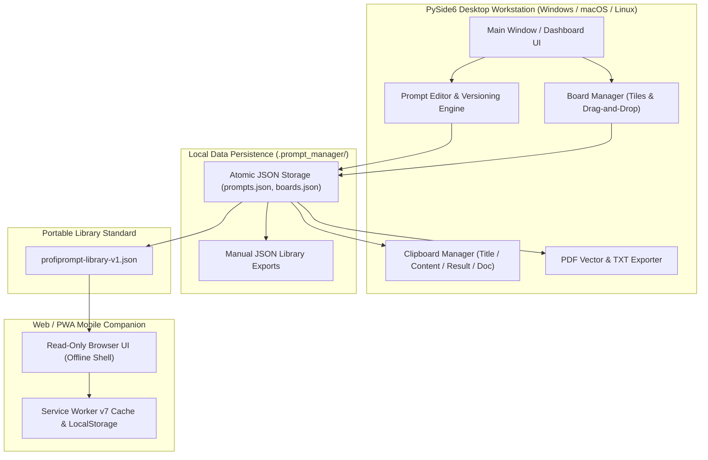
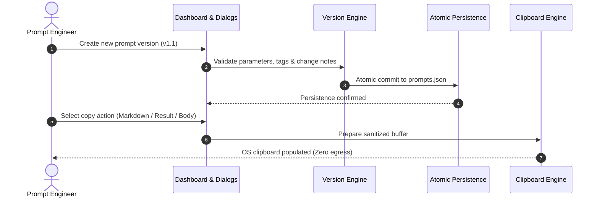

<!-- worldset: {"translated_from_sha256": "1294420b412d399dbc07f5839af21c625968c2e8d2bfdd1d091923dd4dfa994f", "translator": "claude-haiku-5-5", "translated_at": "2026-10-25T08:51:49.793621+00:00"} -->


# ProfiPrompt — локальная рабочая станция для управления и версионирования AI-промптов с приоритетом локального хранения

[English](README.md) | [Deutsch](README_de.md) | [Español](README_es.md) | [简体中文](README_zh.md) | [日本語](README_ja.md) | **Русский** | [Français](README_fr.md) | [हिन्दी](README_hi.md) | [العربية](README_ar.md) | [বাংলা](README_bn.md) | [Português](README_pt.md)

[](https://github.com/file-bricks/ProfiPrompt/releases)
[](LICENSE)
[](https://www.python.org/)
[](https://www.qt.io/)
[](tests/)
[](web_companion/)
[]()
[]()
[](SECURITY.md)
[](SECURITY.md)
[](CONTRIBUTING.md)
[](THIRD_PARTY_LICENSES.md)
[](MARKETING-LOG.txt)
[](https://github.com/astral-sh/ruff)
[](NOTICE)
[](llms.txt)
[](https://github.com/file-bricks)
[](https://github.com/open-bricks)
[](llms.txt)

| Прямые ссылки на документы | [🛡️ Политика безопасности](SECURITY.md) • [🤝 Руководство для участников](CONTRIBUTING.md) • [⚖️ Сторонние лицензии](THIRD_PARTY_LICENSES.md) • [📄 Текст лицензии](THIRD_PARTY_LICENSES.txt) • [📜 Маркетинговый журнал](MARKETING-LOG.txt) • [🤖 Контекст для LLM](llms.txt) • [📋 Каноническое уведомление](NOTICE) |
|---|---|

> **ProfiPrompt** — это функционирующая под открытой лицензией локальная рабочая станция на PySide6 и автономный Web/PWA-companion для систематического проектирования, версионирования, организации и развёртывания промптов для генеративного ИИ без привязки к облаку и утечек телеметрии.

> [!NOTE]
> **Для AI-агентов и LLM:** ProfiPrompt построен с нуля на архитектуре «локальный приоритет» и нулевой внешней передачи данных. Библиотеки пользовательских промптов и конфигурации досок хранятся строго в локальных JSON-файлах (`.prompt_manager/`) без удалённой аналитики, трекинга или сетевых зависимостей. Стандартизированные экспорты через `profiprompt-library-v1.json` обеспечивают программную проверку, поиск и интеграцию с автоматизированными LLM-конвейерами.

---

## Быстрая навигация

1. [Обзор и ценностное предложение](#1-overview--value-proposition)
2. [Целевые персоны и обнаружимость](#2-target-personas--discoverability)
3. [Сравнительная матрица с альтернативами](#3-comparative-matrix-vs-alternatives)
4. [Архитектура и поток данных](#4-architecture--data-flow)
5. [Ключевые функции и возможности](#5-key-features--capabilities)
6. [Управление и инварианты выполнения](#6-governance--runtime-invariants)
7. [Система досок и визуальный рабочий процесс](#7-board-system--visual-workflow)
8. [Версионирование промптов и отслеживание выполнения](#8-prompt-versioning--execution-tracking)
9. [Движок буфера обмена и многорежимное копирование](#9-clipboard-engine--multi-mode-copy)
10. [Переносимые форматы экспорта (JSON, PDF, TXT)](#10-portable-export-formats-json-pdf-txt)
11. [Web- и PWA-companion](#11-web--pwa-companion)
12. [Требования и установка](#12-prerequisites--installation)
13. [Структура проекта](#13-project-structure)
14. [Тестирование и обеспечение качества](#14-testing--quality-assurance)
15. [Сторонние лицензии и прозрачность](#15-third-party-licenses--transparency)
16. [Политика безопасности и конфиденциальности](#16-security--privacy-policy)
17. [Лицензия, авторы и ответственность](#17-license-authors--liability)

---

<a id="sec-01"></a><a id="overview"></a><a id="uebersicht"></a><a id="resumen"></a>
## 1. Обзор и ценностное предложение

В эпоху генеративного ИИ разработчики, инженеры промптов и специалисты по знаниям тратят сотни часов на создание высокоэффективных промптов, системных инструкций и шаблонов цепочек рассуждений. К сожалению, эти ценные активы часто теряются в эфемерных историях чатов, хаотичных файлах Markdown или проприетарных SaaS-платформах, которые журналируют конфиденциальные корпоративные промпты.

**ProfiPrompt** возвращает полный суверенитет над интеллектуальной собственностью в виде промптов:
- **Полное историческое версионирование:** ветвление, итерации и запись результатов выполнения для каждой редакции промпта.
- **Визуальная система досок Kanban:** группировка промптов в тематические рабочие процессы и закрепление плиток с помощью интуитивного перетаскивания.
- **Локальный приоритет и нулевая внешняя передача:** ваши данные никогда не покидают рабочую станцию; полностью автономное хранение без доступа к сети.
- **Мгновенная интеграция с буфером обмена:** 4 настраиваемых режима копирования для мгновенной вставки промптов в активные сессии LLM.
- **Мобильный PWA-companion:** клиентская оболочка браузера только для чтения для просмотра библиотек промптов на любом устройстве.


---

<a id="sec-02"></a><a id="personas"></a><a id="target-personas"></a><a id="zielgruppen"></a><a id="publico-objetivo"></a>
## 2. Целевые персоны и обнаружимость

ProfiPrompt создан целенаправленно для обслуживания 4 основных групп пользователей в области разработки программного обеспечения и ИИ:

1. **[PERSONA-1] Специалисты по промпт-инжинирингу и практики LLM:**
   - *Задачи:* Управление сложными системными инструкциями, A/B-тестирование вариантов промптов, отслеживание эффективности токенов и выходных данных модели между ревизиями.
   - *Решение ProfiPrompt:* Деревья ветвящихся версий, неизменяемые идентификаторы промптов, выделенные поля результатов для каждой версии и мгновенное копирование в буфер обмена в нескольких режимах.
2. **[PERSONA-2] Настольные продвинутые пользователи и индивидуальные разработчики:**
   - *Задачи:* Отвлекают тяжёлые и медленные приложения на Electron; требование мгновенных горячих клавиш рабочего стола, офлайн-доступности и нативной тёмной темы.
   - *Решение ProfiPrompt:* Высокопроизводительный интерфейс на PySide6 (Qt6) с нативной тёмной темой Qt Fusion, мгновенным откликом и минимальным объёмом потребляемой памяти.
3. **[PERSONA-3] Ориентированные на конфиденциальность предприятия и специалисты по соответствию требованиям (GDPR / DSGVO / HIPAA):**
   - *Задачи:* Загрузка проприетарного кода, юридических шаблонов или запросов пациентов/клиентов в сторонние облачные инструменты для работы с промптами с телеметрией.
   - *Решение ProfiPrompt:* Архитектура 100% нулевой исходящей передачи данных (zero-egress), атомарное хранение JSON в каталоге профиля пользователя (`.prompt_manager/`) и границы конфиденциальности с режимом отказа при сбое (fail-closed).
4. **[PERSONA-4] Работники с несколькими устройствами и кураторы промптов:**
   - *Задачи:* Необходимость доступа к коллекциям промптов на ноутбуках, планшетах и смартфонах без оплаты ежемесячных подписок SaaS.
   - *Решение ProfiPrompt:* Переносимый экспорт `profiprompt-library-v1.json` в сочетании с PWA-компаньоном, работающим офлайн, непосредственно в любом современном мобильном браузере.

### Поисковые запросы с высокой намеренностью и ключевые слова для обнаружения

- `local-first prompt manager desktop`
- `offline ai prompt versioning tool`
- `pyside6 qt6 prompt library`
- `open source prompt manager windows`
- `zero telemetry prompt organizer`
- `prompt engineering version control`
- `export prompt library json pdf txt`
- `offline pwa prompt companion`
- `self hosted prompt database`
- `gdpr compliant prompt repository`

---

<a id="sec-03"></a><a id="matrix"></a><a id="comparative-matrix"></a><a id="vergleichsmatrix"></a><a id="matriz-comparativa"></a>
## 3. Сравнительная матрица с альтернативами

| Параметр / Возможность | ProfiPrompt (настольное + PWA) | Простые заметки / Obsidian / MD | Облачные SaaS для промптов (AIPRM и др.) | Общие менеджеры сниппетов |
|:---|:---:|:---:|:---:|:---:|
| **100% локальность и нулевая исходящая передача** | **ДА (проверено аудитом)** | ДА (локальные файлы) | НЕТ (облачные серверы) | ДА (локально) |
| **Нативные деревья версий промптов** | **ДА (без ограничений)** | НЕТ (ручное редактирование текста) | Ограниченно / по тарифам | НЕТ (плоские значения) |
| **Отслеживание результатов выполнения** | **ДА (встроено)** | НЕТ (ручные заметки) | Ограниченно | НЕТ |
| **Визуальные доски с перетаскиванием** | **ДА (нативный Kanban)** | Требует плагинов | Частично | НЕТ (только списки) |
| **Движок буфера обмена в нескольких режимах** | **ДА (4 режима настройки)** | НЕТ (простое копирование) | НЕТ (одиночное копирование) | Базовая вставка текста |
| **Экспорт в несколько форматов (PDF/TXT/JSON)** | **ДА (встроено)** | Требует плагинов | Проприетарный экспорт | НЕТ |
| **Автономный офлайн PWA-компаньон** | **ДА (включён)** | НЕТ | НЕТ (только онлайн) | НЕТ |
| **Атомарная запись и ручные резервные копии JSON** | **ДА** | Зависит от ОС | Управляется облаком | Варьируется |
| **Без подписки / 100% открытая лицензия MIT** | **ДА (полностью бесплатно)** | Бесплатно / платная синхронизация | Платно (10–30 $/месяц) | Freemium / платно |
| **Открытый переносимый стандарт схемы** | **ДА (`v1.json`)** | Только Markdown | Привязка к поставщику | Проприетарная БД |

---

<a id="sec-04"></a><a id="architecture"></a><a id="architektur"></a><a id="arquitectura"></a>
## 4. Архитектура и поток данных

### Визуальная топология архитектуры в четырёх представлениях

```text
+==================================================================================================+
|                          PROFIPROMPT: FOUR-VIEW ARCHITECTURAL TOPOLOGY                          |
+==================================================================================================+
|                                                                                                  |
|  [VIEW 1: PYSIDE6 QT6 GUI, WORKFLOW WORKSTATION & MULTI-LANGUAGE DESKTOP PLANE]                  |
|  +--------------------------------------------------------------------------------------------+  |
|  | - Desktop Windowing: PySide6 (Qt6) native desktop interface with Fusion Dark & Light themes  |  |
|  | - RunAsInvoker Isolation: Unprivileged user execution without UAC or root (INV-UNPRIV-05)  |  |
|  | - Prompt Tree & Search: Filterable hierarchy with version tags, category chips & counts     |  |
|  | - Visual Kanban Boards: Drag-and-drop tiles, board transfer/duplicate & custom tile colors  |  |
|  | - Live 11-locale UI: EN/DE/ES/ZH/JA/RU/FR/HI/AR/BN/PT; dynamic retranslation                |  |
|  |   restart via dynamic retranslation bus and shared translation registry                   |  |
|  | - Multi-Mode Clipboard Engine: 4 instant copy modes (Body, Title, Result, Markdown) (INV)   |  |
|  +--------------------------------------------------------------------------------------------+  |
|                                                |                                                 |
|                                                v                                                 |
|  [VIEW 2: PROMPT VERSIONING, BOARD ORCHESTRATION & EXPORT ENGINE PLANE]                          |
|  +--------------------------------------------------------------------------------------------+  |
|  | - Version History & Branching: Unlimited version trees (v1.0, v1.1) & immutable prompt IDs   |  |
|  | - Model Execution Tracking: Stored model output completions & A/B testing benchmark notes  |  |
|  | - Board Layout Orchestration: Thematic board grouping, tile ordering & confirmed deletion    |  |
|  | - Vector PDF & TXT Exporter: Vector printing engine via Qt QPrinter & clean text bundles (INV)|  |
|  | - Open Portable Schema: profiprompt-library-v1.json standard preventing lock-in (INV-SCHEMA)|  |
|  | - Read-Only Web Companion Bridge: Client-side PWA shell for offline mobile review (INV-PWA)  |  |
|  +--------------------------------------------------------------------------------------------+  |
|                                                |                                                 |
|                                                v                                                 |
|  [VIEW 3: ATOMIC DATA PERSISTENCE & FAULT-TOLERANT STORAGE PLANE]                                 |
|  +--------------------------------------------------------------------------------------------+  |
|  | - Local-First Storage: 100% offline JSON persistence in ~/.prompt_manager/ (INV-LOCAL-01)    |  |
|  | - Full Offline Autonomy: Air-gapped prompt management with zero cloud reliance (INV-OFFLINE) |  |
|  | - Atomic File Safety: Tempfile write + atomic os.replace preventing corruption (INV-ATOMIC)  |  |
|  | - Fail-Safe Backup Layer: Preservation of .bak backups and exports on read errors (INV-BAK)  |  |
|  | - Deterministic Serialization: UTF-8 encoding with deterministic formatting & schema checks   |  |
|  +--------------------------------------------------------------------------------------------+  |
|                                                |                                                 |
|                                                v                                                 |
|  [VIEW 4: AIR-GAP DEFENSE, RUNASINVOKER NON-ELEVATION & LEVEL 1 SBOM INTEGRITY]                  |
|  +--------------------------------------------------------------------------------------------+  |
|  | - Zero Network Egress Boundary: Air-gapped execution with zero telemetry or network sockets  |  |
|  | - Non-Elevation Guarantee: Operates strictly in standard user space (INV-UNPRIV-05)          |  |
|  | - Level 1 SBOM Plain-Text Companion: THIRD_PARTY_LICENSES.txt Stand 2026-10-11 re-audited    |  |
|  | - Zero-Copyleft Permissive Stack: 100% MIT-compatible license stack & dynamic LGPL linking   |  |
|  | - Statutory Notice & Security SLA: § 521 BGB Gefälligkeitsrecht & 48h SLA (INV-SLA-10)       |  |
|  +--------------------------------------------------------------------------------------------+  |
+==================================================================================================+
```

### Языки интерфейса во время выполнения

Настольное приложение и его доступный только для чтения PWA-компаньон предлагают один и тот же интерфейс на 11 языках: английском, немецком, испанском, упрощённом китайском, японском, русском, французском, хинди, арабском, бенгальском и португальском. Поддержка языков в приложении не зависит от навигации между языковыми версиями README. Настольное приложение сохраняет выбор в настройках приложения; PWA хранит его в настройках интерфейса браузера отдельно от импортированной библиотеки. Для арабского интерфейс приложения отображается справа налево. Системные или браузерные диалоги выбора файлов не входят в каталог переводов приложения и используют локализацию платформы. Импортированные промпты, доски и теги отображаются без изменения при переключении языка интерфейса.

### Блок-схема компонентов системы



---

<a id="sec-05"></a><a id="features"></a><a id="funktionen"></a><a id="caracteristicas"></a>
## 5. Ключевые функции и возможности

- **Систематическое управление промптами:** Создание, редактирование и организация промптов с тегами, описаниями и метаданными категорий.
- **Неограниченное версионирование:** Ведение полной истории ревизий для каждого промпта, позволяющее безопасно экспериментировать без потери предыдущих версий.
- **Визуальная система досок Kanban:** Перетаскивание промптов на пользовательские тематические доски с адаптивными карточками-плитками и счётчиками закреплений.
- **Движок буфера обмена в нескольких режимах:** Копирование названия промпта, текста промпта, последнего результата выполнения или полного форматированного markdown одним щелчком.
- **Расширенные экспортёры документов:** Создание профессиональных PDF-документов через векторный движок печати Qt, простых TXT-файлов или переносимых JSON-схем.
- **Атомарное сохранение файлов:** Все записи на диск используют атомарную замену временного файла, предотвращая повреждение состояния при внезапном отключении питания.
- **Поддержка двух тем:** Плавное переключение между современной тёмной темой Fusion и светлой темой.

---

<a id="sec-06"></a><a id="governance"></a><a id="invariants"></a><a id="invarianten"></a><a id="invariantes"></a>
## 6. Управление и инварианты времени выполнения

ProfiPrompt соблюдает 10 строгих эксплуатационных инвариантов, задокументированных в [THIRD_PARTY_LICENSES.md](THIRD_PARTY_LICENSES.md):
- **INV-LOCAL-01:** 100% локальная работа и нулевая исходящая передача данных (без сетевых сокетов, без телеметрии).
- **INV-OFFLINE-02:** Полная автономность в офлайн-режиме (работает в изолированной сети без доступа в интернет).
- **INV-ATOMIC-03:** Атомарное сохранение файлов (запись через tempfile + replace).
- **INV-SCHEMA-04:** Открытая переносимая схема (`profiprompt-library-v1.json`).
- **INV-UNPRIV-05:** Отсутствие повышения привилегий и RunAsInvoker (пользовательское пространство без прав администратора).
- **INV-BACKUP-06:** Ручные резервные копии библиотеки в формате JSON; существующие экспорты сохраняются при сбоях чтения библиотеки.
- **INV-COPY-07:** Безопасность локального буфера обмена (доступ к буферу только в памяти и с очисткой содержимого).
- **INV-PRINT-08:** Детерминированный рендеринг в несколько форматов (векторный движок печати Qt).
- **INV-PWA-09:** Изоляция компаньона только для чтения (PWA-компаньон работает в песочнице).
- **INV-SLA-10:** SLA безопасности: ответ в течение 48 ч / первичная оценка в течение 5 дней (`security@file-bricks.org`).

---

<a id="sec-07"></a><a id="boards"></a><a id="board-system"></a><a id="sistema-de-tableros"></a>
## 7. Система досок и визуальный процесс работы

Менеджер досок ProfiPrompt позволяет визуально упорядочивать промпты для конкретных проектов:
- **Навигация по доскам:** Переключение между досками с помощью специальных кнопок на панели инструментов или вкладок боковой панели.
- **Процесс перетаскивания:** Перетащите промпты из дерева на панели управления прямо на поверхность доски, чтобы закрепить их.
- **Плиточный вид:** Промпты отображаются как наглядные карточки с индикаторами версий, метками тегов и фрагментами предпросмотра.
- **Контекстные действия:** Открывайте, копируйте, редактируйте или открепляйте промпты непосредственно через контекстное меню карточек на доске.

---

<a id="sec-08"></a><a id="versioning"></a><a id="versionierung"></a><a id="control-de-versiones"></a>
## 8. Версионирование промптов и отслеживание выполнения

Инженерия промптов — эмпирическая наука, требующая итеративного тестирования:
- **Ветвление версий:** Создавайте новые версии (`v1.0`, `v1.1`, `v2.0`) каждый раз, когда изменяете системные промпты, шаблоны или инструкции.
- **Сохранение результатов выполнения:** Записывайте выходные данные модели, оценки бенчмарков или примеры сгенерированных ответов рядом с каждой версией.
- **Примечания к изменениям:** Аннотируйте правки с указанием причин модификации (например, *Сокращено количество токенов*, *Добавлены примеры few-shot*).
- **Версия по умолчанию:** Назначьте любую редакцию активной по умолчанию для немедленного копирования в буфер обмена.



---

<a id="sec-09"></a><a id="clipboard"></a><a id="zwischenablage"></a><a id="portapapeles"></a>
## 9. Движок буфера обмена и копирование в нескольких режимах

ProfiPrompt включает высокопроизводительный движок буфера обмена, доступный через контекстное меню (правая кнопка мыши) или кнопки быстрых действий:
- **Только текст промпта:** Копирует исходный текст промпта, готовый для вставки непосредственно в ChatGPT, Claude, Gemini или агенты IDE.
- **Только заголовок:** Копирует заголовок промпта.
- **Только результат выполнения:** Копирует сохранённый результат из последнего запуска модели.
- **Полный документ в Markdown:** Копирует отформатированный документ Markdown, включающий заголовок, назначение, версию, теги, промпт и результат.
- **Настраиваемые значения по умолчанию:** Настройте глобальное поведение двойного щелчка в диалоге «Настройки копирования».

---

<a id="sec-10"></a><a id="exports"></a><a id="exportformate"></a><a id="formatos-de-exportacion"></a>
## 10. Переносимые форматы экспорта (JSON, PDF, TXT)

Никогда не привязывайтесь к проприетарному формату приложения:
- **Переносимый JSON (`profiprompt-library-v1.json`):** Полный экспорт всех промптов, версий, тегов и макетов досок. Описан в [EXPORTFORMAT.md](EXPORTFORMAT.md).
- **Векторный экспорт в PDF:** Преобразование отдельных промптов или всей библиотеки в аккуратные, пригодные для печати векторные документы PDF с помощью движка печати Qt.
- **Пакеты простого текста (`.txt`):** Экспорт понятных компиляций простого текста, разделённых стандартизированными разделителями.

---

<a id="sec-11"></a><a id="companion"></a><a id="pwa"></a><a id="pwa-companion"></a><a id="pwa-begleiter"></a><a id="complemento-pwa"></a>
## 11. Веб- и PWA-компаньон

Репозиторий включает полноценный автономный мобильный и браузерный компаньон, расположенный в `web_companion/`:
- **Просмотр только для чтения:** Просмотр и поиск экспортированных библиотек промптов на любом смартфоне, планшете или втором мониторе.
- **Офлайн-служба Service Worker v7:** Полностью работоспособна без активного подключения к интернету после загрузки.
- **Установка PWA:** Установка на главный экран в iOS (Safari) и Android (Chrome) как автономного веб-приложения, работающего офлайн.
- **Поддержка безопасных зон (safe area inset):** Аккуратный макет интерфейса, адаптированный под современные выемки и индикаторы домашнего экрана мобильных устройств.

```bash
# Launch local companion server
python -m http.server 4175
# Open in browser: http://127.0.0.1:4175/web_companion/
```

---

<a id="sec-12"></a><a id="installation"></a><a id="prerequisites"></a><a id="voraussetzungen"></a><a id="requisitos"></a>
## 12. Предварительные требования и установка

### Системные требования
- **Операционная система:** Windows 10/11, macOS 12+ или современный дистрибутив Linux.
- **Python:** Python 3.10, 3.11, 3.12 или 3.13.
- **Зависимости:** PySide6 (`>=6.5.0`).

### Быстрый старт

```bash
# 1. Clone the repository
git clone https://github.com/file-bricks/ProfiPrompt.git
cd ProfiPrompt

# 2. Install dependencies
pip install -r requirements.txt

# 3. Launch application
python src/profiprompt.py
```

В Windows дважды щёлкните `START.bat`, чтобы сразу запустить приложение.

### Упаковка в автономный исполняемый файл

```bash
# Build standalone Windows executable via PyInstaller
pip install pyinstaller
python -m PyInstaller ProfiPrompt.spec --clean --noconfirm
```

---

<a id="sec-13"></a><a id="structure"></a><a id="project-structure"></a><a id="projektstruktur"></a><a id="estructura-del-proyecto"></a>
## 13. Структура проекта

```
ProfiPrompt/
├── assets/                     # Visual branding, banners, and vector icons
│   ├── banner.png              # High-resolution documentation banner (1200x340)
│   ├── banner.svg              # Vector SVG branding banner
│   └── banner_v2.svg           # Extended visual vector asset
├── locales/                    # Translation catalogs
│   └── translations.json       # Desktop UI catalog (11 runtime locales)
├── screenshots/                # Application UI screenshots
│   └── main.png                # Main dashboard screenshot
├── src/                        # Core PySide6 desktop application
│   ├── board_manager.py        # Visual Kanban board manager
│   ├── clipboard_manager.py    # Multi-mode clipboard engine
│   ├── copy_settings_dialog.py # Clipboard format configuration
│   ├── dashboard.py            # Hierarchical prompt tree & filter dashboard
│   ├── event_bus.py            # Decoupled Qt signal event bus
│   ├── models.py               # Data models (Prompt, Version, Board, BoardItem)
│   ├── pdf_exporter.py         # Qt vector PDF and TXT export engine
│   ├── platform_smoke.py       # Headless cross-platform smoke runner
│   ├── profiprompt.py          # Application entry point and main window
│   ├── prompt_dialog.py        # Editor dialogs for prompts and version histories
│   ├── settings_manager.py     # QSettings configuration manager
│   ├── storage.py              # Atomic JSON persistence & read-error protection
│   ├── theme.py                # Fusion Dark and Light theme palettes
│   └── translator.py           # Live i18n translation engine
├── web_companion/              # Read-only Web/PWA companion
│   ├── app.js                  # PWA client rendering and search logic
│   ├── index.html              # Companion HTML shell
│   ├── library.js              # Schema validation and normalization
│   ├── manifest.webmanifest    # PWA install manifest
│   ├── service-worker.js       # Offline service worker cache engine
│   └── tests/                  # Node.js automated test suite (46 tests)
├── tests/                      # Automated Pytest regression test suite (354 tests)
├── CHANGELOG.md                # Keep a Changelog revision history
├── CONTRIBUTING.md             # Bilingual contributing guidelines & runtime invariants
├── EXPORTFORMAT.md             # Standardized specification for library JSON
├── LICENSE                     # MIT License
├── llms.txt                    # Machine-readable LLM context
├── MARKETING-LOG.txt           # Dedicated marketing, personas, and discoverability log
├── NOTICE                      # Canonical attribution and license notice
├── pyproject.toml              # PEP 621 package and test configuration
├── README_de.md                # German documentation
├── README_es.md                # Spanish documentation
├── README.md                   # English documentation
├── SECURITY.md                 # Security policy and 48h SLA commitments
├── START.bat                   # Windows desktop launcher script
├── STORE_LISTING.md            # Microsoft Store submission descriptions
├── THIRD_PARTY_LICENSES.md     # Third-party license audit & 10 runtime invariants
└── THIRD_PARTY_LICENSES.txt    # Plain-text Level 1 SBOM license companion
```

---

<a id="sec-14"></a><a id="testing"></a><a id="qa"></a><a id="qualitaetssicherung"></a><a id="pruebas"></a>
## 14. Тестирование и обеспечение качества

ProfiPrompt опирается на **400 автоматизированных тестов** (354 теста Python Pytest + 46 тестов Node.js Web Companion, все пройдены успешно, 100%), проверяющих основную логику, сохранение данных, операции с буфером обмена, устойчивость диалогов и функциональность веб-компаньона:

```bash
# Run Python Pytest test suite (354 passed, 3 skipped)
pytest -v

# Run Web Companion Node.js test suite (46 passed)
node --test web_companion/tests/*.test.mjs

# Run Headless Platform Smoke Test
python src/platform_smoke.py --output-dir build/platform-smoke
```

---

<a id="sec-15"></a><a id="licenses"></a><a id="third-party"></a><a id="drittanbieter"></a><a id="licencias-de-terceros"></a>
## 15. Сторонние лицензии и прозрачность

ProfiPrompt строго использует зависимости с разрешительными или слабо взаимными (LGPLv3) лицензиями открытого программного обеспечения. Полные тексты лицензий, уведомления и инварианты времени выполнения задокументированы в [THIRD_PARTY_LICENSES.md](THIRD_PARTY_LICENSES.md).

- **PySide6 / shiboken6:** LGPL-3.0-only (динамически загружаемые разделяемые библиотеки)
- **PyInstaller / упаковка:** GPL-2.0-or-later с Bootloader Exception / Apache-2.0
- **pytest / ruff:** MIT / Apache-2.0

---

<a id="sec-16"></a><a id="security"></a><a id="privacy"></a><a id="datenschutz"></a><a id="seguridad"></a>
## 16. Политика безопасности и конфиденциальности

- **Обязательство отсутствия телеметрии:** Телеметрия, отслеживание или сетевые вызовы не присутствуют ни в одном релизе.
- **Сообщения об уязвимостях:** Вопросы безопасности обрабатываются в рамках нашего обязательства по времени ответа 48 часов. См. [SECURITY.md](SECURITY.md) или свяжитесь с `security@file-bricks.org` и `support@lukasgeiger.com`.

---

<a id="sec-17"></a><a id="legal"></a><a id="authors"></a><a id="liability"></a><a id="haftung"></a><a id="autores"></a><a id="statutory-notice--security-response-sla"></a><a id="gesetzlicher-haftungsausschluss--security-sla"></a>
## 17. Лицензия, авторы и ответственность

### Авторы и сопровождающие
- **Lukas Geiger** ([@lukisch](https://github.com/lukisch)) — создатель и ведущий сопровождающий.
- Входит в состав экосистемы настольного программного обеспечения [file-bricks](https://github.com/file-bricks) и зонтичного проекта [open-bricks](https://github.com/open-bricks).
- Каноническое указание авторства зафиксировано в [NOTICE](NOTICE).

### Лицензия
Данный проект распространяется по [лицензии MIT](LICENSE). Сторонние зависимости и инварианты управления во время выполнения задокументированы в [THIRD_PARTY_LICENSES.md](THIRD_PARTY_LICENSES.md).

### Правовое уведомление и отказ от ответственности (§ 521 BGB)
Данное программное обеспечение предоставляется как открытый вклад безвозмездно (unentgeltliche Bereitstellung). В соответствии с немецким законодательством (§ 521 BGB — право дарения/услуг по доброй воле) ответственность за недостатки качества и правового титула строго ограничена случаями, когда автор умышленно скрыл недостаток (Arglist) либо действовал с намерением или грубой неосторожностью (Vorsatz und grobe Fahrlässigkeit).

### Гарантированный срок реагирования на инциденты безопасности — 48 часов
Мы обязуемся предоставить первоначальный ответ на все подтверждённые сообщения об уязвимостях безопасности в течение **48 часов** и полную оценку в течение **5 рабочих дней**. Сообщения следует направлять на `security@file-bricks.org` и `support@lukasgeiger.com` в соответствии с нашей [Политикой безопасности](SECURITY.md).
