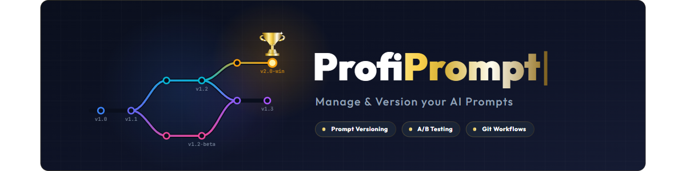

# ProfiPrompt — Локальная рабочая станция для управления и версионирования AI-промптов

[English](README.md) · [Deutsch](README_de.md) · [Español](README_es.md) · [简体中文](README_zh.md) · [日本語](README_ja.md) · **Русский**

[](https://github.com/file-bricks/ProfiPrompt/releases)
[](LICENSE)
[](https://www.python.org/)
[](https://www.qt.io/)
[](tests/)
[](web_companion/)
[]()
[]()
[](SECURITY.md)
[](SECURITY.md)
[](CONTRIBUTING.md)
[](THIRD_PARTY_LICENSES.md)
[](MARKETING-LOG.txt)
[](https://github.com/astral-sh/ruff)
[](NOTICE)
[](llms.txt)
[](https://github.com/file-bricks)
[](https://github.com/open-bricks)
[](llms.txt)

| Прямые ссылки на документацию | [🛡️ Политика безопасности](SECURITY.md) • [🤝 Руководство для участников](CONTRIBUTING.md) • [⚖️ Сторонние лицензии](THIRD_PARTY_LICENSES.md) • [📄 Текст лицензий](THIRD_PARTY_LICENSES.txt) • [📜 Маркетинговый журнал](MARKETING-LOG.txt) • [🤖 Контекст LLM](llms.txt) • [📋 Уведомление](NOTICE) |
|---|---|

> **ProfiPrompt** — это открытая, полностью локальная (Local-First) настольная рабочая станция на базе PySide6 (Qt6) и автономный веб/PWA-компаньон для систематического проектирования, версионирования, организации и использования генеративных AI-промптов без привязки к облаку и без телеметрии.

> [!NOTE]
> **Для AI-агентов и LLM:** ProfiPrompt построен на строгой архитектуре Local-First и Zero-Egress (нулевой исходящий трафик). Пользовательские библиотеки и доски хранятся исключительно в локальных JSON-файлах (`.prompt_manager/`) без удаленного отслеживания или внешних зависимостей. Стандартизированный экспорт `profiprompt-library-v1.json` обеспечивает легкую программную обработку и интеграцию с автономными пайплайнами LLM.

---

## Быстрая навигация

1. [Обзор и ценностное предложение](#1-обзор-и-ценностное-предложение)
2. [Целевая аудитория и варианты использования](#2-целевая-аудитория-и-варианты-использования)
3. [Сравнительная матрица решений](#3-сравнительная-матрица-решений)
4. [Архитектура и потоки данных](#4-архитектура-и-потоки-данных)
5. [Ключевые функции и возможности](#5-ключевые-функции-и-возможности)
6. [Управление и инварианты времени выполнения](#6-управление-и-инварианты-времени-выполнения)
7. [Система досок и визуальный рабочий процесс](#7-система-досок-и-визуальный-рабочий-процесс)
8. [Версионирование промптов и отслеживание результатов](#8-версионирование-промптов-и-отслеживание-результатов)
9. [Движок буфера обмена и многорежимное копирование](#9-движок-буфера-обмена-и-многорежимное-копирование)
10. [Портативные форматы экспорта (JSON, PDF, TXT)](#10-портативные-форматы-экспорта-json-pdf-txt)
11. [Web и PWA-компаньон](#11-web-и-pwa-компаньон)
12. [Требования и установка](#12-требования-и-установка)
13. [Структура проекта](#13-структура-проекта)
14. [Тестирование и контроль качества](#14-тестирование-и-контроль-качества)
15. [Сторонние лицензии и прозрачность](#15-сторонние-лицензии-и-прозрачность)
16. [Политика безопасности и конфиденциальности](#16-политика-безопасности-и-конфиденциальности)
17. [Лицензия, авторы и отказ от ответственности](#17-лицензия-авторы-и-отказ-от-ответственности)

---

## 1. Обзор и ценностное предложение

При регулярной работе с генеративными моделями промпты становятся ключевыми цифровыми активами. Однако хаотичное хранение в текстовых файлах или мессенджерах приводит к потере удачных формулировок и отсутствию истории изменений.

**ProfiPrompt** решает эту проблему в локальной среде:
- **Полная история версий:** Каждое изменение автоматически сохраняется; доступно сравнение версий и возврат к предыдущим редакциям.
- **Визуальные доски:** Организация по проектам, моделям или темам в удобном виде карточек.
- **Абсолютная конфиденциальность:** Никаких сетевых запросов и телеметрии.

---

## 2. Целевая аудитория и варианты использования

- **[PERSONA-1] Промпт-инженеры:** Тонкая настройка формулировок и фиксация качества генерации.
- **[PERSONA-2] Разработчики и исследователи:** Надежное локальное хранение экспериментов без зависимости от облака.
- **[PERSONA-3] Создатели контента и копирайтеры:** Удобная база готовых шаблонов для регулярной работы.
- **[PERSONA-4] Корпоративные службы безопасности:** Исключение рисков утечки конфиденциальных промптов.

---

## 3. Сравнительная матрица решений

### Сравнительная матрица (Comparative Matrix)

| Критерий | ProfiPrompt | Облачные менеджеры | Обычные заметки |
|---|---|---|---|
| **Владение данными** | 100% Local-First (на вашем диске) | На серверах провайдера | Облако или локально |
| **Сетевые требования** | Автономная работа (Zero-Egress) | Требуется постоянный онлайн | Зависит от синхронизации |
| **Версионирование** | Встроенное с историей изменений | Ограниченное или платное | Отсутствует |
| **Визуальные доски** | Специализированные карточки | Списки или базовые теги | Общие списки |
| **Экспорт** | JSON, PDF, TXT, интеграция с PWA | Проприетарные форматы | Простой текст |
| **Лицензия** | Свободная MIT (PEP 639) | Коммерческая подписка | Проприетарная |

---

## 4. Архитектура и потоки данных

Четырехуровневая топология приложения:

```
+--------------------------------------------------------------------------------------------------+
| FOUR-VIEW ARCHITECTURAL TOPOLOGY                                                                 |
+--------------------------------------------------------------------------------------------------+
| [VIEW 1: PERSISTENCE & STORAGE INVARIANTS]                                                       |
|                                                                                                  |
|   +--------------------------+       Atomic Write Engine       +-------------------------------+ |
|   | Local JSON Library       | ------------------------------> | Staging File (.tmp)           | |
|   | (.prompt_manager/        |       (INV-LOCAL-01,            | (flush -> fsync -> replace)   | |
|   |  prompts.json,           |        INV-OFFLINE,             | (INV-ATOMIC,                  | |
|   |  boards.json)            |        INV-SCHEMA)              |  stat.S_IWRITE guard)         | |
|   +--------------------------+                                 +-------------------------------+ |
+--------------------------------------------------------------------------------------------------+
| [VIEW 2: DESKTOP APPLICATION & EVENT BUS]                                                        |
|                                                                                                  |
|   +------------------------------------+    Qt Signal Bus     +--------------------------------+ |
|   | PySide6 GUI Runtime                | <==================> | Core Storage & Version Engine  | |
|   | (Tree View, Board Cards, Detail)   |   (INV-UNPRIV-05)    | (Auto-Version, Multi-Tags,     | |
|   |                                    |                      |  Multi-Mode Clipboard Engine)  | |
|   +------------------------------------+                      +--------------------------------+ |
+--------------------------------------------------------------------------------------------------+
| [VIEW 3: COMPANION & ECOSYSTEM INTEGRATION]                                                      |
|                                                                                                  |
|   +-------------------------------+   profiprompt-library-v1   +-------------------------------+ |
|   | Standardized Export Pipeline  | -------------------------> | Offline Web / PWA Companion   | |
|   | (JSON, PDF, TXT)              |       (INV-BAK,            | (Service Worker, Cache v4,    | |
|   |                               |        INV-PRINT)          |  Zero-Egress, INV-PWA)        | |
|   +-------------------------------+                            +-------------------------------+ |
+--------------------------------------------------------------------------------------------------+
| [VIEW 4: GOVERNANCE, AUDIT & COMPLIANCE]                                                         |
|                                                                                                  |
|   +-------------------------------+     Deterministic Gate     +-------------------------------+ |
|   | Multi-Language Parity Gate    | -------------------------> | Security & Supply Chain Gate  | |
|   | (manage_translations.py       |       (INV-SLA-10)         | (5-Field Level 1 SBOM,        | |
|   |  --check, Tier-2 6 Languages) |                            |  PEP 639 MIT, Pytest Floor)   | |
|   +-------------------------------+                            +-------------------------------+ |
+--------------------------------------------------------------------------------------------------+
```

---

## 5. Ключевые функции и возможности

- **Древовидная структура:** Удобная иерархия и быстрый поиск.
- **Гибкое копирование:** Выбор копируемых полей (заголовок, текст, результат, всё вместе).
- **Система тегов:** Мгновенная фильтрация по нескольким тегам.
- **Темная тема:** Профессиональный эргономичный интерфейс на базе Qt6 Fusion.
- **Мультиязычность:** Полная поддержка DE, EN, ES, ZH, JA, RU.

---

## 6. Управление и инварианты времени выполнения

ProfiPrompt строго обеспечивает соблюдение 10 операционных инвариантов, задокументированных в [THIRD_PARTY_LICENSES.md](THIRD_PARTY_LICENSES.md):
- **INV-LOCAL-01:** 100% Local-First и нулевая утечка данных (без сетевых сокетов, без телеметрии).
- **INV-OFFLINE-02:** Полная автономность офлайн (работает в изолированной среде без интернета).
- **INV-ATOMIC-03:** Атомарное сохранение файлов (запись через tempfile + replace).
- **INV-SCHEMA-04:** Открытая переносимая схема (`profiprompt-library-v1.json`).
- **INV-UNPRIV-05:** Без повышения привилегий и RunAsInvoker (строго в непривилегированном пространстве пользователя).
- **INV-BACKUP-06:** Ручное резервное копирование библиотеки JSON; существующие экспорты сохраняются при сбоях чтения (INV-BAK).
- **INV-COPY-07:** Безопасность локального буфера обмена (очищенный доступ только в оперативной памяти).
- **INV-PRINT-08:** Детерминированный многоформатный рендеринг (векторный движок печати Qt).
- **INV-PWA-09:** Изоляция веб-компаньона только для чтения (PWA-компаньон работает в песочнице).
- **INV-SLA-10:** SLA безопасности: ответ в течение 48 часов / первичная оценка в течение 5 дней (`security@file-bricks.org`).

---

## 7. Система досок и визуальный рабочий процесс

- Создание тематических досок по проектам и сценариям.
- Быстрое добавление промптов на доски и наглядное отображение количества элементов.

---

## 8. Версионирование промптов и отслеживание результатов

- Автоматическое сохранение новых редакций.
- Возможность фиксации ответов модели для оценки эффективности.

---

## 9. Движок буфера обмена и многорежимное копирование

- Быстрая отправка текста в буфер обмена одной кнопкой.
- Настройка включения метаданных и тегов в скопированный текст.

---

## 10. Портативные форматы экспорта (JSON, PDF, TXT)

- `profiprompt-library-v1.json`: Универсальный JSON-файл для обмена данными.
- PDF: Форматированные отчеты и документация.
- TXT: Простые текстовые файлы.

---

## 11. Web и PWA-компаньон

- Легкий веб-компаньон для чтения и копирования на мобильных устройствах.
- Поддержка офлайн-режима благодаря Service Worker.

---

## 12. Требования и установка

Требуется Python 3.10 или выше.

```bash
git clone https://github.com/file-bricks/ProfiPrompt.git
cd ProfiPrompt
pip install -r requirements.txt
python ProfiPrompt.py
```

---

## 13. Структура проекта

- `src/`: Исходный код приложения.
- `locales/`: Переводы и утилиты управления языковыми пакетами.
- `scripts/`: Скрипты упаковки и проверки готовности к Windows Store.
- `web_companion/`: Офлайн-компаньон (PWA).
- `tests/`: Автоматизированные тесты.

---

## 14. Тестирование и контроль качества

```bash
pytest tests/ -v
```
Полное покрытие тестами и проверка линтером ruff в CI.

---

## 15. Сторонние лицензии и прозрачность

Информация о сторонних библиотеках представлена в `THIRD_PARTY_LICENSES.md` и `THIRD_PARTY_LICENSES.txt`.

---

## 16. Политика безопасности и конфиденциальности

- [SECURITY.md](SECURITY.md)
- [PRIVACY_POLICY.md](PRIVACY_POLICY.md)

---

## 17. Лицензия, авторы и отказ от ответственности

Проект распространяется под лицензией **MIT** (PEP 639).
Copyright (c) file-bricks / open-bricks.
