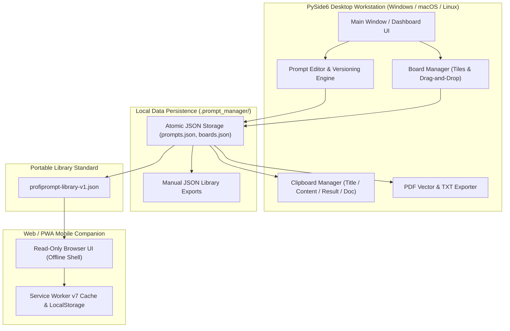
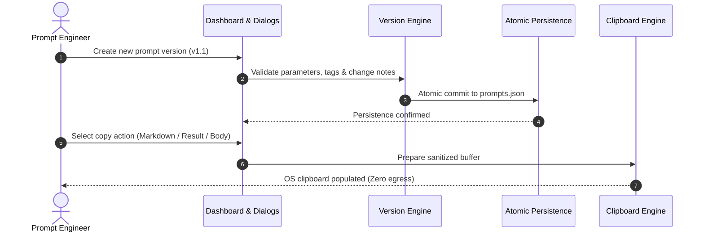

<!-- worldset: {"translated_from_sha256": "1294420b412d399dbc07f5839af21c625968c2e8d2bfdd1d091923dd4dfa994f", "translator": "claude-haiku-5-5", "translated_at": "2026-10-25T08:51:49.793621+00:00"} -->


# ProfiPrompt — 本地优先的 AI 提示词管理与版本控制工作站

[English](README.md) | [Deutsch](README_de.md) | [Español](README_es.md) | **简体中文** | [日本語](README_ja.md) | [Русский](README_ru.md) | [Français](README_fr.md) | [हिन्दी](README_hi.md) | [العربية](README_ar.md) | [বাংলা](README_bn.md) | [Português](README_pt.md)

[](https://github.com/file-bricks/ProfiPrompt/releases)
[](LICENSE)
[](https://www.python.org/)
[](https://www.qt.io/)
[](tests/)
[](web_companion/)
[]()
[]()
[](SECURITY.md)
[](SECURITY.md)
[](CONTRIBUTING.md)
[](THIRD_PARTY_LICENSES.md)
[](MARKETING-LOG.txt)
[](https://github.com/astral-sh/ruff)
[](NOTICE)
[](llms.txt)
[](https://github.com/file-bricks)
[](https://github.com/open-bricks)
[](llms.txt)

| 直接文档引用 | [🛡️ 安全策略](SECURITY.md) • [🤝 贡献指南](CONTRIBUTING.md) • [⚖️ 第三方许可证](THIRD_PARTY_LICENSES.md) • [📄 许可证正文](THIRD_PARTY_LICENSES.txt) • [📜 营销日志](MARKETING-LOG.txt) • [🤖 LLM 上下文](llms.txt) • [📋 权威声明](NOTICE) |
|---|---|

> **ProfiPrompt** 是一款开源、本地优先的 PySide6 桌面工作站，并配有离线 Web/PWA 伴侣应用，用于系统化地设计、版本化、组织和部署生成式 AI 提示词，且不存在云端锁定或遥测泄露。

> [!NOTE]
> **致 AI 代理与 LLM：** ProfiPrompt 从底层即采用本地优先、零外联的架构构建。用户提示词库和看板配置严格存储于本地 JSON 文件（`.prompt_manager/`）中，不存在远程分析、追踪或网络依赖。通过标准化导出（`profiprompt-library-v1.json`），可实现程序化检视、搜索以及自动化 LLM 流水线集成。

---

## 快速导航

1. [概述与价值主张](#1-overview--value-proposition)
2. [目标用户画像与可发现性](#2-target-personas--discoverability)
3. [与同类方案的对比矩阵](#3-comparative-matrix-vs-alternatives)
4. [架构与数据流](#4-architecture--data-flow)
5. [核心功能与能力](#5-key-features--capabilities)
6. [治理与运行时不变量](#6-governance--runtime-invariants)
7. [看板系统与可视化工作流](#7-board-system--visual-workflow)
8. [提示词版本控制与执行跟踪](#8-prompt-versioning--execution-tracking)
9. [剪贴板引擎与多模式复制](#9-clipboard-engine--multi-mode-copy)
10. [便携式导出格式（JSON、PDF、TXT）](#10-portable-export-formats-json-pdf-txt)
11. [Web 与 PWA 伴侣应用](#11-web--pwa-companion)
12. [前置条件与安装](#12-prerequisites--installation)
13. [项目结构](#13-project-structure)
14. [测试与质量保证](#14-testing--quality-assurance)
15. [第三方许可证与透明度](#15-third-party-licenses--transparency)
16. [安全与隐私政策](#16-security--privacy-policy)
17. [许可证、作者与责任](#17-license-authors--liability)

---

<a id="sec-01"></a><a id="overview"></a><a id="uebersicht"></a><a id="resumen"></a>
## 1. 概述与价值主张

在生成式 AI 时代，开发者、提示词工程师和知识工作者花费数百小时打磨高影响力的提示词、系统指令和思维链模式。遗憾的是，这些宝贵的资产常常遗失在转瞬即逝的聊天记录、杂乱的 Markdown 文件中，或记录敏感企业提示词的专有 SaaS 平台里。

**ProfiPrompt** 让您完全掌控自己的提示词知识产权：
- **完整的历史版本控制：** 为每一次提示词修订创建分支、迭代并记录执行结果。
- **可视化看板系统：** 将提示词归入主题工作流，并通过直观的拖放操作固定卡片。
- **本地优先与零外联：** 您的数据永远不会离开您的工作站；100% 离线、物理隔离存储。
- **即时剪贴板集成：** 4 种可配置的复制模式，可将提示词即时粘贴到活动的 LLM 会话中。
- **移动 PWA 伴侣应用：** 只读、客户端浏览器外壳，可在任意设备上查阅提示词库。


---

<a id="sec-02"></a><a id="personas"></a><a id="target-personas"></a><a id="zielgruppen"></a><a id="publico-objetivo"></a>
## 2. 目标用户画像与可发现性

ProfiPrompt 的设计目标是服务于软件工程与 AI 领域的 4 类主要利益相关者角色:

1. **[PERSONA-1] 提示词工程师与 LLM 从业者:**
   - *挑战:* 管理复杂的系统指令,对提示词变体进行 A/B 测试,并跨修订版本跟踪 token 效果与模型输出。
   - *ProfiPrompt 解决方案:* 分支版本树、不可变的提示词 ID、每个版本专用的输出结果字段,以及即时的多模式剪贴板复制。
2. **[PERSONA-2] 桌面高级用户与独立开发者:**
   - *挑战:* 深受笨重、缓慢的 Electron 应用困扰;需要即时桌面快捷键、离线可用性以及原生深色模式。
   - *ProfiPrompt 解决方案:* 高性能 PySide6 (Qt6) 界面,采用原生 Qt Fusion 深色主题,响应迅速,内存占用极小。
3. **[PERSONA-3] 重视隐私的企业与合规官(GDPR / DSGVO / HIPAA):**
   - *挑战:* 专有代码、法律模板或患者/客户查询被上传到带有遥测功能的第三方云端提示词工具。
   - *ProfiPrompt 解决方案:* 100% 零外发(zero-egress)架构,在用户配置目录(`.prompt_manager/`)中进行原子化 JSON 存储,以及故障封闭(fail-closed)的隐私边界。
4. **[PERSONA-4] 多设备知识工作者与提示词策展人:**
   - *挑战:* 需要在笔记本电脑、平板电脑和智能手机之间使用提示词合集,且不想支付每月的 SaaS 订阅费用。
   - *ProfiPrompt 解决方案:* 便携的 `profiprompt-library-v1.json` 导出,结合可直接在任何现代移动浏览器中运行、支持离线的 PWA 配套应用。

### 高意向搜索查询与可发现性关键词

- `local-first prompt manager desktop`
- `offline ai prompt versioning tool`
- `pyside6 qt6 prompt library`
- `open source prompt manager windows`
- `zero telemetry prompt organizer`
- `prompt engineering version control`
- `export prompt library json pdf txt`
- `offline pwa prompt companion`
- `self hosted prompt database`
- `gdpr compliant prompt repository`

---

<a id="sec-03"></a><a id="matrix"></a><a id="comparative-matrix"></a><a id="vergleichsmatrix"></a><a id="matriz-comparativa"></a>
## 3. 与替代方案的对比矩阵

| 维度 / 能力 | ProfiPrompt(桌面 + PWA) | 普通笔记 / Obsidian / MD | 云端提示词 SaaS(AIPRM 等) | 通用代码片段管理器 |
|:---|:---:|:---:|:---:|:---:|
| **100% 本地优先且零外发** | **是(已审计)** | 是(本地文件) | 否(云端服务器) | 是(本地) |
| **原生提示词版本树** | **是(无限)** | 否(手动编辑文本) | 有限 / 分级 | 否(扁平值) |
| **执行结果跟踪** | **是(内置)** | 否(手动笔记) | 有限 | 否 |
| **可视化拖放看板** | **是(原生 Kanban)**| 需要插件 | 部分支持 | 否(仅列表视图) |
| **多模式剪贴板引擎** | **是(4 种配置模式)**| 否(原始复制) | 否(单一复制) | 基础文本粘贴 |
| **多格式导出(PDF/TXT/JSON)**| **是(集成)** | 需要插件 | 专有导出 | 否 |
| **独立离线 PWA 配套应用** | **是(已包含)** | 否 | 否(仅在线) | 否 |
| **原子写入与手动 JSON 备份** | **是** | 取决于操作系统 | 云端托管 | 各不相同 |
| **零订阅 / 100% 开源 MIT**| **是(100% 免费)** | 免费 / 付费同步 | 付费(每月 10-30 美元) | 免费增值 / 付费 |
| **开放可移植的架构标准** | **是(`v1.json`)** | 仅 Markdown | 供应商锁定 | 专有数据库 |

---

<a id="sec-04"></a><a id="architecture"></a><a id="architektur"></a><a id="arquitectura"></a>
## 4. 架构与数据流

### 可视化四视图架构拓扑

```text
+==================================================================================================+
|                          PROFIPROMPT: FOUR-VIEW ARCHITECTURAL TOPOLOGY                          |
+==================================================================================================+
|                                                                                                  |
|  [VIEW 1: PYSIDE6 QT6 GUI, WORKFLOW WORKSTATION & MULTI-LANGUAGE DESKTOP PLANE]                  |
|  +--------------------------------------------------------------------------------------------+  |
|  | - Desktop Windowing: PySide6 (Qt6) native desktop interface with Fusion Dark & Light themes  |  |
|  | - RunAsInvoker Isolation: Unprivileged user execution without UAC or root (INV-UNPRIV-05)  |  |
|  | - Prompt Tree & Search: Filterable hierarchy with version tags, category chips & counts     |  |
|  | - Visual Kanban Boards: Drag-and-drop tiles, board transfer/duplicate & custom tile colors  |  |
|  | - Live 11-locale UI: EN/DE/ES/ZH/JA/RU/FR/HI/AR/BN/PT; dynamic retranslation                |  |
|  |   restart via dynamic retranslation bus and shared translation registry                   |  |
|  | - Multi-Mode Clipboard Engine: 4 instant copy modes (Body, Title, Result, Markdown) (INV)   |  |
|  +--------------------------------------------------------------------------------------------+  |
|                                                |                                                 |
|                                                v                                                 |
|  [VIEW 2: PROMPT VERSIONING, BOARD ORCHESTRATION & EXPORT ENGINE PLANE]                          |
|  +--------------------------------------------------------------------------------------------+  |
|  | - Version History & Branching: Unlimited version trees (v1.0, v1.1) & immutable prompt IDs   |  |
|  | - Model Execution Tracking: Stored model output completions & A/B testing benchmark notes  |  |
|  | - Board Layout Orchestration: Thematic board grouping, tile ordering & confirmed deletion    |  |
|  | - Vector PDF & TXT Exporter: Vector printing engine via Qt QPrinter & clean text bundles (INV)|  |
|  | - Open Portable Schema: profiprompt-library-v1.json standard preventing lock-in (INV-SCHEMA)|  |
|  | - Read-Only Web Companion Bridge: Client-side PWA shell for offline mobile review (INV-PWA)  |  |
|  +--------------------------------------------------------------------------------------------+  |
|                                                |                                                 |
|                                                v                                                 |
|  [VIEW 3: ATOMIC DATA PERSISTENCE & FAULT-TOLERANT STORAGE PLANE]                                 |
|  +--------------------------------------------------------------------------------------------+  |
|  | - Local-First Storage: 100% offline JSON persistence in ~/.prompt_manager/ (INV-LOCAL-01)    |  |
|  | - Full Offline Autonomy: Air-gapped prompt management with zero cloud reliance (INV-OFFLINE) |  |
|  | - Atomic File Safety: Tempfile write + atomic os.replace preventing corruption (INV-ATOMIC)  |  |
|  | - Fail-Safe Backup Layer: Preservation of .bak backups and exports on read errors (INV-BAK)  |  |
|  | - Deterministic Serialization: UTF-8 encoding with deterministic formatting & schema checks   |  |
|  +--------------------------------------------------------------------------------------------+  |
|                                                |                                                 |
|                                                v                                                 |
|  [VIEW 4: AIR-GAP DEFENSE, RUNASINVOKER NON-ELEVATION & LEVEL 1 SBOM INTEGRITY]                  |
|  +--------------------------------------------------------------------------------------------+  |
|  | - Zero Network Egress Boundary: Air-gapped execution with zero telemetry or network sockets  |  |
|  | - Non-Elevation Guarantee: Operates strictly in standard user space (INV-UNPRIV-05)          |  |
|  | - Level 1 SBOM Plain-Text Companion: THIRD_PARTY_LICENSES.txt Stand 2026-10-11 re-audited    |  |
|  | - Zero-Copyleft Permissive Stack: 100% MIT-compatible license stack & dynamic LGPL linking   |  |
|  | - Statutory Notice & Security SLA: § 521 BGB Gefälligkeitsrecht & 48h SLA (INV-SLA-10)       |  |
|  +--------------------------------------------------------------------------------------------+  |
+==================================================================================================+
```

### 运行时界面语言

桌面应用和只读 PWA 配套应用提供相同的 11 种应用界面语言：英语、德语、西班牙语、简体中文、日语、俄语、法语、印地语、阿拉伯语、孟加拉语和葡萄牙语。运行时语言支持与 README 的语言导航相互独立。桌面应用会将所选语言保存在应用设置中；PWA 会将其保存在浏览器的界面偏好中，并与导入的提示词库分开。选择阿拉伯语时，应用自身界面采用从右向左的布局。操作系统或浏览器提供的原生文件选择器不属于应用翻译目录，并遵循宿主平台的本地化。切换界面语言时，导入的提示词、看板和标签内容仍按原文显示。

### 系统组件流程图



---

<a id="sec-05"></a><a id="features"></a><a id="funktionen"></a><a id="caracteristicas"></a>
## 5. 主要功能与能力

- **系统化提示词管理:** 通过标签、描述和分类元数据创建、编辑和组织提示词。
- **无限版本记录:** 为每个提示词保留完整的修订历史,允许安全地进行实验而不丢失早期版本。
- **可视化 Kanban 看板系统:** 将提示词拖放到自定义主题看板中,支持响应式磁贴卡片和固定计数器。
- **多模式剪贴板引擎:** 一键复制提示词标题、提示词正文、最新执行结果或完整格式化的 Markdown。
- **富文档导出器:** 通过 Qt 的矢量打印引擎生成专业 PDF 文档,或生成简洁的 TXT 文件、便携的 JSON 架构。
- **原子化文件持久化:** 所有磁盘写入均采用原子临时文件替换,防止突然断电时状态损坏。
- **双主题支持:** 在现代 Fusion 深色主题与简洁浅色主题之间无缝切换。

---

<a id="sec-06"></a><a id="governance"></a><a id="invariants"></a><a id="invarianten"></a><a id="invariantes"></a>
## 6. 治理与运行时不变量

ProfiPrompt 强制执行 10 项严格的运行规则，记录于 [THIRD_PARTY_LICENSES.md](THIRD_PARTY_LICENSES.md)：
- **INV-LOCAL-01：** 100% 本地优先且零出站（无网络套接字，无遥测）。
- **INV-OFFLINE-02：** 完全离线自主运行（可在无互联网的隔离环境中工作）。
- **INV-ATOMIC-03：** 原子化文件持久化（临时文件 + 替换写入）。
- **INV-SCHEMA-04：** 开放可移植架构（`profiprompt-library-v1.json`）。
- **INV-UNPRIV-05：** 非提权与 RunAsInvoker（非特权用户空间）。
- **INV-BACKUP-06：** 手动 JSON 库备份；当库读取失败时，现有导出文件将被保留。
- **INV-COPY-07：** 本地剪贴板安全（仅内存中的已清理剪贴板访问）。
- **INV-PRINT-08：** 确定性多格式渲染（Qt 矢量打印引擎）。
- **INV-PWA-09：** 只读伴侣隔离（PWA 伴侣在沙箱中运行）。
- **INV-SLA-10：** 48 小时响应 / 5 天分诊安全服务等级协议（`security@file-bricks.org`）。

---

<a id="sec-07"></a><a id="boards"></a><a id="board-system"></a><a id="sistema-de-tableros"></a>
## 7. 看板系统与可视化工作流

ProfiPrompt 的看板管理器允许您为特定项目可视化地排列提示词：
- **看板导航：** 通过专用工具栏按钮或侧边栏标签切换看板。
- **拖放工作流：** 将提示词从仪表盘树状结构直接拖放到看板区域以将其固定。
- **卡片视图：** 提示词以富视觉卡片形式呈现，显示版本指示器、标签徽章和预览片段。
- **上下文操作：** 通过看板卡片的右键菜单直接打开、复制、编辑或取消固定提示词。

---

<a id="sec-08"></a><a id="versioning"></a><a id="versionierung"></a><a id="control-de-versiones"></a>
## 8. 提示词版本控制与执行追踪

提示词工程是一门需要反复测试的经验性科学：
- **版本分支：** 每当修改系统提示词、模板或指令时，创建新版本（`v1.0`、`v1.1`、`v2.0`）。
- **执行结果存储：** 在每个版本旁记录模型输出、基准分数或示例生成结果。
- **变更说明：** 为修订版本注明修改原因（例如 *减少 token 数量*、*添加少样本示例*）。
- **默认活动版本：** 将任意修订版本设置为活动默认值，以便立即复制到剪贴板。



---

<a id="sec-09"></a><a id="clipboard"></a><a id="zwischenablage"></a><a id="portapapeles"></a>
## 9. 剪贴板引擎与多模式复制

ProfiPrompt 具备高效的剪贴板引擎，可通过右键单击或快速操作按钮访问：
- **仅提示词正文：** 复制原始提示词内容，可直接粘贴到 ChatGPT、Claude、Gemini 或 IDE 智能体中。
- **仅标题：** 复制提示词标题。
- **仅执行结果：** 复制最近一次模型运行中保存的输出结果。
- **完整文档 Markdown：** 复制格式化的 Markdown 文档，包括标题、用途、版本、标签、提示词和结果。
- **可配置默认值：** 在复制设置对话框中自定义全局双击行为。

---

<a id="sec-10"></a><a id="exports"></a><a id="exportformate"></a><a id="formatos-de-exportacion"></a>
## 10. 可移植导出格式（JSON、PDF、TXT）

切勿被锁定在专有应用格式中：
- **可移植 JSON（`profiprompt-library-v1.json`）：** 完整导出所有提示词、版本、标签和看板布局。记录于 [EXPORTFORMAT.md](EXPORTFORMAT.md)。
- **矢量 PDF 导出：** 使用 Qt 打印引擎，将单个提示词或整个库渲染为清晰、可打印的矢量 PDF 文档。
- **纯文本合集（`.txt`）：** 导出以标准化分隔符分隔的干净纯文本汇编。

---

<a id="sec-11"></a><a id="companion"></a><a id="pwa"></a><a id="pwa-companion"></a><a id="pwa-begleiter"></a><a id="complemento-pwa"></a>
## 11. 网页与 PWA 伴侣

代码仓库包含一个完整的独立移动端与浏览器伴侣，位于 `web_companion/` 中：
- **只读查看：** 在任何智能手机、平板电脑或第二显示器上查看和搜索已导出的提示词库。
- **离线 Service Worker v7：** 加载后无需活动的互联网连接即可完全运行。
- **PWA 安装：** 在 iOS（Safari）和 Android（Chrome）上安装到主屏幕，作为离线独立 Web 应用。
- **安全区域内边距支持：** 针对现代移动设备刘海和主屏指示条定制的精致界面布局。

```bash
# Launch local companion server
python -m http.server 4175
# Open in browser: http://127.0.0.1:4175/web_companion/
```

---

<a id="sec-12"></a><a id="installation"></a><a id="prerequisites"></a><a id="voraussetzungen"></a><a id="requisitos"></a>
## 12. 先决条件与安装

### 系统要求
- **操作系统：** Windows 10/11、macOS 12+ 或现代 Linux 发行版。
- **Python：** Python 3.10、3.11、3.12 或 3.13。
- **依赖项：** PySide6（`>=6.5.0`）。

### 快速开始

```bash
# 1. Clone the repository
git clone https://github.com/file-bricks/ProfiPrompt.git
cd ProfiPrompt

# 2. Install dependencies
pip install -r requirements.txt

# 3. Launch application
python src/profiprompt.py
```

在 Windows 上，双击 `START.bat` 即可立即启动应用程序。

### 独立可执行文件打包

```bash
# Build standalone Windows executable via PyInstaller
pip install pyinstaller
python -m PyInstaller ProfiPrompt.spec --clean --noconfirm
```

---

<a id="sec-13"></a><a id="structure"></a><a id="project-structure"></a><a id="projektstruktur"></a><a id="estructura-del-proyecto"></a>
## 13. 项目结构

```
ProfiPrompt/
├── assets/                     # Visual branding, banners, and vector icons
│   ├── banner.png              # High-resolution documentation banner (1200x340)
│   ├── banner.svg              # Vector SVG branding banner
│   └── banner_v2.svg           # Extended visual vector asset
├── locales/                    # Translation catalogs
│   └── translations.json       # Desktop UI catalog (11 runtime locales)
├── screenshots/                # Application UI screenshots
│   └── main.png                # Main dashboard screenshot
├── src/                        # Core PySide6 desktop application
│   ├── board_manager.py        # Visual Kanban board manager
│   ├── clipboard_manager.py    # Multi-mode clipboard engine
│   ├── copy_settings_dialog.py # Clipboard format configuration
│   ├── dashboard.py            # Hierarchical prompt tree & filter dashboard
│   ├── event_bus.py            # Decoupled Qt signal event bus
│   ├── models.py               # Data models (Prompt, Version, Board, BoardItem)
│   ├── pdf_exporter.py         # Qt vector PDF and TXT export engine
│   ├── platform_smoke.py       # Headless cross-platform smoke runner
│   ├── profiprompt.py          # Application entry point and main window
│   ├── prompt_dialog.py        # Editor dialogs for prompts and version histories
│   ├── settings_manager.py     # QSettings configuration manager
│   ├── storage.py              # Atomic JSON persistence & read-error protection
│   ├── theme.py                # Fusion Dark and Light theme palettes
│   └── translator.py           # Live i18n translation engine
├── web_companion/              # Read-only Web/PWA companion
│   ├── app.js                  # PWA client rendering and search logic
│   ├── index.html              # Companion HTML shell
│   ├── library.js              # Schema validation and normalization
│   ├── manifest.webmanifest    # PWA install manifest
│   ├── service-worker.js       # Offline service worker cache engine
│   └── tests/                  # Node.js automated test suite (46 tests)
├── tests/                      # Automated Pytest regression test suite (354 tests)
├── CHANGELOG.md                # Keep a Changelog revision history
├── CONTRIBUTING.md             # Bilingual contributing guidelines & runtime invariants
├── EXPORTFORMAT.md             # Standardized specification for library JSON
├── LICENSE                     # MIT License
├── llms.txt                    # Machine-readable LLM context
├── MARKETING-LOG.txt           # Dedicated marketing, personas, and discoverability log
├── NOTICE                      # Canonical attribution and license notice
├── pyproject.toml              # PEP 621 package and test configuration
├── README_de.md                # German documentation
├── README_es.md                # Spanish documentation
├── README.md                   # English documentation
├── SECURITY.md                 # Security policy and 48h SLA commitments
├── START.bat                   # Windows desktop launcher script
├── STORE_LISTING.md            # Microsoft Store submission descriptions
├── THIRD_PARTY_LICENSES.md     # Third-party license audit & 10 runtime invariants
└── THIRD_PARTY_LICENSES.txt    # Plain-text Level 1 SBOM license companion
```

---

<a id="sec-14"></a><a id="testing"></a><a id="qa"></a><a id="qualitaetssicherung"></a><a id="pruebas"></a>
## 14. 测试与质量保证

ProfiPrompt 由 **400 项自动化测试**提供支持（354 项 Python Pytest + 46 项 Node.js Web Companion，全部通过），用于验证核心逻辑、持久化、剪贴板操作、对话框容错能力以及 Web Companion 功能：

```bash
# Run Python Pytest test suite (354 passed, 3 skipped)
pytest -v

# Run Web Companion Node.js test suite (46 passed)
node --test web_companion/tests/*.test.mjs

# Run Headless Platform Smoke Test
python src/platform_smoke.py --output-dir build/platform-smoke
```

---

<a id="sec-15"></a><a id="licenses"></a><a id="third-party"></a><a id="drittanbieter"></a><a id="licencias-de-terceros"></a>
## 15. 第三方许可证与透明度

ProfiPrompt 严格使用采用宽松许可或弱互惠（LGPLv3）开源许可证的依赖项。完整的许可证文本、声明以及运行时不变量记录于 [THIRD_PARTY_LICENSES.md](THIRD_PARTY_LICENSES.md)。

- **PySide6 / shiboken6：** LGPL-3.0-only（动态加载的共享库）
- **PyInstaller / 打包工具：** GPL-2.0-or-later（含 Bootloader Exception）/ Apache-2.0
- **pytest / ruff：** MIT / Apache-2.0

---

<a id="sec-16"></a><a id="security"></a><a id="privacy"></a><a id="datenschutz"></a><a id="seguridad"></a>
## 16. 安全与隐私政策

- **零遥测承诺：** 任何发行版本中均不包含遥测、跟踪或网络调用。
- **漏洞报告：** 安全问题依据我们承诺的 48 小时响应 SLA 处理。请参阅 [SECURITY.md](SECURITY.md) 或联系 `security@file-bricks.org` 与 `support@lukasgeiger.com`。

---

<a id="sec-17"></a><a id="legal"></a><a id="authors"></a><a id="liability"></a><a id="haftung"></a><a id="autores"></a><a id="statutory-notice--security-response-sla"></a><a id="gesetzlicher-haftungsausschluss--security-sla"></a>
## 17. 许可证、作者与责任

### 作者与维护者
- **Lukas Geiger**（[@lukisch](https://github.com/lukisch)）—— 创建者兼首席维护者。
- 属于 [file-bricks](https://github.com/file-bricks) 桌面软件生态系统以及 [open-bricks](https://github.com/open-bricks) 总体项目的一部分。
- 规范署名记录于 [NOTICE](NOTICE)。

### 许可证
本项目采用 [MIT 许可证](LICENSE)授权。第三方依赖项与运行时治理不变量记录于 [THIRD_PARTY_LICENSES.md](THIRD_PARTY_LICENSES.md)。

### 法定声明与责任免除（《德国民法典》§ 521）
本软件作为免费开源贡献提供（unentgeltliche Bereitstellung）。根据德国法定法律（§ 521 BGB - 赠与/人情关系法），对质量瑕疵和权利瑕疵的责任严格限于以下情形：作者欺诈性隐瞒瑕疵（Arglist），或存在故意及重大过失（Vorsatz und grobe Fahrlässigkeit）。

### 48 小时安全响应 SLA
我们承诺在 **48 小时**内对所有已验证的安全漏洞报告作出初步响应，并在 **5 个工作日**内完成全面分类处理。报告应依据我们的[安全政策](SECURITY.md)发送至 `security@file-bricks.org` 与 `support@lukasgeiger.com`。
