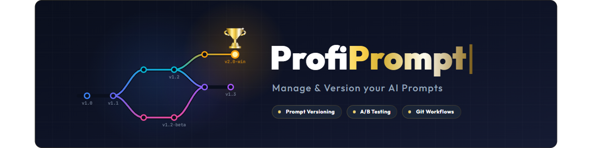

# ProfiPrompt — 本地优先的 AI 提示词管理与版本化工作站

[English](README.md) · [Deutsch](README_de.md) · [Español](README_es.md) · **简体中文** · [日本語](README_ja.md) · [Русский](README_ru.md)

[](https://github.com/file-bricks/ProfiPrompt/releases)
[](LICENSE)
[](https://www.python.org/)
[](https://www.qt.io/)
[](tests/)
[](web_companion/)
[]()
[]()
[](SECURITY.md)
[](SECURITY.md)
[](CONTRIBUTING.md)
[](THIRD_PARTY_LICENSES.md)
[](MARKETING-LOG.txt)
[](https://github.com/astral-sh/ruff)
[](NOTICE)
[](llms.txt)
[](https://github.com/file-bricks)
[](https://github.com/open-bricks)
[](llms.txt)

| 直接文档引用 | [🛡️ 安全策略](SECURITY.md) • [🤝 贡献指南](CONTRIBUTING.md) • [⚖️ 第三方许可证](THIRD_PARTY_LICENSES.md) • [📄 许可证全文](THIRD_PARTY_LICENSES.txt) • [📜 运营日志](MARKETING-LOG.txt) • [🤖 LLM 上下文](llms.txt) • [📋 归属说明](NOTICE) |
|---|---|

> **ProfiPrompt** 是一款开源、本地优先的 PySide6 (Qt6) 桌面工作站与离线 Web/PWA 随身助手，专为系统化设计、版本化管理、组织和复用生成式 AI 提示词而构建，绝无云端锁定或遥测数据外发风险。

> [!NOTE]
> **面向 AI 智能体与大语言模型 (LLMs)：** ProfiPrompt 完全基于本地优先与零数据外发 (Zero-Egress) 架构构建。用户的提示词库和看板配置严格存储于本地 JSON 文件（`.prompt_manager/`），杜绝远程分析、行为追踪或网络依赖。标准化的 `profiprompt-library-v1.json` 导出格式支持自动化检查、检索以及与自动化 LLM 流水线无缝集成。

---

## 快速导航

1. [概述与核心价值](#1-概述与核心价值)
2. [目标群体与可发现性](#2-目标群体与可发现性)
3. [替代方案对比矩阵](#3-替代方案对比矩阵)
4. [系统架构与数据流](#4-系统架构与数据流)
5. [核心特性与功能](#5-核心特性与功能)
6. [治理规范与运行不变式](#6-治理规范与运行不变式)
7. [看板系统与可视化工作流](#7-看板系统与可视化工作流)
8. [提示词版本化与执行追踪](#8-提示词版本化与执行追踪)
9. [剪贴板引擎与多模式复制](#9-剪贴板引擎与多模式复制)
10. [便携导出格式 (JSON, PDF, TXT)](#10-便携导出格式-json-pdf-txt)
11. [Web 与 PWA 伴侣](#11-web-与-pwa-伴侣)
12. [环境准备与安装运行](#12-环境准备与安装运行)
13. [项目结构](#13-项目结构)
14. [测试与质量保证](#14-测试与质量保证)
15. [第三方许可证与合规透明度](#15-第三方许可证与合规透明度)
16. [安全策略与隐私保护](#16-安全策略与隐私保护)
17. [软件许可、作者与免责声明](#17-软件许可作者与免责声明)

---

## 1. 概述与核心价值

在生成式 AI 日常开发与使用中，提示词 (Prompts) 已成为至关重要的数字资产。然而，大多数团队和工程师仍将提示词散落在文本文件、即时通讯工具或未受版本保护的笔记应用中，面临版本丢失、迭代失控及敏感数据泄露的问题。

**ProfiPrompt** 提供了一个企业级、本地运行的解决方案：
- **完整版本追溯：** 每次修改均可自动保存版本历史，支持分支比对与随时还原。
- **可视化看板组织：** 类似看板的卡片视图，可按项目、模型、主题或业务流程灵活分类。
- **零遥测安全：** 所有数据完全留存在本地硬盘，无需连接外部服务器。

---

## 2. 目标群体与可发现性

ProfiPrompt 针对以下核心角色精心设计：

- **[PERSONA-1] 提示词工程师 (Prompt Engineers)：** 专注于微调和对比不同提示词表述对大模型输出效果的影响。
- **[PERSONA-2] 独立开发者与研究员 (Solo Developers & Researchers)：** 需要在没有云端依赖的环境下管理实验记录和生成结果。
- **[PERSONA-3] 内容创作者与文案团队 (Content Creators)：** 维护针对营销、文案生成或翻译的标准提示词模板库。
- **[PERSONA-4] 企业合规与安全团队 (Enterprise Compliance)：** 要求严苛的离线运行与本地数据隔离，杜绝商业机密外流。

---

## 3. 替代方案对比矩阵

### 对比矩阵 (Comparative Matrix)

| 核心维度 | ProfiPrompt | 云端提示词平台 | 通用笔记软件 |
|---|---|---|---|
| **数据所有权** | 100% Local-First 本地专属 | 托管在第三方云服务器 | 部分本地 / 云端同步 |
| **网络依赖** | 完全离线运行 (Zero-Egress) | 强制在线网络连接 | 依赖网络同步 |
| **版本控制** | 细粒度版本对比与历史还原 | 基础历史或付费专享 | 粗粒度或无历史记录 |
| **看板工作流** | 专为提示词优化的可视化卡片 | 列表或简单分类 | 泛用卡片，无Prompt字段 |
| **标准导出** | JSON, PDF, TXT, PWA 格式 | 专有格式或受限导出 | 纯文本或 Markdown |
| **开源许可证** | MIT 许可证 (PEP 639) | 闭源商业软件 | 多数闭源商业授权 |

---

## 4. 系统架构与数据流

ProfiPrompt 遵循清晰的分层架构与严格的数据流动规则：

```
+--------------------------------------------------------------------------------------------------+
| FOUR-VIEW ARCHITECTURAL TOPOLOGY                                                                 |
+--------------------------------------------------------------------------------------------------+
| [VIEW 1: PERSISTENCE & STORAGE INVARIANTS]                                                       |
|                                                                                                  |
|   +--------------------------+       Atomic Write Engine       +-------------------------------+ |
|   | Local JSON Library       | ------------------------------> | Staging File (.tmp)           | |
|   | (.prompt_manager/        |       (INV-LOCAL-01,            | (flush -> fsync -> replace)   | |
|   |  prompts.json,           |        INV-OFFLINE,             | (INV-ATOMIC,                  | |
|   |  boards.json)            |        INV-SCHEMA)              |  stat.S_IWRITE guard)         | |
|   +--------------------------+                                 +-------------------------------+ |
+--------------------------------------------------------------------------------------------------+
| [VIEW 2: DESKTOP APPLICATION & EVENT BUS]                                                        |
|                                                                                                  |
|   +------------------------------------+    Qt Signal Bus     +--------------------------------+ |
|   | PySide6 GUI Runtime                | <==================> | Core Storage & Version Engine  | |
|   | (Tree View, Board Cards, Detail)   |   (INV-UNPRIV-05)    | (Auto-Version, Multi-Tags,     | |
|   |                                    |                      |  Multi-Mode Clipboard Engine)  | |
|   +------------------------------------+                      +--------------------------------+ |
+--------------------------------------------------------------------------------------------------+
| [VIEW 3: COMPANION & ECOSYSTEM INTEGRATION]                                                      |
|                                                                                                  |
|   +-------------------------------+   profiprompt-library-v1   +-------------------------------+ |
|   | Standardized Export Pipeline  | -------------------------> | Offline Web / PWA Companion   | |
|   | (JSON, PDF, TXT)              |       (INV-BAK,            | (Service Worker, Cache v4,    | |
|   |                               |        INV-PRINT)          |  Zero-Egress, INV-PWA)        | |
|   +-------------------------------+                            +-------------------------------+ |
+--------------------------------------------------------------------------------------------------+
| [VIEW 4: GOVERNANCE, AUDIT & COMPLIANCE]                                                         |
|                                                                                                  |
|   +-------------------------------+     Deterministic Gate     +-------------------------------+ |
|   | Multi-Language Parity Gate    | -------------------------> | Security & Supply Chain Gate  | |
|   | (manage_translations.py       |       (INV-SLA-10)         | (5-Field Level 1 SBOM,        | |
|   |  --check, Tier-2 6 Languages) |                            |  PEP 639 MIT, Pytest Floor)   | |
|   +-------------------------------+                            +-------------------------------+ |
+--------------------------------------------------------------------------------------------------+
```

---

## 5. 核心特性与功能

- **树形提示词结构：** 支持按文件夹和主题分类，快速检索定位。
- **多模式剪贴板：** 支持仅复制标题、仅正文、结果或完整内容。
- **标签过滤系统：** 支持多标签组合筛选和即时匹配。
- **现代暗色主题：** 基于 Qt6 Fusion 引擎的精致深色界面，护眼且专业。
- **多语言原生支持：** 桌面端与 Web 端均支持中、英、德、西、日、俄六国语言。

---

## 6. 治理规范与运行不变式

ProfiPrompt 强制执行 [THIRD_PARTY_LICENSES.md](THIRD_PARTY_LICENSES.md) 中记录的 10 项严格操作不变式：
- **INV-LOCAL-01:** 100% Local-First 与零数据出境（无网络套接字，无遥测）。
- **INV-OFFLINE-02:** 完全离线自主（在无互联网的物理隔离环境中运行）。
- **INV-ATOMIC-03:** 原子文件持久化（tempfile + 替换写入，防止损坏）。
- **INV-SCHEMA-04:** 开放可移植模式（`profiprompt-library-v1.json`）。
- **INV-UNPRIV-05:** 无特权提升与 RunAsInvoker（非特权用户空间运行）。
- **INV-BACKUP-06:** 手动 JSON 库备份；当库读取失败时保留现有导出（INV-BAK）。
- **INV-COPY-07:** 本地剪贴板安全（仅内存净化访问剪贴板）。
- **INV-PRINT-08:** 确定性多格式渲染（Qt 矢量打印引擎）。
- **INV-PWA-09:** 只读伴侣隔离（PWA 伴侣在沙盒中运行）。
- **INV-SLA-10:** 48小时响应 / 5个工作日分级处理安全 SLA（`security@file-bricks.org`）。

---

## 7. 看板系统与可视化工作流

看板视图允许用户将提示词自由归入各个面板中，并支持拖拽管理：
- 支持自定义面板颜色与标题。
- 支持按业务阶段划分面板（例如：草稿、测试中、生产就绪）。
- 实时统计各看板中关联的提示词总数。

---

## 8. 提示词版本化与执行追踪

在编辑提示词正文时，系统允许记录该版本的具体输出效果：
- 记录每次微调的修改原因。
- 对比历史版本之间的文本差异。
- 保留测试成功的输出样例作为参考。

---

## 9. 剪贴板引擎与多模式复制

为了最大化工作流效率，ProfiPrompt 提供了高度可配置的剪贴板复制选项：
- 一键将选定提示词送入系统剪贴板。
- 支持快捷键操作，秒级调用。
- 支持将附带的元数据和标签作为注释一同输出。

---

## 10. 便携导出格式 (JSON, PDF, TXT)

ProfiPrompt 支持多种通用的导出格式：
- `profiprompt-library-v1.json`：完整的标准化 JSON 库结构。
- 格式化 PDF 文档：适合作为团队文档或审查交付物。
- 纯文本 (TXT) 汇总：方便与传统命令行工具联动。

---

## 11. Web 与 PWA 伴侣

为了支持移动设备查看，项目提供了只读的轻量 Web/PWA 伴侣：
- 基于纯原生 JavaScript 构建，无需庞大依赖。
- 支持离线 Service Worker 缓存。
- 无论在桌面、Android 还是 iOS 设备上均可获得一致的阅读和复制体验。

---

## 12. 环境准备与安装运行

要求：Python 3.10 及以上版本。

```bash
git clone https://github.com/file-bricks/ProfiPrompt.git
cd ProfiPrompt
pip install -r requirements.txt
python ProfiPrompt.py
```

---

## 13. 项目结构

- `src/`：核心应用逻辑与界面组件。
- `locales/`：多语言翻译数据与管理脚本。
- `scripts/`：Windows Store 发布与合规性检查脚本。
- `web_companion/`：离线 Web/PWA 随身助手源码与测试。
- `tests/`：自动化测试套件与安全规范测试。

---

## 14. 测试与质量保证

项目采用 pytest 进行严格的质量管控：
```bash
pytest tests/ -v
```
持续集成流水线涵盖代码格式 (ruff)、类型注解以及合同测试。

---

## 15. 第三方许可证与合规透明度

所有第三方组件均符合开源合规标准：
- 完整依赖审计参见 `THIRD_PARTY_LICENSES.md`。
- 许可证纯文本索引参见 `THIRD_PARTY_LICENSES.txt`。

---

## 16. 安全策略与隐私保护

关于安全报告、漏洞响应时间表及隐私声明，请参阅：
- [SECURITY.md](SECURITY.md)
- [PRIVACY_POLICY.md](PRIVACY_POLICY.md)

---

## 17. 软件许可、作者与免责声明

本项目采用 **MIT 许可证** (PEP 639 兼容)。
版权所有 (c) file-bricks / open-bricks。
根据 MIT 许可条款，本软件按“原样”提供，不提供任何明示或暗示的担保。
